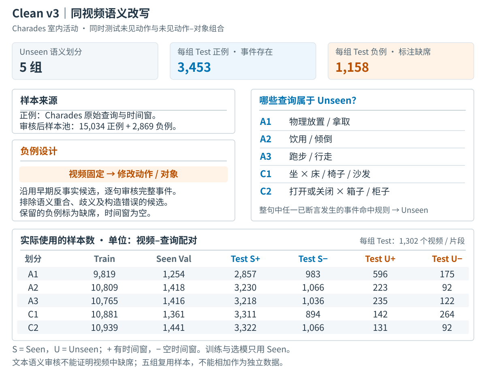
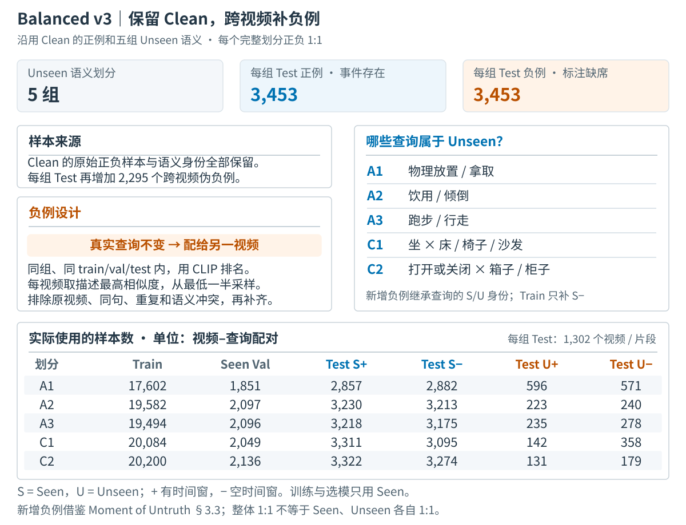
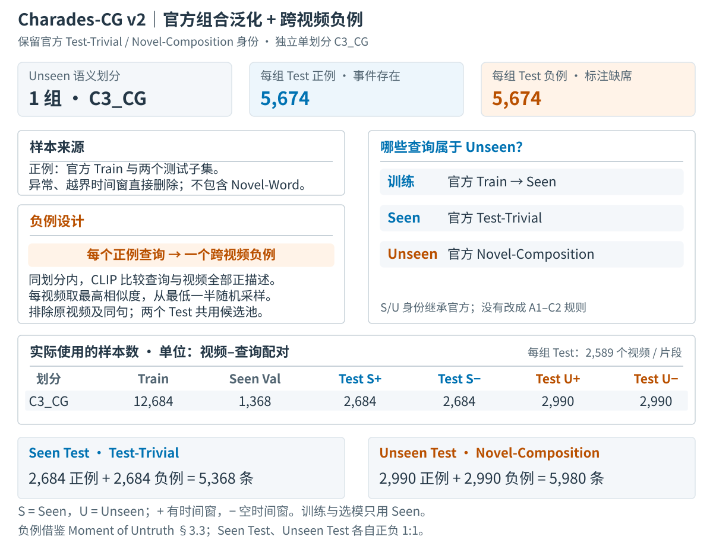
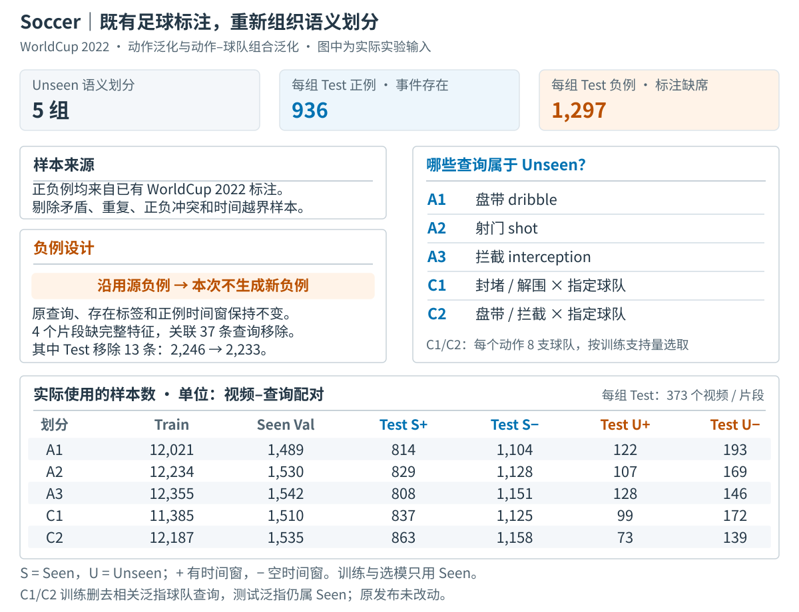
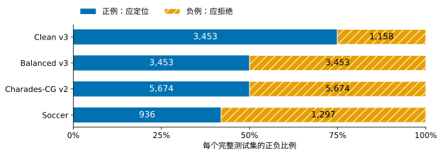
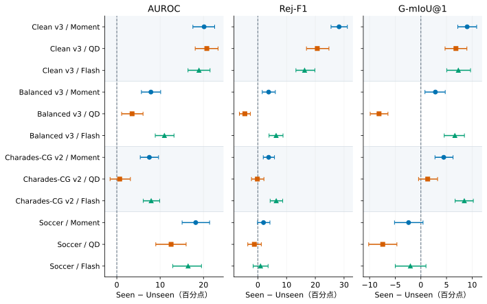

# GMR 未见语义泛化评测

视频时刻检索根据一句查询，在视频中找出对应事件的时间段。然而，只考察事件存在时的定位表现，无法说明模型能否拒绝未发生的事件，也无法说明这两种能力能否推广到训练未见的语义。我们关注：**当查询中的动作或组合未进入下游训练时，模型还能判断事件是否发生，并在发生时准确定位吗？** 为此，我们整理了四套含正负查询的数据，用 Seen 样本训练和选模，分别衡量 Seen 与 Unseen 的存在判断、拒绝和端到端定位表现。实验显示，未见语义下的存在分数排序能力普遍下降；拒绝与定位分数还需结合正负比例和正例误拒率解释。

本页汇总 **四套数据、三个模型、48 个完成的评测设置**。模型为 Moment-DETR-GMR、QD-DETR-GMR、FlashVTG-GMR。更新于 2026-10-11。

## 四套数据的详细实验结果

| 数据集 | 详细结果 README | 完成情况 |
| --- | --- | --- |
| Clean v3（未补充负例） | [数据与最终实验结果](experiments/agy_test/v3_release_baselines_20261009/README.md) | 五划分 × 三模型，15/15 |
| Balanced v3（补充跨视频负例） | [数据与最终实验结果](experiments/agy_test/v3_balanced_baselines_20261010/README.md) | 五划分 × 三模型，15/15 |
| Charades-CG v2（官方组合划分） | [数据制作与 Seen→Unseen 评测](experiments/agy_test/publication_review_20261011/charades_cg/README.md) | C3_CG × 三模型，3/3 |
| Soccer-GMR-Unseen v1 | [数据制作与泛化退化评测](experiments/agy_test/publication_review_20261011/soccer_unseen/README.md) | 五划分 × 三模型，15/15 |

各入口包含训练与评估协议、最终结果或其完整表格链接。三项指标的逐划分数值与置信区间另见[统一详细结果表](docs/gmr_baseline_summary_20261011/RESULTS_WITH_CI.md)。

## 四套数据集

**一个样本是一对视频与查询**：正例有事件时间窗，负例的时间窗为空，模型应当拒绝。Seen/Unseen 则表示查询是否命中当前划分指定的 **Unseen 的语义**，与正负标签相互独立；因此 Test 同时包含 S+、S−、U+、U−，并非全部是 Unseen。

下面四张图分别说明**来源、负例设计、Unseen 的语义和实际样本数**。A 组测试动作泛化，C 组测试组合泛化；所有模型仅用 S+/S− 训练，并用 Seen 验证选择 checkpoint 和阈值。

### Clean v3：固定视频，修改查询

*Clean 通过修改动作或对象构造候选，再进行文本语义审核。五组规定不同的 Unseen 语义，共用视频分配与完整 Test 样本；训练排除命中 Unseen 语义的完整查询。[数据说明](data/release/semantic_existence_v3_release/README.md)*

### Balanced v3：保留原样本，跨视频补齐负例

*Balanced 完整保留 Clean，再追加跨视频伪负例，使每个完整 train/val/test 正负 1:1；Seen、Unseen 子集仍可能不平衡。[数据说明](data/release/semantic_existence_v3_balanced/README.md)*

### Charades-CG v2：保留官方未见组合，配对跨视频负例

*CG 沿用官方 Test-Trivial 为 Seen、Novel-Composition 为 Unseen，不套用 A1–C2 规则。每个正例构造一个跨视频负例，Seen Test 与 Unseen Test 各自正负 1:1。[数据说明](data/release/semantic_existence_v3_release/extensions/charades_cg_gmr_v2/README.md)*

Balanced 与 CG 的负例借鉴 [Moment of Untruth §3.3](https://arxiv.org/html/2502.08544v2#S3.SS3)：在同组、同 train/val/test 内，CLIP 比较查询与候选视频已有的正描述，每个视频取最高相似度，再从排名最低的一半视频中采样。排除原视频和含相同查询的视频；Balanced 另过滤重复与语义冲突。**低相似度不能证明事件缺席**，这些新增负例均未逐视频验证。

### Soccer：沿用已有正负例，构建动作与球队组合划分

*Soccer 本次未生成新负例，沿用 WorldCup 2022 来源标签；图中列出特征过滤后真正进入实验的数量。C1/C2 每个动作指定 8 支球队，训练另删除相关动作的泛指球队查询，测试泛指查询仍为 Seen。[数据说明](data/release/soccer_gmr_unseen_v1/README.md) · [具体球队与复现记录](README_ENGINEERING.md)*

Unseen 指下游训练中的语义划分，不表示 CLIP/SlowFast 预训练从未接触这些概念。五组复用视频与查询，不能将组间数量相加作为独立数据量。

## 数据规模与分布

| 数据 | 训练数／组 | Seen 验证数／组 | 测试正例 | 测试负例 | 测试总数／组 |
| --- | --- | --- | --- | --- | --- |
| Clean v3 | 9,819–10,939 | 1,254–1,441 | 3,453 | 1,158 | 4,611 |
| Balanced v3 | 17,602–20,200 | 1,851–2,136 | 3,453 | 3,453 | 6,906 |
| Charades-CG v2 | 12,684 | 1,368 | 5,674 | 5,674 | 11,348 |
| Soccer | 11,385–12,355 | 1,489–1,542 | 936 | 1,297 | 2,233 |

*条内为实际样本数；每条对应一个完整测试集。五组复用视频与查询，不能把五组行数相加当作独立样本。整体正负平衡也不保证 Seen、Unseen 各自平衡。*

Soccer 原发布每组 Test 有 2,246 条；4 个片段未得到完整特征，关联母池 37 条查询被排除，其中 Test 排除 13 条，实际测试 **2,233 条**。三个模型使用相同副本，原发布保留不变。

查看每组 Test 的 Seen / Unseen 正负数量

| 数据 | 划分 | S+ | S− | U+ | U− |
| --- | --- | --- | --- | --- | --- |
| Clean v3 | A1_v3 | 2857 | 983 | 596 | 175 |
| Clean v3 | A2_v3 | 3230 | 1066 | 223 | 92 |
| Clean v3 | A3_v3 | 3218 | 1036 | 235 | 122 |
| Clean v3 | C1_v3 | 3311 | 894 | 142 | 264 |
| Clean v3 | C2_v3 | 3322 | 1066 | 131 | 92 |
| Balanced v3 | A1_v3 | 2857 | 2882 | 596 | 571 |
| Balanced v3 | A2_v3 | 3230 | 3213 | 223 | 240 |
| Balanced v3 | A3_v3 | 3218 | 3175 | 235 | 278 |
| Balanced v3 | C1_v3 | 3311 | 3095 | 142 | 358 |
| Balanced v3 | C2_v3 | 3322 | 3274 | 131 | 179 |
| Charades-CG v2 | C3_CG | 2684 | 2684 | 2990 | 2990 |
| Soccer | A1_soccer | 814 | 1104 | 122 | 193 |
| Soccer | A2_soccer | 829 | 1128 | 107 | 169 |
| Soccer | A3_soccer | 808 | 1151 | 128 | 146 |
| Soccer | C1_soccer | 837 | 1125 | 99 | 172 |
| Soccer | C2_soccer | 863 | 1158 | 73 | 139 |

## 实验结果

三个指标分别回答：**AUROC**——存在分数能否区分正负例；**Rej-F1**——是否正确拒绝缺席查询；**G-mIoU@1**——把拒绝与时间定位合起来，最终输出是否正确。

下表为 **Seen → Unseen**。Clean、Balanced、Soccer 各自取五划分等权平均；Charades-CG 为 C3_CG 单划分。各数据集独立汇总，分数不能直接当作跨数据集的方法收益。

| 数据 | 模型 | AUROC | Rej-F1（%） | G-mIoU@1（%） |
| --- | --- | --- | --- | --- |
| Clean v3 | Moment-DETR-GMR | 0.7238 → 0.5224 | 50.51 → 22.25 | 34.54 → 25.51 |
| Clean v3 | QD-DETR-GMR | 0.7413 → 0.5337 | 51.30 → 30.61 | 34.86 → 28.02 |
| Clean v3 | FlashVTG-GMR | 0.7543 → 0.5647 | 53.36 → 37.09 | 41.75 → 34.44 |
| Balanced v3 | Moment-DETR-GMR | 0.7253 → 0.6466 | 65.88 → 62.11 | 45.99 → 43.16 |
| Balanced v3 | QD-DETR-GMR | 0.5445 → 0.5093 | 56.87 → 61.40 | 39.01 → 47.17 |
| Balanced v3 | FlashVTG-GMR | 0.7706 → 0.6608 | 68.04 → 61.68 | 51.48 → 44.85 |
| Charades-CG v2 | Moment-DETR-GMR | 0.6338 → 0.5587 | 63.87 → 60.10 | 45.95 → 41.49 |
| Charades-CG v2 | QD-DETR-GMR | 0.5050 → 0.4984 | 57.42 → 57.58 | 39.44 → 38.11 |
| Charades-CG v2 | FlashVTG-GMR | 0.7997 → 0.7204 | 70.63 → 64.24 | 53.43 → 44.96 |
| Soccer | Moment-DETR-GMR | 0.7720 → 0.5900 | 76.17 → 74.19 | 50.55 → 52.94 |
| Soccer | QD-DETR-GMR | 0.7221 → 0.5969 | 73.12 → 74.34 | 46.10 → 53.54 |
| Soccer | FlashVTG-GMR | 0.7722 → 0.6077 | 73.56 → 72.63 | 48.73 → 50.78 |

*Gap = Seen − Unseen，单位为百分点：右侧表示 Unseen 较低，左侧表示 Unseen 较高。误差线为 2,000 次视频簇 bootstrap 的 95% CI。Moment / QD / Flash 分别对应三个 backbone；图中汇总范围与上表相同。*

**存在判断的排序能力普遍下降。** Clean 三模型的 AUROC Gap 为 18.96–20.76 pp，Balanced 为 3.52–10.98 pp，Soccer 为 12.52–18.20 pp；这些宏平均区间均高于 0。Charades-CG 的 Moment、Flash 同样下降，QD 的 AUROC 接近 0.5，Gap 区间跨 0。

**拒绝和定位指标并不总是一起下降。** 负 Gap 按原符号保留。特别是 Rej-F1 和 G-mIoU 会受到测试子集正负比例影响，不能仅凭它们较高就认定泛化更好。

例如 Soccer C2/QD 的 73 条 Unseen 正例中，**72 条被误拒**，但 Unseen G-mIoU 仍为 65.09%：该子集还有 139 条负例，正确拒绝负例也会得到分数。Balanced QD 在 C1/C2 甚至拒绝全部 Unseen 正例。因此必须同时看存在判断、定位分数和正例误拒率。

查看整体拒绝、正例误拒和端到端定位结果

| 数据 | 模型 | 整体 Rej-F1 | 整体拒绝率 | Seen 正例误拒率 | Unseen 正例误拒率 | 整体 G-mIoU@1 |
| --- | --- | --- | --- | --- | --- | --- |
| Clean v3 | Moment | 48.70% | 35.63% | 28.45% | 24.42% | 33.53% |
| Clean v3 | QD | 49.56% | 38.01% | 30.02% | 31.59% | 33.98% |
| Clean v3 | Flash | 52.46% | 39.15% | 29.66% | 34.68% | 40.91% |
| Balanced v3 | Moment | 65.46% | 49.32% | 32.59% | 41.07% | 45.65% |
| Balanced v3 | QD | 57.21% | 63.54% | 59.29% | 71.86% | 39.45% |
| Balanced v3 | Flash | 67.39% | 45.19% | 24.60% | 40.36% | 50.82% |
| Charades-CG v2 | Moment | 61.86% | 66.16% | 55.89% | 64.58% | 43.60% |
| Charades-CG v2 | QD | 57.50% | 67.15% | 67.29% | 66.62% | 38.74% |
| Charades-CG v2 | Flash | 67.25% | 43.87% | 21.20% | 27.66% | 48.97% |
| Soccer | Moment | 75.91% | 68.26% | 45.71% | 70.35% | 50.82% |
| Soccer | QD | 73.26% | 65.68% | 45.67% | 71.72% | 46.89% |
| Soccer | Flash | 73.50% | 61.71% | 39.14% | 64.01% | 48.98% |

拒绝率为全部测试查询中被拒绝的比例；正例误拒率为真实存在事件被拒绝的比例。汇总范围与主要结果表一致。

## 完整结果与阅读说明

[全部 48 个设置、逐划分指标与 95% CI](docs/gmr_baseline_summary_20261011/RESULTS_WITH_CI.md) · [各划分完整样本数](docs/gmr_baseline_summary_20261011/DATASET_COUNTS.md) · [工程实验与复现记录](README_ENGINEERING.md)

[原分支 README：实验报告归档](README_EXPERIMENT_REPORT.md)原样保留发布前的详细报告；[工程实验版](README_ENGINEERING.md)包含本次集成的四套数据与 Soccer 实验记录。

本次使用单个训练种子，checkpoint 与阈值只由 Seen 验证确定。置信区间反映固定模型的视频抽样不确定性；Soccer 按片段聚类，不能据此声称整场比赛独立。负例没有逐视频确认缺席，结果以当前构造／来源标签为准。

这些实验均为独立 baseline；Unseen Net Gain、Seen Change、Gap Reduction 需要同版本、同划分、同 backbone 的新方法对照，本次不定义。

## 数据、训练测试与模型代码路径

[完整路径索引（Markdown）](docs/gmr_baseline_summary_20261011/DATA_CODE_PATHS.md)列出了四套数据的发布标注、逐组训练/验证/测试输入、三个 backbone 的训练与推理脚本、模型源码与配置、冻结预测和本机特征/权重目录。

| 数据 | 实际输入 | 训练总控 | 测试与评测总控 | 当前结果对应的模型源码 |
| --- | --- | --- | --- | --- |
| Clean v3 | [冻结标注](experiments/agy_test/v3_release_baselines_20261009/groups) | [run_baselines.py](experiments/agy_test/v3_release_baselines_20261009/run_baselines.py) | [run_baselines.py](experiments/agy_test/v3_release_baselines_20261009/run_baselines.py) / [最终评测](experiments/agy_test/v3_release_baselines_20261009/finalize_baselines.py) | [native_source/models](experiments/agy_test/v3_release_baselines_20261009/native_source/models) |
| Balanced v3 | [冻结标注](experiments/agy_test/v3_balanced_baselines_20261010/groups) | [run_baselines.py](experiments/agy_test/v3_balanced_baselines_20261010/run_baselines.py) | [run_baselines.py](experiments/agy_test/v3_balanced_baselines_20261010/run_baselines.py) | [native_source/models](experiments/agy_test/v3_balanced_baselines_20261010/native_source/models) |
| Charades-CG v2 | [C3_CG 标注](data/release/semantic_existence_v3_release/extensions/charades_cg_gmr_v2/splits/C3_CG) | [原 v1 训练](experiments/agy_test/charades_cg_baselines_20261010/run_baselines.py) | [v2 重新测试](experiments/agy_test/charades_cg_v2_evaluation_20261011/run_baselines.py) | [源码快照/models](experiments/agy_test/publication_review_20261011/charades_cg/docs/reports/charades_cg_gmr_baselines_20261011/source_snapshot/native_source/models) |
| Soccer | [特征过滤后标注](data/experiment_inputs/soccer_unseen_baselines_20261011/splits) | [run_baselines.py](experiments/agy_test/publication_review_20261011/soccer_unseen/docs/reports/soccer_unseen_baselines_20261011/source_snapshot/run_baselines.py) | [run_baselines.py](experiments/agy_test/publication_review_20261011/soccer_unseen/docs/reports/soccer_unseen_baselines_20261011/source_snapshot/run_baselines.py) | [源码快照/models](experiments/agy_test/publication_review_20261011/soccer_unseen/docs/reports/soccer_unseen_baselines_20261011/source_snapshot/native_source/models) |

三个 backbone 的具体 train.py、evaluate.py / inference.py、模型与 GMR 分支路径均在完整索引中逐项链接。CG v2 复用 v1 冻结模型和阈值；Soccer 脚本为本机实验的归档快照，运行目录与本机视频、特征和 checkpoint 路径见该索引。
