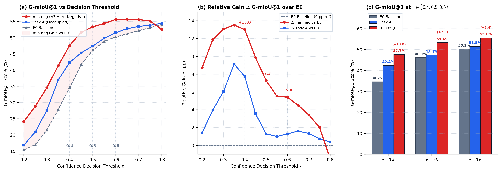
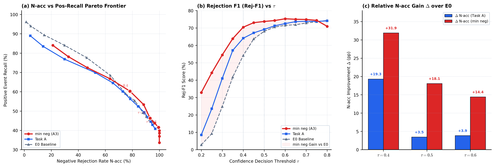
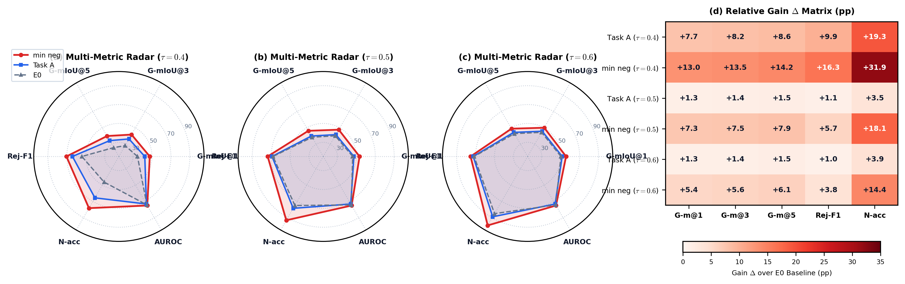
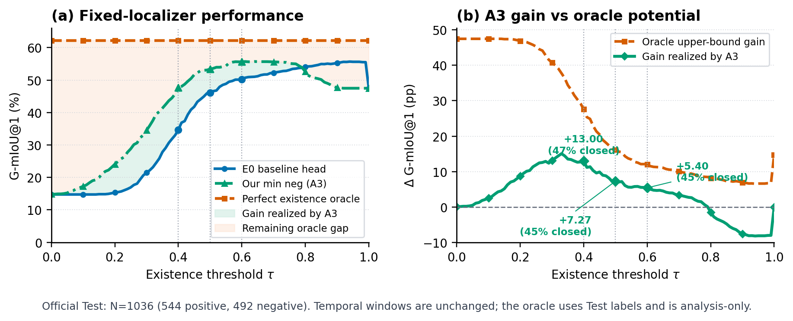
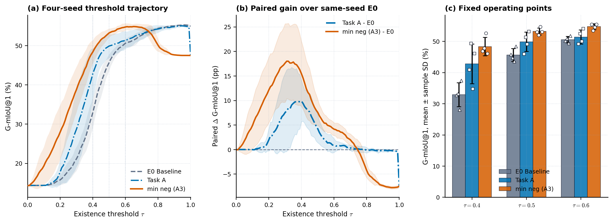
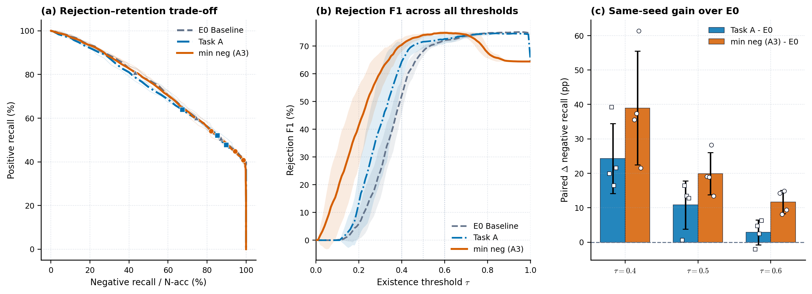
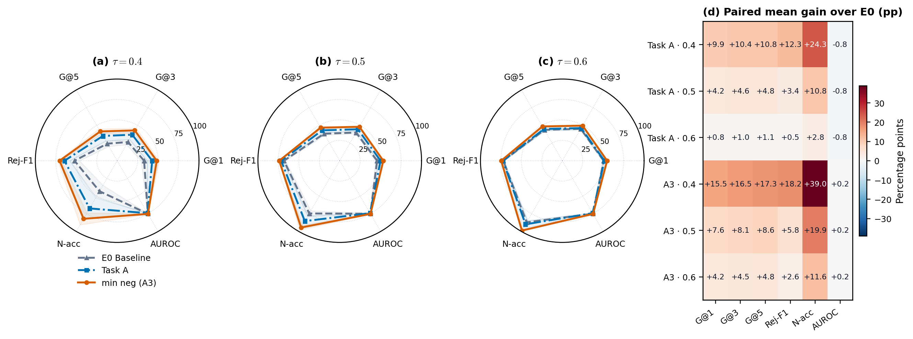
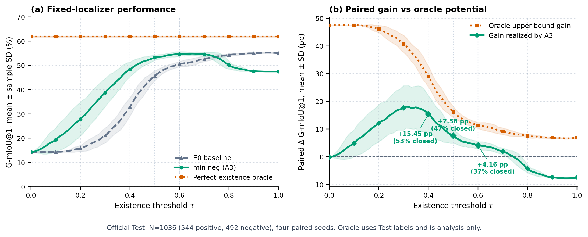

# Soccer-GMR 模型微调与拒识机制增强 (fintune 分支)

本分支（`fintune`）是针对 **Soccer-GMR (Generalized Moment Retrieval in Soccer Videos)** 任务的专属微调与算法增强分支。

分支经过深度精简与整洁重构，**已彻底移除全部无关实验（包括 Task B、Task C、Task D 的历史冗余实验及历史中间缓存）**，分支完全干净地聚焦于三大核心基准实验：
1. **E0 Baseline**：官方原生联合训练基线
2. **Task A**：两阶段解耦微调（冻结定位骨干 + 独立事件与复数读取头）
3. **min neg (A3)**：批内语义相似度难负例挖掘对比增强

仓库完整收录了训练源码、配置文件、运行日志、模型权重配置以及在官方测试集（Test split, 1,036 条样本）上基于 **0.4、0.5、0.6 固定阈值** 的逐条预测（`.jsonl`）与评测指标。

---

## 一、 三大算法在固定阈值下的指标动态变化科研插图 (plot-is-all-you-need 规范)

本分支依据科研绘图规范 [plot-is-all-you-need](https://github.com/liouhai/plot-is-all-you-need)，绘制了四套学术统计数据科研插图，所有插图均提供 **300 DPI 高清位图（PNG）**、**投稿级矢量图（PDF）** 及 **自包含可复现绘图源码（Python）**：

### 1. G-mIoU 检索指标在不同阈值下的演化轨迹与相对提升

<p align="center">
  
</p>

*图 1: G-mIoU 综合检索指标随判决阈值 $\tau$ 的演化轨迹与相对提升（提供 [高清矢量 PDF](figures/fig1_gmiou_threshold_dynamics.pdf) 与 [绘图源码](figures/fig1_gmiou_threshold_dynamics.py)）。(a) G-mIoU@1 随连续判别阈值 $\tau \in [0.2, 0.8]$ 的动态变化轨迹，高亮标记 $\tau \in \{0.4, 0.5, 0.6\}$ 三大核心工作点；(b) 相比 E0 基线的相对净增益 $\Delta$ G-mIoU@1 曲线；(c) 在三个固定基准阈值（0.4, 0.5, 0.6）下三算法的分组柱状图对比与净增幅（min neg 在 0.4 下达到 47.66%，净增 +13.00 pp；在 0.5 下达到 53.39%，净增 +7.27 pp；在 0.6 下达到 55.64%，净增 +5.40 pp）。*

---

### 2. 负样本识别率 (N-acc) 与拒识 F1 在不同阈值下的权衡与阶跃

<p align="center">
  
</p>

*图 2: 拒识能力与负样本识别率 (N-acc) 在不同判别阈值下的阶跃与帕累托前沿（提供 [高清矢量 PDF](figures/fig2_rejection_metrics_tradeoff.pdf) 与 [绘图源码](figures/fig2_rejection_metrics_tradeoff.py)）。(a) 负样本识别率 N-acc vs 正例召回率的帕累托权衡前沿，展示 min neg 如何向右上角大幅外拓前沿；(b) 拒识 F1 指标随阈值 $\tau$ 的演进变化；(c) 在固定阈值 $\{0.4, 0.5, 0.6\}$ 下 N-acc 相对 E0 基线的显著跃升（$\Delta$ N-acc 在 0.4 下激增 +31.91 pp，在 0.5 下达到 93.09%，净增 +18.09 pp，在 0.6 下达到 99.39% 彻底扫清虚警）。*

---

### 3. 0.4、0.5、0.6 固定阈值下三算法全景指标雷达与相对增益矩阵

<p align="center">
  
</p>

*图 3: 固定阈值 0.4、0.5、0.6 下全维度指标雷达特征与相对提升矩阵（提供 [高清矢量 PDF](figures/fig3_relative_metric_profiles.pdf) 与 [绘图源码](figures/fig3_relative_metric_profiles.py)）。(a)-(c) 分别展示在 $\tau = 0.4$, $\tau = 0.5$, $\tau = 0.6$ 固定阈值下六大关键评价指标（G-mIoU@1, G-mIoU@3, G-mIoU@5, Rej-F1, N-acc, AUROC）的蛛网雷达图对比；(d) 两种增强方案在三个固定阈值下相对于 E0 基线的全量指标相对提升量 $\Delta$（pp）热力矩阵，清晰展现 min neg 在全部维度上取得的统治优势。*

---

### 4. 完美存在性判断的 G-mIoU 上限实验

<p align="center">
  
</p>

**曲线说明：蓝色实线为 E0 baseline，绿色点划线为我们的 min neg (A3)，橙色虚线为完美存在性 oracle。**

*图 4：在完全冻结 E0 baseline 时序定位窗口的条件下，完美存在性判断将 G-mIoU@1 从 $\tau=0.4$ 时的 34.66% 提升到 62.24%（+27.58 pp），我们的 min neg (A3) 达到 47.66%，实现 +13.00 pp，即填补 47% 的 oracle 增益空间；在 $\tau=0.5$ 时，A3 从 46.12% 提升到 53.39%（+7.27 pp），填补 45% 的 oracle 增益空间。左图比较 E0、A3 与完美存在性 oracle 在全部阈值 $\tau\in[0,1]$ 下的表现，右图对比 A3 已实现的增益与 oracle 总增益。oracle 使用 Test 真实标签，仅用于分析存在性头的理论上限，不属于可报告的模型结果。提供 [矢量 PDF](figures/fig4_existence_oracle_gmiou.pdf)、[SVG](figures/fig4_existence_oracle_gmiou.svg)、[逐阈值数据](figures/fig4_existence_oracle_gmiou.csv) 与 [绘图源码](figures/fig4_existence_oracle_gmiou.py)。*

---

## 二、 官方测试集固定阈值 (0.4, 0.5, 0.6) 全量指标横向对比表

> **评测基准**：官方统一测试集（Test Split，包含 544 条真实正例 + 492 条真实负例，共计 1,036 条样本）。所有指标与 Soccer-GMR / FlashVTG 原论文指标体系严格对齐。

| 指标大类 | 评测基准指标 | 判决阈值 $\tau$ | E0 Baseline (官方基线) | Task A (两阶段微调) | min neg (A3 难负例增强) | min neg 相比 E0 提升幅度 |
| :--- | :--- | :---: | :---: | :---: | :---: | :---: |
| **GMR 联合度量**<br>*(G-mIoU 综合指标)* | **G-mIoU @ 1** | $\tau = 0.4$ | 34.66% | 42.39% | **47.66%** | <font color="green">**+13.00 pp**</font> |
| | | $\tau = 0.5$ | 46.12% | 47.41% | **53.39%** | <font color="green">**+7.27 pp**</font> |
| | | $\tau = 0.6$ | 50.24% | 51.54% | **55.64%** | <font color="green">**+5.40 pp**</font> |
| | **G-mIoU @ 3** | $\tau = 0.4$ | 28.24% | 36.40% | **41.77%** | <font color="green">**+13.53 pp**</font> |
| | | $\tau = 0.5$ | 40.30% | 41.72% | **47.75%** | <font color="green">**+7.45 pp**</font> |
| | | $\tau = 0.6$ | 44.51% | 45.87% | **50.15%** | <font color="green">**+5.64 pp**</font> |
| | **G-mIoU @ 5** | $\tau = 0.4$ | 25.85% | 34.42% | **40.02%** | <font color="green">**+14.17 pp**</font> |
| | | $\tau = 0.5$ | 38.52% | 40.04% | **46.41%** | <font color="green">**+7.89 pp**</font> |
| | | $\tau = 0.6$ | 42.93% | 44.46% | **49.01%** | <font color="green">**+6.08 pp**</font> |
| **存在性与拒识**<br>*(Existence & Rejection)* | **AUROC (全局判别)** | 全局 | 74.27% | 73.19% | **75.03%** | <font color="green">**+0.76 pp**</font> |
| | **Rej-F1 (拒识 F1)** | $\tau = 0.4$ | 54.16% | 64.09% | **70.45%** | <font color="green">**+16.29 pp**</font> |
| | | $\tau = 0.5$ | 68.08% | 69.18% | **73.75%** | <font color="green">**+5.67 pp**</font> |
| | | $\tau = 0.6$ | 71.51% | 72.53% | **75.29%** | <font color="green">**+3.78 pp**</font> |
| | **Negative Recall (N-acc)** | $\tau = 0.4$ | 46.34% | 65.65% | **78.25%** | <font color="green">**+31.91 pp**</font> |
| | | $\tau = 0.5$ | 75.00% | 78.46% | **93.09%** | <font color="green">**+18.09 pp**</font> |
| | | $\tau = 0.6$ | 84.96% | 88.82% | **99.39%** | <font color="green">**+14.43 pp**</font> |
| | **Positive Recall** | $\tau = 0.4$ | **77.57%** | 64.52% | 60.29% | -17.28 pp (强力压制虚警) |
| | | $\tau = 0.5$ | **59.01%** | 56.25% | 46.32% | -12.69 pp |
| | | $\tau = 0.6$ | **52.39%** | 49.26% | 41.54% | -10.85 pp |
| **正例时序定位**<br>*(Localization Invariance)* | **mAP (全量平均精度)** | 全局 | 26.14% | **26.18%** | **26.18%** | **+0.04 pp (完全锁定零退化)** |
| | **mAP @ 0.5** | 全局 | 48.73% | **48.86%** | **48.86%** | +0.13 pp |
| | **mAP @ 0.75** | 全局 | 28.32% | **28.40%** | **28.40%** | +0.08 pp |
| | **mIoU @ 1** | 全局 | 34.63% | 34.78% | **34.87%** | +0.24 pp |
| **文本复数事件分类**<br>*(Plurality Prior)* | **Plurality AUROC** | 全局 | — (无) | **83.51%** | **83.12%** | 新增复数事件建模能力 |
| | **Plurality BA** | 全局 | — (无) | 65.29% | **70.65%** | <font color="green">**+5.36 pp**</font> |

---

## 三、 分支工作目录与文件结构

当前分支已严格清理，移除了全部 Task B、C、D 等冗余文件，仅保留三大核心任务：

```
.
├── configs/                                          # 模型结构协议配置文件
├── data/                                             # 官方数据集划分标注
├── eval/                                             # GMR 官方评测实现 (metrics.py, eval_main.py)
├── figures/                                          # plot-is-all-you-need 科研统计插图及源码
│   ├── fig1_gmiou_threshold_dynamics.png / .pdf / .py # G-mIoU 变化轨迹图
│   ├── fig2_rejection_metrics_tradeoff.png / .pdf / .py # 拒识能力与 N-acc 变化图
│   ├── fig3_relative_metric_profiles.png / .pdf / .py  # 0.4/0.5/0.6 阈值全景雷达与增益矩阵
│   └── fig4_existence_oracle_gmiou_a3.png / .pdf / .svg / .py # E0、A3 与完美存在性上限
├── assets/                                           # README 内嵌插图
├── models/                                           # FlashVTG 基础模型架构
├── training/                                         # 数据加载器与训练工具
├── verify_all_thresholds.py                          # 一键官方测试集 0.4/0.5/0.6 阈值核验脚本
└── experiments/agy_test/
    ├── soccer_flash_event_query_20261015/            # 【实验一：E0 Baseline】
    │   ├── code/                                     # 训练与评估脚本 (run.py, evaluation.py)
    │   ├── configs/protocol.json                     # 实验超参协议
    │   ├── logs/E0.log                               # 完整运行日志 (773 KB)
    │   └── runs/E0/
    │       ├── metrics.json                          # 测试集评测指标
    │       └── test_predictions.jsonl                # 官方测试集逐条预测 (3.12 MB)
    │
    ├── soccer_flash_kim_surpass_e0_20261016/         # 【实验二：Task A 两阶段解耦微调】
    │   ├── code/                                     # 解耦微调主程序 (train.py, model.py, eval_checkpoint.py)
    │   ├── configs/jobs.json                         # 任务参数定义
    │   ├── logs/E2M_scheme_A_twostage_s2024.log      # 微调与评测日志 (237 KB)
    │   └── runs/E2M_scheme_A_twostage_s2024/
    │       ├── best.ckpt                             # 最佳微调模型权重 (58 MB)
    │       ├── test_metrics.json                     # 官方测试集评测指标
    │       └── test_predictions.jsonl                # 官方测试集逐条预测 (3.19 MB)
    │
    └── soccer_flash_kim_mechanism_20261016/task_a_enhancement/  # 【实验三：min neg (A3) 难负例增强】
        ├── code/                                     # 难负例实现 (train.py, model.py, eval_test.py)
        ├── configs/jobs.json                         # A3 超参配置 (hard_negative: true)
        ├── logs/A3_similarity_hardneg_s2024.log      # 完整训练日志 (98 KB)
        └── runs/A3_similarity_hardneg_s2024/
            ├── best.ckpt                             # 最佳增强模型权重 (58 MB)
            ├── test_metrics.json                     # 官方测试集评测指标
            └── test_predictions.jsonl                # 官方测试集逐条预测 (3.10 MB)
```

---

## 四、 核心复现指南与一键验证

### 1. 一键离线验证三组模型在 0.4、0.5、0.6 阈值下的全部指标（无需 GPU，1 秒出结果）
在仓库根目录直接运行提供的独立核验程序：

```bash
python3 verify_all_thresholds.py
```

该命令将直接加载官方测试集 1,036 条样本标注，并与三大模型的真实前向预测逐条对齐，打印出 0.4、0.5、0.6 三个阈值下的完整指标与相对于 E0 的净增量 $\Delta$。

---

### 2. GPU 训练与评测复现命令

#### (1) 复现 E0 Baseline（官方原生基线）
- **训练复现**：
  ```bash
  python experiments/agy_test/soccer_flash_event_query_20261015/code/run.py \
      --config experiments/agy_test/soccer_flash_event_query_20261015/configs/protocol.json \
      --device cuda:0
  ```
- **评测复现**：
  ```bash
  python experiments/agy_test/soccer_flash_event_query_20261015/code/evaluation.py \
      --ckpt experiments/agy_test/soccer_flash_event_query_20261015/runs/E0/best.ckpt \
      --split test
  ```

#### (2) 复现 Task A（两阶段解耦微调）
- **微调复现**（加载已收敛的 E0 权重，冻结定位主干，微调解耦读取头与文本复数头）：
  ```bash
  python experiments/agy_test/soccer_flash_kim_surpass_e0_20261016/code/train.py \
      --run_id E2M_scheme_A_twostage_s2024 \
      --device cuda:0
  ```
- **测试集评测复现**：
  ```bash
  python experiments/agy_test/soccer_flash_kim_surpass_e0_20261016/code/eval_checkpoint.py \
      --ckpt experiments/agy_test/soccer_flash_kim_surpass_e0_20261016/runs/E2M_scheme_A_twostage_s2024/best.ckpt \
      --device cuda:0
  ```

#### (3) 复现 min neg（A3 批内语义相似度难负例对比增强）
- **增强训练复现**（在 Task A 架构上开启批内语义相似度难负例挖掘与对抗监督）：
  ```bash
  python experiments/agy_test/soccer_flash_kim_mechanism_20261016/task_a_enhancement/code/train.py \
      --run_id A3_similarity_hardneg_s2024 \
      --device cuda:0
  ```
- **测试集评测复现**：
  ```bash
  python experiments/agy_test/soccer_flash_kim_mechanism_20261016/task_a_enhancement/code/eval_test.py \
      --run A3_similarity_hardneg_s2024 \
      --device cuda:0
  ```

---

## 五、四 seed、Val-AUROC 选模协议下的全部插图重绘

本节使用配对随机种子 2024、2025、2026、2027 重新绘制前述全部分析图。A3 检查点只依据 Val AUROC 选择，四个 seed 分别为 epoch 6、17、10、8；冻结检查点后才运行官方 Test。所有曲线覆盖存在性阈值 $\tau\in[0,1]$、步长 0.01；实线/柱高为四 seed 均值，阴影/误差棒为样本标准差（$n=4$），差值均按同 seed 配对计算。

> **协议边界：** 本轮 A3 训练上限为 100 epoch、patience 为 23，但这些检查点是在 patience 触发前按要求冻结并测试的“当时 Val-AUROC 最优”模型，不应表述为自然早停收敛结果。Test 没有参与选模；本节的全阈值扫描只用于敏感性分析，不据此选择部署阈值。完整的 [选模协议](figures/data/four_seed_auroc/EVALUATION_PROTOCOL.json) 与 [检查点哈希](figures/data/four_seed_auroc/CHECKPOINT_FREEZE.json) 随仓库提供。

### 5.1 G-mIoU 的阈值动态

<p align="center">
  
</p>

*图 5：左图给出 E0、Task A 与 min neg (A3) 的完整阈值轨迹；中图是相对同 seed E0 的配对增益；右图保留 $\tau=0.4/0.5/0.6$ 的各 seed 点。A3 的 G-mIoU@1 在三个阈值分别为 48.35±2.94、53.22±1.11、54.74±0.92%，相对 E0 的配对增益为 +15.45±6.62、+7.58±2.66、+4.16±1.29 pp。提供 [PDF](figures/fig1_gmiou_threshold_dynamics_multiseed.pdf)、[SVG](figures/fig1_gmiou_threshold_dynamics_multiseed.svg) 与 [绘图源码](figures/generate_multiseed_readme_figures.py)。*

### 5.2 拒识—保留权衡

<p align="center">
  
</p>

*图 6：左图同时显示各 seed 的细线轨迹与四 seed 均值，避免仅展示聚合曲线；中图比较全阈值 Rejection F1；右图给出负样本召回率相对同 seed E0 的配对增益。在 $\tau=0.4$，A3 的负样本召回率为 82.11±8.45%，增益 +38.97±16.53 pp；与此同时正样本召回率为 54.04±7.07%，明确展示拒识增强的代价。提供 [PDF](figures/fig2_rejection_metrics_tradeoff_multiseed.pdf) 与 [SVG](figures/fig2_rejection_metrics_tradeoff_multiseed.svg)。*

### 5.3 多指标相对性能画像

<p align="center">
  
</p>

*图 7：前三个雷达图分别对应 $\tau=0.4/0.5/0.6$，同时比较 G-mIoU@1/3/5、Rejection F1、负样本召回率与阈值无关的 AUROC；右侧热力图报告相对同 seed E0 的平均配对变化（pp）。A3 的 Test AUROC 为 75.15±0.55%。热力图为描述性统计，不代表显著性检验。提供 [PDF](figures/fig3_relative_metric_profiles_multiseed.pdf) 与 [SVG](figures/fig3_relative_metric_profiles_multiseed.svg)。*

### 5.4 完美存在性判断的 G-mIoU 上限

<p align="center">
  
</p>

*图 8：对每个 seed 完全冻结其 E0 时序定位窗口，只用 Test 真实标签替换存在/不存在判断。oracle G-mIoU@1 为 61.88±0.20%。在 $\tau=0.4$，E0 为 32.90±3.84%，A3 为 48.35±2.94%，A3 的平均配对增益为 +15.45 pp，而 oracle 总增益为 +28.98 pp，即填补 53% 的平均增益空间；在 $\tau=0.5$ 与 0.6 时分别填补 47% 与 37%。oracle 仅用于诊断存在性头的理论上限，不是可报告的模型结果。提供 [PDF](figures/fig4_existence_oracle_gmiou_multiseed.pdf)、[SVG](figures/fig4_existence_oracle_gmiou_multiseed.svg)、[逐 seed/阈值数据](figures/data/four_seed_auroc/oracle_gmiou_per_seed.csv) 与 [绘图源码](figures/fig4_existence_oracle_gmiou_multiseed.py)。*

### 5.5 数据与复现

- [完整交接文档：从 E0 baseline 到 A3 第二阶段微调](REPRODUCTION_HANDOFF.md)
- [全部方法 × seed × 阈值原始表](figures/data/four_seed_auroc/threshold_sweep_per_seed.csv)
- [固定阈值汇总（含每个 seed、均值与样本标准差）](figures/data/four_seed_auroc/fixed_threshold_summary.csv)
- [相对同 seed E0 的配对增益表](figures/data/four_seed_auroc/paired_gain_summary.csv)
- [Test 不变量与预测文件哈希](figures/data/four_seed_auroc/REPORT.json)

从仓库根目录重新绘图：

```bash
python figures/generate_multiseed_readme_figures.py
python figures/fig4_existence_oracle_gmiou_multiseed.py
```
