# GMR 三组基准实验汇总

本分支汇总 Clean Semantic Existence v3、Balanced v3 与 Charades-CG-GMR v2 的数据、方法源码、运行脚本和冻结结果，更新于 **2026-10-11**。两个 v3 项目各完成五划分 × 三 backbone（15/15）；Charades-CG v2 完成 C3_CG × 三 backbone（3/3），共 **33 个已完成评测设置**。

## GMR 方法与研究问题


*原 GMR README 方法图：定位分支预测时间窗，存在判断分支通过阈值决定输出时间窗或空集。图源：[GMR](https://github.com/dymm9977/generalized-moment-retrieval)。*

GMR 在时间定位骨干上增加存在判断分支：事件存在时返回时间窗，缺席时返回空集。我们关注：**面对训练未见的动作或组合，模型能否找准真实事件，并拒绝未发生的事件？** 为此，三套数据、三个骨干均使用 Seen 训练和选模，分别评测 Seen/Unseen 的 AUROC、Rej-F1 与 G-mIoU@1。Clean v3 三模型的五划分宏平均 AUROC 下降 18.96–20.76 pp；Balanced v3 仍下降 3.52–10.98 pp，Charades-CG 的 Moment/Flash 也有显著差距。这些结果支持进一步研究**事件存在判断与时间定位如何共同泛化到未见语义**。

## 项目与数据入口

| 项目 | 实验 README | 对应数据集 | 完成设置 |
|---|---|---|---:|
| Clean v3 | [v3_release_baselines_20261009](experiments/agy_test/v3_release_baselines_20261009/README.md) | [semantic_existence_v3_release](data/release/semantic_existence_v3_release/README.md) | 15/15 |
| Balanced v3 | [v3_balanced_baselines_20261010](experiments/agy_test/v3_balanced_baselines_20261010/README.md) | [semantic_existence_v3_balanced](data/release/semantic_existence_v3_balanced/README.md) | 15/15 |
| Charades-CG v2 | [charades_cg](experiments/agy_test/publication_review_20261011/charades_cg/README.md) | [charades_cg_gmr_v2](data/release/semantic_existence_v3_release/extensions/charades_cg_gmr_v2/README.md) | 3/3 |

方法包含 **Moment-DETR-GMR、QD-DETR-GMR、FlashVTG-GMR**。各项目的 `native_source/` 或 `source_snapshot/native_source/` 保留实际使用的 `models/`、`training/`、`configs/` 和 `eval/`，以各自 `SOURCE_MANIFEST.json` 为准。

## 数据版本、构建方式与划分

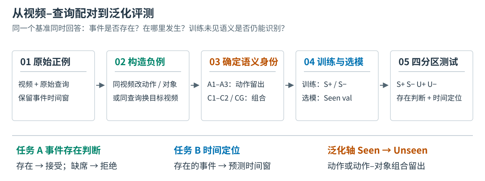

*图 1：数据构建与评测的总体关系。训练与选模使用 Seen，测试同时考察事件存在判断、时间定位与语义泛化。*

构建目标是同时评测模型的**事件存在判断**与**时间定位**，以及这两种能力能否推广到训练未见的动作或组合。整体流程为：**原始视频–查询正例 → 构造负例 → 按动作/组合确定 Seen 与 Unseen → Seen 训练和选模 → Seen/Unseen 测试**。

### 负样本构建的思路与来源

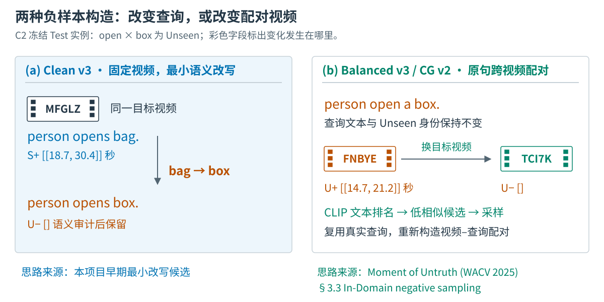

*图 2：C2 的真实构造例。左侧固定 MFGLZ，将 bag 改为 box；右侧保留开箱原句，将目标视频从 FNBYE 换为 TCI7K。两种流程的来源与筛选方式如下。*

**Clean v3 沿用本项目早期的最小语义改写候选。** 固定视频，只修改原查询中的动作或对象，例如把“打开袋子”改为“打开箱子”，再结合原始描述与事件语义筛选。这样得到词汇和场景接近、但所指事件不同的查询，用来考察模型是否识别动作和对象的细节。v3 在这些候选上完成事件解析、语义审核和动作/组合划分。

**Balanced v3 与 Charades-CG v2 的跨视频负例借鉴 [Moment of Untruth（WACV 2025）§3.3](https://arxiv.org/html/2502.08544v2#S3.SS3) 的 In-Domain negative sampling。** 核心思路是复用同一数据集的真实查询，将它配给另一视频；通过 CLIP 文本相似度排名筛选目标视频。我们的实现将这一思路用于各自的语义划分：Balanced v3 保留原样本并按组补齐正负数量，Charades-CG v2 则为官方划分中的每个正例构造一个负例。

### 先明确：一个样本是什么，S/U 和 +/− 怎样确定？

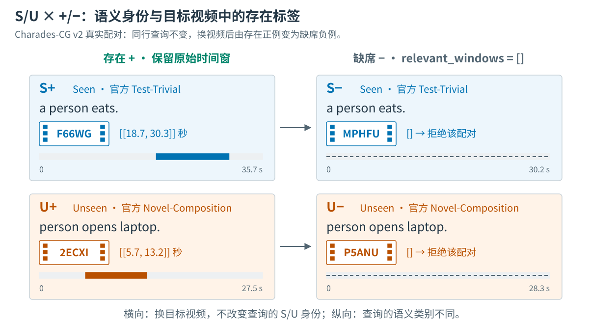

*图 3：Charades-CG v2 的四分区真实配对。同行查询与语义身份不变，换目标视频后时间窗变为 `[]`；时间轴按各视频真实时长绘制。*

每个样本是一对 **目标视频 + 文本查询**，主要字段为 `qid`、`vid`、`query`、`relevant_windows`、`exist_label`、`partition`。正例保留原始时间窗，例如 `[[5.7, 13.2]]` 秒；负例为 `[]`，模型应拒绝该视频–查询配对。

**S/U 表示查询在当前划分中的语义身份，+/− 表示它是否被标注为在目标视频中存在。** 因此 S+、S− 分别为 Seen 查询的存在/缺席配对，U+、U− 分别为 Unseen 查询的存在/缺席配对。一个 Unseen 查询换到另一视频后仍是 Unseen，只有存在标签从 + 变为 −；同一句查询也可能在不同语义划分中具有不同 S/U 身份。

### Clean v3：固定视频，修改查询，再审计和划分

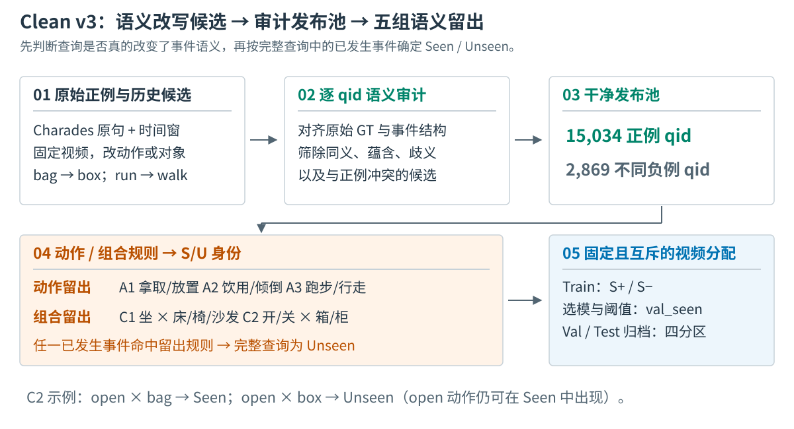

*图 4：Clean v3 从语义改写候选到发布池，再按动作族或动作–对象组合形成五组划分。发布池数量按不同 qid 计数。*

1. **准备正例和候选负例。** 正例来自 Charades 的原句、视频及时间窗；历史候选负例在同一视频上修改查询中的动作或对象。例如视频原句为 “person opens bag.”，构造句为 “person opens box.”，负例窗口置空。
2. **清理后形成发布池。** 逐 qid 做文本语义与原始 GT 对齐审计，筛除同义、蕴含、歧义及与已有正例冲突的候选；保留 15,034 个正例 qid、2,869 个不同负例 qid。
3. **按语义规则分为 Seen/Unseen，再使用固定视频分配。** A1–A3 留出动作族，C1–C2 留出动作与对象组合；完整查询只要有一个被标为已发生、且命中留出规则的事件，就归为 Unseen。表示目的、意图或否定的事件不触发留出。五组共用持久化视频 train/val/test 分配，三者视频互斥；训练仅保留 S+/S−，验证和测试归档保留四个分区，选模和定阈值只读取 `val_seen.jsonl`。

动作划分按完整查询中的动作族判定；组合划分进一步区分动作作用的对象或支撑位置。例如 C2 的 open × box 属于 Unseen，open × bag 属于 Seen。`sofa` 与 `couch` 统一为沙发。

### Balanced v3：保留 Clean v3，原句不变，跨视频补负例

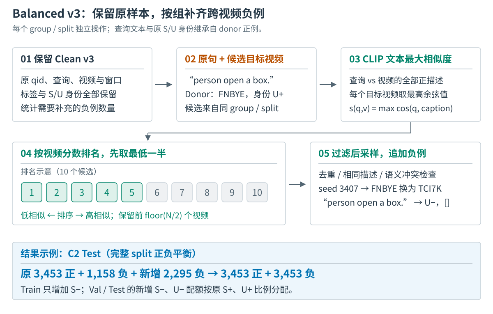

*图 5：先取视频相似度排名最低一半，再过滤和采样。排名条用 10 个候选作流程示意；下方数量来自真实 C2 Test，新增 2,295 条负例后正负各 3,453 条。*

1. **先复制原始样本。** Clean v3 的 qid、视频、查询、时间窗、标签和 S/U 身份均保留。每个 group、每个 train/val/test split 分别计算还缺多少负例。
2. **从该 group/split 的已有正例取一句查询。** 原查询和它的 S/U 身份不变，原视频为 donor；候选目标视频来自同 group、同 split，并排除 donor 视频。例如 “person opens a box.” 在原视频有时间窗，把相同句子配给另一目标视频后，新增 U−，窗口为 `[]`，并记录 donor qid、原视频和目标视频。
3. **按文本相似度筛选。** 用归一化 CLIP 句向量，将该查询与每个候选视频的全部正描述比较；该视频的分数取其中最大的余弦相似度，即“该视频已标注内容与查询最相近的程度”。按分数从低到高排序（同分按视频 ID），先保留最低 `floor(N/2)` 个视频，再过滤重复视频–查询对、完全相同描述及语义重叠/相反动作冲突，使用 seed 3407 采样。
4. **追加到正负数相等。** 每个完整 split 的负例数补至正例数，train 新增 S−；val/test 的新增 S−/U− 配额按原 S+/U+ 比例分配。新增例另存于 `provenance/` 与 `master/negative_added.jsonl`。

这里筛选的是每句查询的**相似度排名最低一半的视频**。例如有 100 个候选视频，就先保留排名最低的 50 个，再执行上述过滤与采样。

### Charades-CG v2：使用官方组合划分，联合测试池跨视频配对

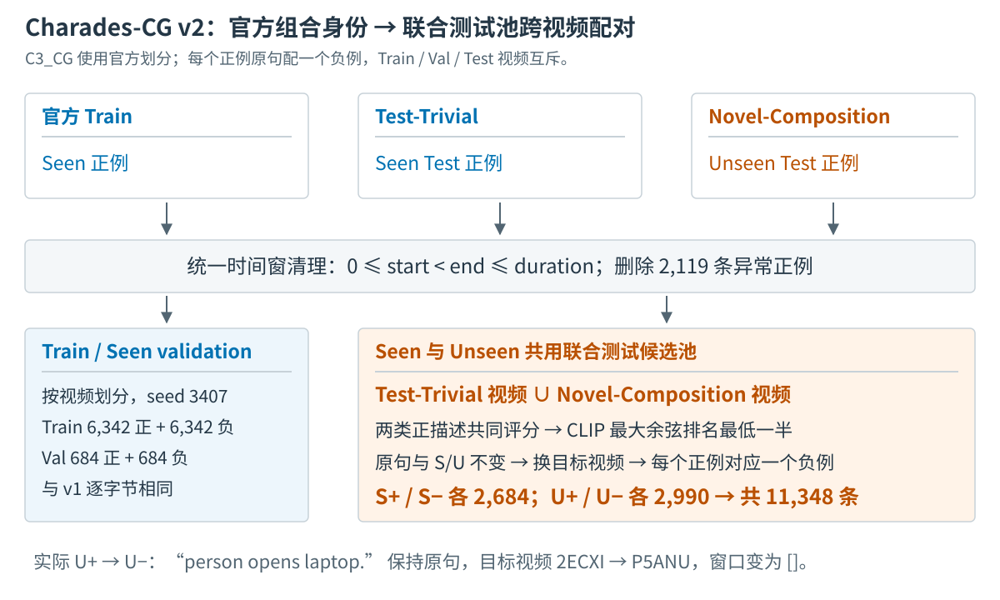

*图 6：接收官方组合身份并清理时间窗；Seen 与 Unseen 测试共用视频候选池，每个正例查询对应一个跨视频负例，形成 11,348 条四分区测试样本。*

1. **接收官方身份与正例。** 从 [Charades-CG 官方数据](https://github.com/YYJMJC/Compositional-Temporal-Grounding/tree/2372337e9166b8e26b83ce936a8474c6ae127290/Charades-CG) 读取原句、视频、时间窗及组合标记。官方 Train 视频按 seed 3407 分为训练和 Seen validation；Test-Trivial 为 Seen Test，Novel-Composition 为 Unseen Test。本包采用 C3_CG 这一个官方组合划分。
2. **机械清理时间窗。** 按 `0 ≤ start < end ≤ duration` 删除 2,119 条异常正例，保留原句，不截断越界窗口。v2 的 Train 和 Seen validation 与 v1 逐字节相同，分别为 6,342 正 + 6,342 负、684 正 + 684 负；Train、validation、test 视频互斥。
3. **每个正例查询构造一个跨视频负例。** 查询文本与官方 S/U 身份不变，排除原视频和含完全相同查询的视频；使用 CLIP 文本最大余弦分数，对同 split 候选视频排序并在最低一半中均匀采样。测试候选池是 Test-Trivial 与 Novel-Composition 干净正例视频的并集，同视频两类正描述共同参与评分。
4. **形成四分区测试集。** 每个正例对应一个负例，得到 S+/S− 各 2,684 条、U+/U− 各 2,990 条，共 11,348 条。v2 重新生成两类测试负例并全量推理；两类测试查询可共享目标视频，评估时联合按目标视频抽样。

### 每个语义划分的真实例子：图示与合并对照表

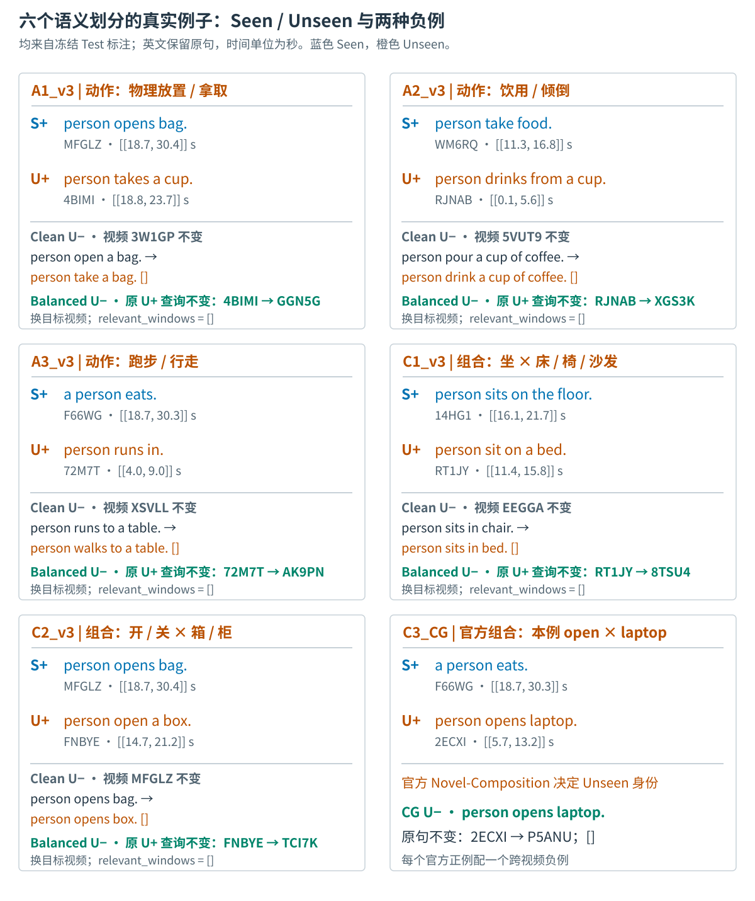

*图 7：A1–A3、C1–C2 与 C3_CG 的真实正负例。每格先对照 S+ 与 U+，再展示该划分中的 U− 如何构造。*

图中实例及下表全部取自各版本的**冻结 Test 标注**，英文保持原句，时间单位为秒。A1–C2 的 S+ / U+ 在 Clean 与 Balanced 中相同；后两列分别展示两种数据版本的实际 U− 构造，S− 使用相同流程但查询属于 Seen。完整 qid、来源字段及事件结构见 [PIPELINE_EXAMPLES.json](docs/gmr_baseline_summary_20261011/PIPELINE_EXAMPLES.json)。

<details>
<summary>展开六个语义划分的合并对照表</summary>

| 语义划分 | 哪些查询归为 Unseen | Seen 正例 S+ | Unseen 正例 U+ | Clean v3 的 U−：固定视频改查询 | Balanced v3 / CG v2 的 U−：固定查询换视频 |
|---|---|---|---|---|---|
| A1_v3 | 动作：物理放置 / 拿取 | “person opens bag.”<br>`MFGLZ`；`[[18.7, 30.4]]` 秒 | “person takes a cup.”<br>`4BIMI`；`[[18.8, 23.7]]` 秒 | 视频 `3W1GP` 不变：<br>“person open a bag.” → “person take a bag.”；`[]` | “person takes a cup.” 不变：<br>`4BIMI` → `GGN5G`；`[]` |
| A2_v3 | 动作：饮用 / 倾倒 | “person take food.”<br>`WM6RQ`；`[[11.3, 16.8]]` 秒 | “person drinks from a cup.”<br>`RJNAB`；`[[0.1, 5.6]]` 秒 | 视频 `5VUT9` 不变：<br>“person pour a cup of coffee.” → “person drink a cup of coffee.”；`[]` | “person drinks from a cup.” 不变：<br>`RJNAB` → `XGS3K`；`[]` |
| A3_v3 | 动作：跑步 / 行走 | “a person eats.”<br>`F66WG`；`[[18.7, 30.3]]` 秒 | “person runs in.”<br>`72M7T`；`[[4.0, 9.0]]` 秒 | 视频 `XSVLL` 不变：<br>“person runs to a table.” → “person walks to a table.”；`[]` | “person runs in.” 不变：<br>`72M7T` → `AK9PN`；`[]` |
| C1_v3 | 组合：坐 × 床 / 椅 / 沙发 | “person sits on the floor.”<br>`14HG1`；`[[16.1, 21.7]]` 秒 | “person sit on a bed.”<br>`RT1JY`；`[[11.4, 15.8]]` 秒 | 视频 `EEGGA` 不变：<br>“person sits in chair.” → “person sits in bed.”；`[]` | “person sit on a bed.” 不变：<br>`RT1JY` → `8TSU4`；`[]` |
| C2_v3 | 组合：打开 / 关闭 × 箱 / 柜 | “person opens bag.”<br>`MFGLZ`；`[[18.7, 30.4]]` 秒 | “person open a box.”<br>`FNBYE`；`[[14.7, 21.2]]` 秒 | 视频 `MFGLZ` 不变：<br>“person opens bag.” → “person opens box.”；`[]` | “person open a box.” 不变：<br>`FNBYE` → `TCI7K`；`[]` |
| C3_CG（Charades-CG v2） | 官方 Novel-Composition；本例官方标记为 open × laptop。Test-Trivial 为 Seen | “a person eats.”<br>`F66WG`；`[[18.7, 30.3]]` 秒 | “person opens laptop.”<br>`2ECXI`；`[[5.7, 13.2]]` 秒 | 不采用改句流程 | “person opens laptop.” 不变：<br>`2ECXI` → `P5ANU`；`[]` |

</details>

例如 C2 中，“person opens bag.” 是 S+，“person open a box.” 是 U+：留出的是 **open × box** 组合，open 这个动作仍可在其他对象上出现。Clean 的负例把同一视频的 bag 改成 box；Balanced 的负例把已有的开箱查询移到另一视频。C3 的 open × laptop 则来自官方 `novels` 组合标记。

<details>
<summary>原始科研图归档：三套构建管线与五类语义留出</summary>

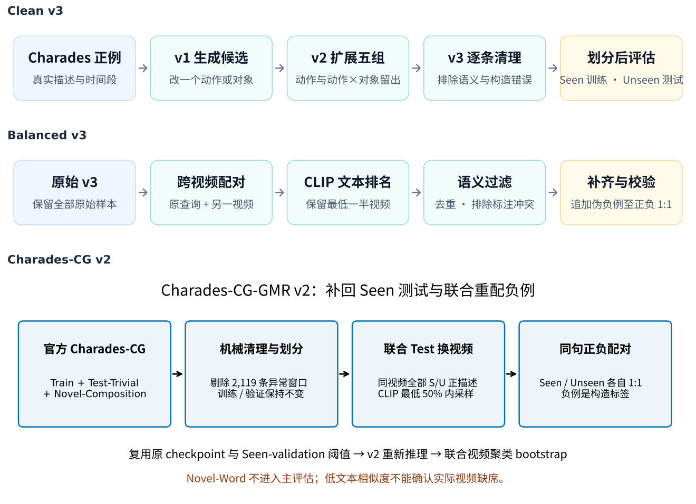

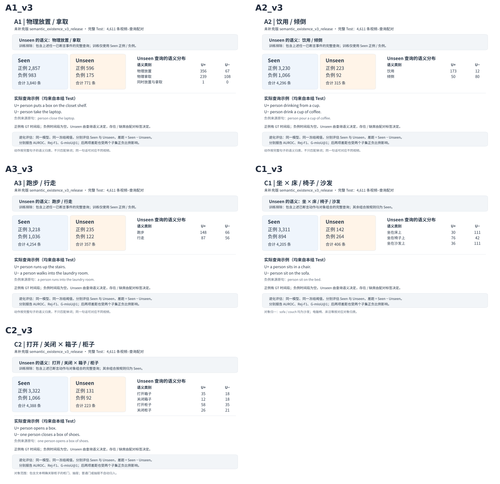

该图保留 Clean v3 的原始定义、真实查询示例和统计；Balanced v3 沿用相同语义定义，但补充负例后的数量见下表。

</details>

### 各测试划分的数据组成

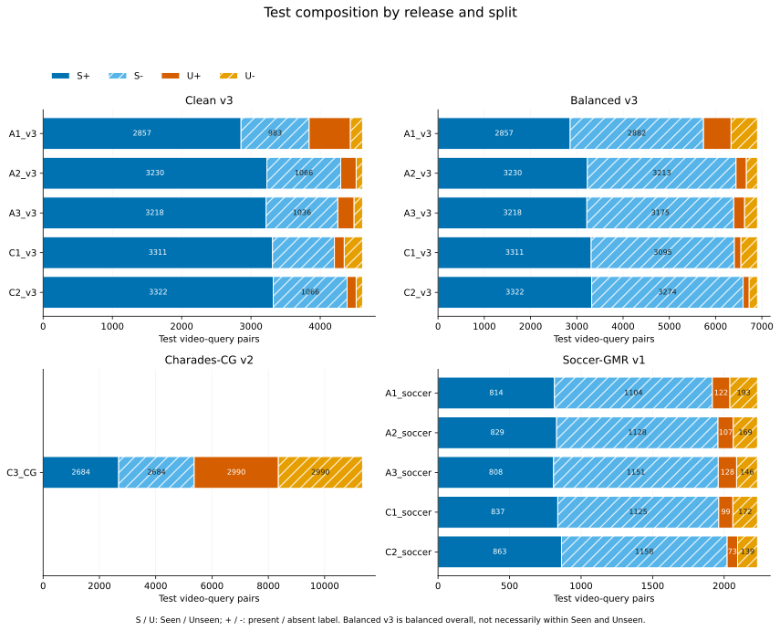

*图 8：Balanced v3 的完整测试集与 Charades-CG v2 正负平衡，Balanced 的 Seen/Unseen 子集仍有比例差异。图中 S/U 为 Seen/Unseen，+/− 为存在/缺席构造标签；全部 train/val/test 计数见 [DATASET_COUNTS](docs/gmr_baseline_summary_20261011/DATASET_COUNTS.md)。五划分共享视频与查询，不能把行数相加当作独立样本数。*

| 数据集 | Test split | S+ | S− | U+ | U− | 总行数 |
|---|---|---:|---:|---:|---:|---:|
| Clean v3 | A1_v3 | 2857 | 983 | 596 | 175 | 4611 |
| Clean v3 | A2_v3 | 3230 | 1066 | 223 | 92 | 4611 |
| Clean v3 | A3_v3 | 3218 | 1036 | 235 | 122 | 4611 |
| Clean v3 | C1_v3 | 3311 | 894 | 142 | 264 | 4611 |
| Clean v3 | C2_v3 | 3322 | 1066 | 131 | 92 | 4611 |
| Balanced v3 | A1_v3 | 2857 | 2882 | 596 | 571 | 6906 |
| Balanced v3 | A2_v3 | 3230 | 3213 | 223 | 240 | 6906 |
| Balanced v3 | A3_v3 | 3218 | 3175 | 235 | 278 | 6906 |
| Balanced v3 | C1_v3 | 3311 | 3095 | 142 | 358 | 6906 |
| Balanced v3 | C2_v3 | 3322 | 3274 | 131 | 179 | 6906 |
| Charades-CG v2 | C3_CG | 2684 | 2684 | 2990 | 2990 | 11348 |

## 统一训练和评测协议

| 项目 | 固定设置 |
|---|---|
| 特征 | CLIP 文本，CLIP + SlowFast 视频；精确查询 SHA-256 核验复用特征 |
| 训练 | S+/S− only；seed 3407；从头训练，最多 100 epochs；max_es_cnt=26（连续 27 次无改善早停） |
| Checkpoint | Moment/QD：Seen validation MR-full-mAP；Flash：Seen validation R1@0.5 与 R1@0.7 均值 |
| 阈值 | 完整 Seen validation 的 5–95 分位数、91 个候选，最大化 Balanced Accuracy，并列取最早；score ≥ threshold 接受 |
| 分数 | Moment/QD 原生四位 sigmoid；Flash 原生六位 logit，避免三位概率饱和并列 |
| 定位 | 原生输出第一个合法窗口；不因窗口终点超过标注时长改选后续窗口 |
| 不确定性 | 2,000 次 video-cluster bootstrap，seed 3407，冻结 checkpoint 与阈值；Seen/Unseen 共享视频联合重采样 |
| 宏平均 | 仅 Clean/Balanced 的五组全部完成后作等权 MACRO；共同视频宇宙配对抽样；C3_CG 单独报告 |

Charades-CG v2 **复用原 C3_CG 的冻结 checkpoint、Seen-validation 原生预测及阈值**，重新推理 v2 测试；其训练/验证与 v1 相同。

AUROC 为存在分数的排序能力。Actual Rej-F1 将拒绝作为正决策，`2TN/(2TN+FP+FN)`；TN 为正确拒绝缺席，FP 为错误接受缺席，FN 为错误拒绝存在。G-mIoU@1 接受查询时使用原生 top-1 的集合 IoU；拒绝负例得 1，拒绝正例得 0，再对全部样本平均。**Gap = Seen − Unseen**，统一用 pp；AUROC 差值乘 100，负 Gap 保留为 Unseen 点估计更高。

## 主要结果

下表各单元格为 **Seen → Unseen（Gap pp）**。AUROC 为 0–1；Rej-F1、G-mIoU@1 为百分数。Clean/Balanced 为完整五划分等权宏平均，Charades-CG 为单划分。

| 数据 / 汇总范围 | Backbone | AUROC | Rej-F1 (%) | G-mIoU@1 (%) |
|---|---|---:|---:|---:|
| Clean v3 / MACRO | Moment-DETR-GMR | 0.7238 → 0.5224 (+20.14) | 50.51 → 22.25 (+28.27) | 34.54 → 25.51 (+9.03) |
| Clean v3 / MACRO | QD-DETR-GMR | 0.7413 → 0.5337 (+20.76) | 51.30 → 30.61 (+20.68) | 34.86 → 28.02 (+6.84) |
| Clean v3 / MACRO | FlashVTG-GMR | 0.7543 → 0.5647 (+18.96) | 53.36 → 37.09 (+16.27) | 41.75 → 34.44 (+7.31) |
| Balanced v3 / MACRO | Moment-DETR-GMR | 0.7253 → 0.6466 (+7.87) | 65.88 → 62.11 (+3.76) | 45.99 → 43.16 (+2.83) |
| Balanced v3 / MACRO | QD-DETR-GMR | 0.5445 → 0.5093 (+3.52) | 56.87 → 61.40 (-4.53) | 39.01 → 47.17 (-8.16) |
| Balanced v3 / MACRO | FlashVTG-GMR | 0.7706 → 0.6608 (+10.98) | 68.04 → 61.68 (+6.36) | 51.48 → 44.85 (+6.63) |
| Charades-CG v2 / C3_CG | Moment-DETR-GMR | 0.6338 → 0.5587 (+7.51) | 63.87 → 60.10 (+3.77) | 45.95 → 41.49 (+4.46) |
| Charades-CG v2 / C3_CG | QD-DETR-GMR | 0.5050 → 0.4984 (+0.66) | 57.42 → 57.58 (-0.16) | 39.44 → 38.11 (+1.33) |
| Charades-CG v2 / C3_CG | FlashVTG-GMR | 0.7997 → 0.7204 (+7.93) | 70.63 → 64.24 (+6.39) | 53.43 → 44.96 (+8.47) |

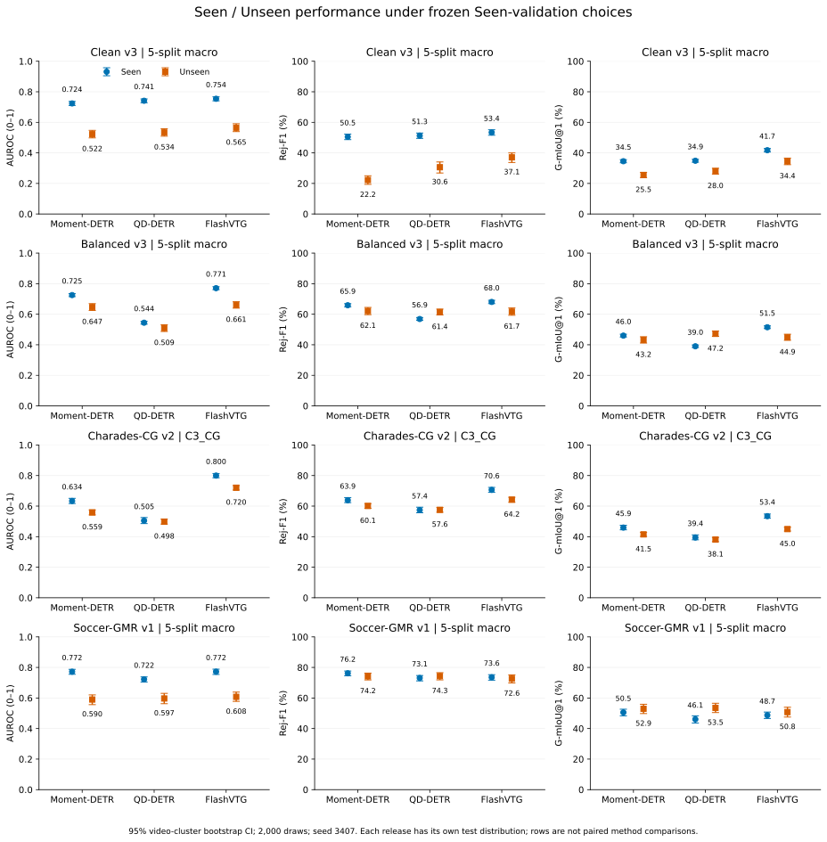

*图 9：三套数据中，多数模型的 Unseen AUROC 点估计低于 Seen。每行对应一个数据版本，每列对应一项指标；圆点/方点分别为 Seen/Unseen，误差线为视频聚类 bootstrap 95% CI。*

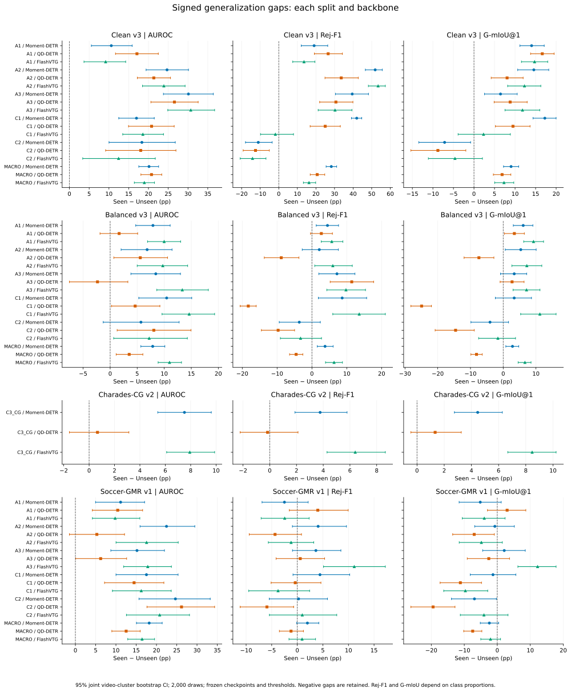

*图 10：泛化差距随划分、模型和指标而改变；负 Gap 原样保留。展示各 split/backbone 与五组 MACRO 的 95% CI，虚线为零。*

**完整结果与 CI**：[逐划分、逐 backbone 的三项 Seen/Unseen、Gap 及 overall 表](docs/gmr_baseline_summary_20261011/RESULTS_WITH_CI.md) · [CSV](docs/gmr_baseline_summary_20261011/metrics.csv) · [JSON](docs/gmr_baseline_summary_20261011/metrics.json)。所有汇总均读取未舍入的冻结 JSON。

| 数据 / 汇总范围 | Backbone | Overall Rej-F1 | Overall RR | S+ FRR | U+ FRR | Overall G-mIoU@1 |
|---|---|---:|---:|---:|---:|---:|
| Clean v3 / MACRO | Moment-DETR-GMR | 48.70% | 35.63% | 28.45% | 24.42% | 33.53% |
| Clean v3 / MACRO | QD-DETR-GMR | 49.56% | 38.01% | 30.02% | 31.59% | 33.98% |
| Clean v3 / MACRO | FlashVTG-GMR | 52.46% | 39.15% | 29.66% | 34.68% | 40.91% |
| Balanced v3 / MACRO | Moment-DETR-GMR | 65.46% | 49.32% | 32.59% | 41.07% | 45.65% |
| Balanced v3 / MACRO | QD-DETR-GMR | 57.21% | 63.54% | 59.29% | 71.86% | 39.45% |
| Balanced v3 / MACRO | FlashVTG-GMR | 67.39% | 45.19% | 24.60% | 40.36% | 50.82% |
| Charades-CG v2 / C3_CG | Moment-DETR-GMR | 61.86% | 66.16% | 55.89% | 64.58% | 43.60% |
| Charades-CG v2 / C3_CG | QD-DETR-GMR | 57.50% | 67.15% | 67.29% | 66.62% | 38.74% |
| Charades-CG v2 / C3_CG | FlashVTG-GMR | 67.25% | 43.87% | 21.20% | 27.66% | 48.97% |

**结果解读**：Clean v3 的三模型宏平均 AUROC Gap 为 18.96–20.76 pp；Balanced v3 为 3.52–10.98 pp。Balanced QD 的 Unseen AUROC 为 0.5093，U+ FRR 为 71.86%，Rej-F1/G-mIoU Gap 为负。Charades-CG 的 Moment/Flash 三项 Gap CI 均高于零；QD 三项 Gap CI 均含零，其 AUROC 接近随机排序。

独立 baseline 的 **Unseen Net Gain、Seen Change、Gap Reduction 对三项指标均为 N/A**；后续同版本、同 split、同 backbone 的方法对照按 paired bootstrap 报告这些变化。

## 源码、脚本和冻结结果

| 内容 | 位置 |
|---|---|
| 数据制作 / 校验 | [scripts](scripts/)；各数据集 `construction_protocol.json`、`validation_report.json`、清单和 provenance |
| Clean / Balanced 实际模型源码与配置 | 各实验 `native_source/{models,training,configs,eval}/` 与 `SOURCE_MANIFEST.json` |
| Clean / Balanced 训练和推理 | 各实验 `run_baselines.py`、`common.py`、`launch_native.sh`；原训练配置保留于 `groups/*/runs/` |
| Clean / Balanced 冻结输出 | `groups/*/evaluation/*/{predictions.npz,FROZEN_CALIBRATION.json,bootstrap_draws.npz,metrics.json,bootstrap.json}`；`frozen_checkpoints/` 保留权重哈希与原验证预测；`runs/*/test/` 保留原生测试窗口 |
| Clean / Balanced 补充 bootstrap | `evaluation/degradation_cache/`、`degradation_bootstrap.json`，以及原始 Markdown/CSV/JSON |
| Charades-CG 自含审阅包 | [README](experiments/agy_test/publication_review_20261011/charades_cg/README.md)；包内 `docs/reports/charades_cg_gmr_baselines_20261011/{frozen,source_snapshot}/` |
| Charades-CG 原训练与 v2 执行脚本 | [原训练](experiments/agy_test/charades_cg_baselines_20261010/) · [v2 重评估](experiments/agy_test/charades_cg_v2_evaluation_20261011/)；实际 native 源码见审阅包快照 |
| 图表 | [合并图](assets/gmr_baseline_summary_20261011/)；原图与绘制代码保留于 `assets/semantic_existence_v3/` 和 Charades-CG 包内 assets |
| 构建过程科研示意图 | [绘图脚本](scripts/render_gmr_construction_figures.py) · [图中数据来源](docs/gmr_baseline_summary_20261011/CONSTRUCTION_FIGURES.json)；七张图均有 SVG / PDF / PNG |
| 本次发布元数据 | [PACKAGING](docs/gmr_baseline_summary_20261011/PACKAGING.json) · [PUBLICATION_MANIFEST](docs/gmr_baseline_summary_20261011/PUBLICATION_MANIFEST.json) · [实验完成记录](docs/gmr_baseline_summary_20261011/EXPERIMENTS.json) |

发布范围包含标注、方法/训练/评估源码、配置、脚本、冻结预测、校准与 bootstrap 产物。遵循仓库约定，视频、特征数组、模型权重和凭据不进入提交；权重以原始 SHA-256 清单追溯。Balanced 的超大 `master/negative_added.jsonl` 使用无损 gzip 存储，还原后逐字节匹配原校验值。日志归档为 `.log.gz`。

## 使用与复现

从仓库根目录还原超大标注并校验发布文件：

```bash
python scripts/restore_gmr_publication.py
```

汇总与重绘只读取已保存结果，不需要视频、特征或权重：

```bash
python -m pip install -r requirements-publication.txt
python scripts/build_gmr_publication_summary.py
```

重绘直接合并原始 SVG 元素，并从冻结指标/标注生成数据组成、性能与 Gap 图；导出 SVG/PDF/PNG，原始矢量图可单独查看。

仅重绘七张数据构建示意图：

```bash
python scripts/render_gmr_construction_figures.py
```

构建图使用原生 SVG 元素，文本、框线、箭头和时间轴均可编辑；示例句子、视频 ID、时间窗和数量来自冻结标注与统计。

训练依赖见 `requirements.txt`、`requirements-flash-vtg.txt`；数据构建另见 `requirements-dataset.txt`。原始 `run_baselines.py` / `common.py` 是执行时源码记录，包含本机解释器、视频目录及历史特征清单路径；在其他机器运行须先按 README 和 `PROTOCOL.json` 配置路径并准备外部特征、冻结权重或新训练目录。`launch_native.sh` 支持 `V3_NATIVE_REPO`、`DATA_ROOT`、`FEATURE_ROOT`、`VIDEO_ROOT`、`RUN_ROOT`、`TRAIN_GPU`、`GMR_PYTHON` 和 `FLASH_PYTHON`；应使用全新 RUN_ROOT，以免覆盖已有实验。Charades 原训练脚本所用 native 源码在审阅包中，需对应设置其路径。

已有 `RELEASE_VALIDATION`、`LOCAL_VERIFICATION` 和独立验收记录保存在各项目中；还原脚本执行发布级 SHA-256 完整性校验。重建数据需准备原始审计材料与 CLIP 向量缓存，运行模型需准备对应特征与权重。

## 说明

负例依据文本与已有标注构造，未逐视频核验缺席；组合划分按冻结事件字段判定，字段判定例子见 [例证记录](docs/gmr_baseline_summary_20261011/PIPELINE_EXAMPLES.json)。Rej-F1 与 G-mIoU 受子集正负比例影响，因此其 Gap 需结合类别计数与正例误拒率解释；不同数据版本的差值不作为同测试集方法增益。95% CI 描述固定模型、单种子的视频抽样不确定性；Unseen 指下游留出语义。
