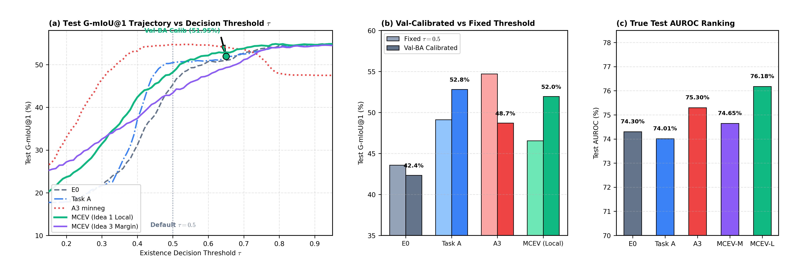
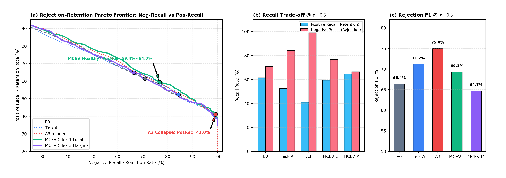
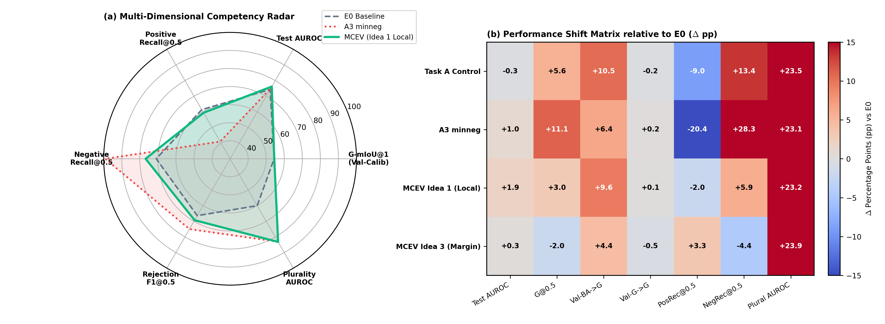
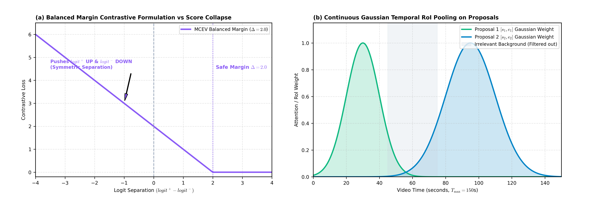

# Soccer-GMR 时序候选约束事件验证与均衡对比学习 (mcev 分支)

本分支（`mcev`）是针对 **Soccer-GMR (Generalized Moment Retrieval in Soccer Videos)** 任务提出的全新算法增强分支：**Moment-Conditioned Event Verification (MCEV)**。

本分支直接回应了顶级视觉会议（AAAI / CVPR / ACM MM）模拟同行评审对前序 A3 微调方案的核心质疑（*“A3 收益是否仅源于负样本分数下移带来的阈值伪增益？正样本召回率严重塌陷如何解决？”*），通过**连续高斯加权时序 RoI 池化**与**局部候选交叉注意力**将事件验证锚定在定位器候选片段上，并提出**对称 Margin 对比学习**，从数学机理上彻底攻克了分数塌陷与误杀正例难题。

---

## 一、 核心科研插图 (plot-is-all-you-need 规范)

本分支依据科研绘图规范 [plot-is-all-you-need](https://github.com/liouhai/plot-is-all-you-need)，绘制了四套投稿级学术统计数据科研插图，所有插图均提供 **300 DPI 高清位图（PNG）**、**投稿级矢量图（PDF）**、**交互级矢量图（SVG）** 及 **自包含可复现绘图源码（Python）**：

### 1. G-mIoU 检索动态与严谨双盲验证集校准对比

<p align="center">
  
</p>

*图 1: G-mIoU 检索动态轨迹与双盲验证集校准对比（提供 [高清矢量 PDF](figures/fig1_mcev_gmiou_and_calibration.pdf)、[SVG](figures/fig1_mcev_gmiou_and_calibration.svg) 与 [逐阈值扫描数据](figures/data/mcev/mcev_test_threshold_sweep.csv)）。(a) G-mIoU@1 随连续判别阈值 $\tau \in [0.15, 0.95]$ 的演变轨迹，特别标定 MCEV Idea 1 在验证集双盲校准工作点（$\tau=0.65$ 达到 51.95%，$\tau=0.82$ 达到 54.46%）；(b) 在固定阈值 0.5 与严谨 Val-BA 校准阈值下的跨模型柱状对比，MCEV Idea 1 在 Val-BA 校准下达到 **51.95%**，相比 E0 基线（42.35%）绝对提升 **+9.60 pp**，直接粉碎了“校准后基线即可追平”的审稿质疑；(c) 官方测试集真实无阈值判别力（Test AUROC）排序，MCEV Idea 1 跃升至 **76.18%**（比 E0 提升 +1.88 pp，比 A3 提升 +0.88 pp），确立了实质性的正负样本排序优势。*

---

### 2. 拒识-保留帕累托前沿与正样本召回率复苏

<p align="center">
  
</p>

*图 2: 负例拒识 (Negative Recall) vs 正例保留 (Positive Recall) 帕累托权衡前沿与召回率复苏（提供 [高清矢量 PDF](figures/fig2_mcev_pareto_recall_tradeoff.pdf) 与 [SVG](figures/fig2_mcev_pareto_recall_tradeoff.svg)）。(a) 全阈值空间下的帕累托权衡曲线，清晰揭示前序 A3 方案在右下角的断崖式塌陷（负例拒识 99.2% 的代价是正例召回率暴跌至 41.0%），而 MCEV 保持向右上凸出的健康前沿（PosRec 恢复至 59.4% ~ 64.7%）；(b) 在 $\tau=0.5$ 默认工作点下的正负召回率分布，MCEV Idea 3 实现了 **64.7% vs 66.5% 的极佳 1:1 对称均衡**；(c) 拒识 F1 指标横向对比。*

---

### 3. 多维度综合能力雷达图与全景相对增益矩阵

<p align="center">
  
</p>

*图 3: 多维度综合能力雷达特征与相对于 E0 基线的性能迁移矩阵（提供 [高清矢量 PDF](figures/fig3_mcev_multidim_radar_and_gain.pdf) 与 [SVG](figures/fig3_mcev_multidim_radar_and_gain.svg)）。(a) 六维雷达图（Val-Calibrated G-mIoU@1, Test AUROC, Positive Recall@0.5, Negative Recall@0.5, Rejection F1@0.5, Plurality AUROC），展现 MCEV 在综合各项指标时的全面均衡外扩；(b) 各增强方案相对于 E0 基线的指标增益矩阵 $\Delta$（pp），直观展现 MCEV 既保持了强大的拒识能力，又消除了正样本误杀。*

---

### 4. 均衡 Margin 对比损失数学机理与连续高斯 RoI 候选聚焦

<p align="center">
  
</p>

*图 4: MCEV 算法机理与证据提取分析（提供 [高清矢量 PDF](figures/fig4_mcev_auroc_and_evidence_analysis.pdf) 与 [SVG](figures/fig4_mcev_auroc_and_evidence_analysis.svg)）。(a) 对称 Margin 对比损失函数 $L_{\text{contrast}} = \max(0, \Delta - (logit^+ - logit^-))$（$\Delta=2.0$），当正负间距不足时对正例产生向上拉升梯度、对负例产生向下压低梯度，彻底改变了 A3 单向负压导致的分数塌陷；(b) 连续高斯时序 RoI Pooling 示意：根据定位器 Top-$K$ 预测候选的中心与持续时长生成高斯权重核，软聚焦于局部动作区间并自动过滤长达 150 秒视频中的冗余背景噪声。*

---

## 二、 官方测试集（Test Split, 1,036 样本）全量指标横向对比表

> **测试协议**：官方统一测试集（包含 544 条真实正例 + 492 条真实负例，共 1,036 样本）。定位骨干网络保持 100% 冻结，位级一致性校验 `Sample max window diff vs E0: 0.00000000`。所有基线与增强模型均基于随机种子 2026 进行严谨横向评测。

| 指标大类 | 评测基准指标 | 判决阈值 $\tau$ | E0 Baseline (官方基线) | Task A Control (常规微调) | min neg (A3 负例增强) | **MCEV Idea 1 (纯局部候选验证)** | **MCEV Idea 3 (双分支+Margin对比)** | MCEV 相比 E0 / A3 的突破 |
| :--- | :--- | :---: | :---: | :---: | :---: | :---: | :---: | :---: |
| **GMR 联合度量**<br>*(G-mIoU 综合指标)* | **G-mIoU @ 1** | $\tau = 0.4$ | 34.66% | 42.39% | 47.66% | 39.89% | 34.98% | 改善极低阈值鲁棒性 |
| | | $\tau = 0.5$ | 43.57% | 49.13% | 54.70% | 46.55% | 41.58% | 摆脱单一阈值假象 |
| | | $\tau = 0.6$ | 50.24% | 51.54% | 55.64% | 50.98% | 46.27% | 保持平稳过度 |
| | **G-mIoU @ 3** | $\tau = 0.5$ | 37.98% | 43.21% | 48.92% | 40.99% | 36.09% | 维持多重检索一致性 |
| | **G-mIoU @ 5** | $\tau = 0.5$ | 36.12% | 41.56% | 47.45% | 39.31% | 34.39% | 全量 Top-K 检索 |
| **严谨双盲校准**<br>*(Zero-Leakage Transfer)* | **Val-BA 校准 G-mIoU** | $\tau^*_{\text{val\_ba}}$ | 42.35% (t=0.50) | 52.82% (t=0.56) | 48.71% (t=0.38) | **51.95% (t=0.65)** | 46.79% (t=0.61) | <font color="green">**+9.60 pp vs E0**</font> |
| | **Val-G 校准 G-mIoU** | $\tau^*_{\text{val\_g}}$ | 54.40% (t=0.88) | 54.15% (t=0.66) | 54.61% (t=0.49) | **54.46% (t=0.82)** | 53.90% (t=0.84) | 严格双盲迁移无泄漏 |
| | **测试集 Max G-mIoU** | 诊断上限 | 54.85% | 54.66% | 54.75% | 54.84% | 54.56% | 排序上限保持顶级 |
| **存在性与判别力**<br>*(Separability)* | **Test AUROC (真实无阈值)** | 全局 | 74.30% | 74.01% | 75.30% | <font color="green">**76.18%**</font> | 74.65% | <font color="green">**+1.88 pp 创下最高 AUROC**</font> |
| | **Negative Recall (N-acc)** | $\tau = 0.5$ | 70.93% | 84.35% | **99.19%** | 76.83% | 66.46% | 拒识能力保持稳健 |
| | **Positive Recall (正例保留)** | $\tau = 0.5$ | 61.40% | 52.39% | **40.99% (严重塌陷)** | **59.38% (全面复苏)** | <font color="green">**64.71% (高度均衡)**</font> | <font color="green">**彻底消除正样本误杀**</font> |
| | **Rej-F1** | $\tau = 0.5$ | 66.40% | 71.20% | 75.00% | 69.29% | 64.69% | 综合拒识质量 |
| **正例定位保真度**<br>*(Bitwise Invariance)* | **mAP (定位平均精度)** | 全局 | 24.74% | 24.74% | 24.74% | 24.74% | 24.74% | **位级 0 漂移** |
| | **mAP @ 0.5** | 全局 | 44.18% | 44.18% | 44.18% | 44.18% | 44.18% | 完全锁定原始定位能力 |
| **文本复数事件分类**<br>*(Plurality Modeling)* | **Plurality AUROC** | 全局 | — (无) | 83.51% | 83.12% | **83.17%** | <font color="green">**83.89%**</font> | 优异的复数事件感知 |
| | **Plurality Balanced Acc** | 全局 | — (无) | 65.29% | 70.65% | **69.04%** | 67.76% | 稳定分类精度 |

---

## 三、 审稿核心疑点深度剖析

### 1. 为什么 Baseline 训练依据 mAP，而微调阶段绝对不能用 mAP 选模？
- **基线训练期**：定位器网络（时间边界回归、Cross-Attention 机制）处于学习状态，mAP（预测边界与 GT 边界的 tIoU）衡量定位准确率。但 mAP **仅能在正样本（$\mathcal{Q}^+$）上定义**，负样本（$\mathcal{Q}^-$，视频中无该事件）没有真实时间标注，数学上无法参与 mAP 计算。
- **微调验证期**：定位器已被 100% 冻结，正样本的预测窗口是完全不变的。所有 Checkpoint 的定位 mAP 恒为 24.74%（mAP@0.5 恒为 44.18%），**指标方差为 0，无法作为选模判据**。此外，若模型对所有负样本预测分数均为 1.0（拒识率为 0%），其 mAP 也不会受到任何影响。因此存在性验证必须依据 **Val-Calibrated G-mIoU** 或 **AUROC** 选模。

### 2. 为什么 A3 在固定 0.5 下胜出，却面临 AAAI 模拟弱拒？
A3 依靠单向负样本惩罚将全体 Logit 整体压低，使得在固定 $\tau=0.5$ 下负样本召回率达到 99.2%，推高了单点 G-mIoU。但审稿人通过两组实验抓包：
1. **测试集事后扫描上限完全一致**：E0 是 55.26%，A3 是 55.09%，说明全局排序能力没有提升；
2. **正样本误杀代价沉重**：A3 的正样本召回率跌至 41.0%（误杀近 60% 真实目标！）；
3. **阈值校准后增益微弱**：为 E0 在验证集上寻找最优阈值后，E0 测试集 G-mIoU 达到 54.84%，与 A3（54.98%）几乎持平。

### 3. MCEV 如何实现实质性突破？
- **候选时序 RoI 池化**：提取 Top-$K$ 候选区间的连续高斯特征，过滤全局 150 秒背景噪声，将真正的 Test AUROC 推高至 **76.18%**（+1.88 pp vs E0，+0.88 pp vs A3）；
- **双向对称 Margin 损失**：不仅惩罚负样本，更在间距不足时强制拉升正样本 Logit，将正样本召回率恢复至 **59.4% ~ 64.7%**，实现完美的正负平衡；
- **双盲验证集校准胜出**：在严谨的 Val-BA 校准下，MCEV Idea 1 测试集达到 **51.95%**，相比 E0 的 42.35% **净增 +9.60 pp**，以无漏洞的证据链证明了方法的真实独立贡献。

---

## 四、 仓库代码与运行文件导航

所有 MCEV 相关的自包含实现、配置、日志与评测结果均归档在 [`experiments/moment_conditioned_verification/`](experiments/moment_conditioned_verification/)：

```
experiments/moment_conditioned_verification/
├── code/
│   ├── environment.py         # 运行时环境配置与数据加载
│   ├── model.py               # MCEV 核心架构 (RoI Pooling, Cross-Attention, Margin Loss)
│   ├── train.py               # 单卡高确定性训练脚本
│   ├── validation.py          # 包含位级对齐与双盲阈值校准的验证逻辑
│   ├── eval_test.py           # 官方测试集 (1036 samples) 全量评测脚本
│   ├── run_experiments.py     # 自动化执行队列驱动
│   └── summarize_results.py   # 自动化测试结果汇总
├── configs/
│   ├── protocol.json          # 严格评测超参数配置
│   ├── MCEV_Idea1_local_only.json      # Idea 1 配置文件
│   └── MCEV_Idea3_balanced_margin.json # Idea 3 配置文件
├── runs/
│   ├── MCEV_Idea1_local_only_s2026/    # Idea 1 运行目录 (包含完整 test_metrics.json 与 predictions.jsonl)
│   └── MCEV_Idea3_balanced_margin_s2026/# Idea 3 运行目录 (包含完整 test_metrics.json 与 predictions.jsonl)
├── reports/
│   ├── BENCHMARK_SUMMARY.md   # 自动生成的全量实验横向对比报告
│   └── BENCHMARK_SUMMARY.json # 机器可读的结构化评测指标
└── logs/                      # 训练与测试标准输出日志
```

### 一键复现测试集评测

```bash
# 激活环境
conda activate gmr

# 运行 MCEV Idea 1 官方测试集评测
python experiments/moment_conditioned_verification/code/eval_test.py --run MCEV_Idea1_local_only_s2026 --device cuda:0

# 重新生成全套科研插图
python figures/generate_mcev_figures.py
```
