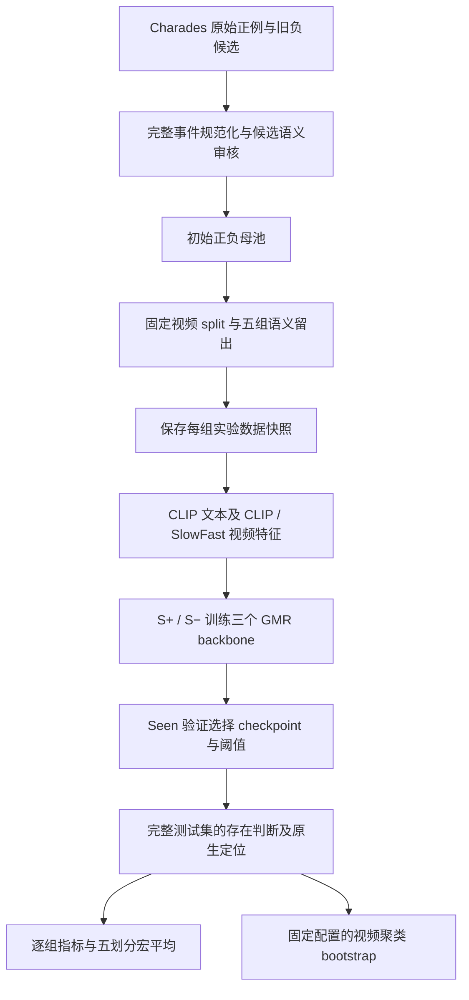

# Semantic Existence v3：Baseline 实验结果与数据管线交接

整理日期：2026-10-09。仓库根目录：`/home/guoxiangyu/paper/Openword/generalized-moment-retrieval`。以下路径相对仓库根目录。

## 1. 实验范围与数据版本

**本报告中的结果来自实验目录保存的初始 v3 快照，不是当前负例重审替换后的 v3 发布版结果。** 已找到五个划分 × 三个 backbone 的 15 个已完成训练任务、完整测试指标和五划分等权宏平均。本文整理已有文件，没有重新训练或重新执行 bootstrap。

- 实验根目录：`experiments/agy_test/v3_addseen_20261009/`。
- 实际使用的数据快照：`experiments/agy_test/v3_addseen_20261009/groups/<group>/release/<group>/`。
- 训练完成记录：[TRAINING_COMPLETE.json](../../experiments/agy_test/v3_addseen_20261009/TRAINING_COMPLETE.json)，15 项任务均为 `trained`，返回码为 0。
- 快照共覆盖 18,661 个去重 qid：15,076 个正例、3,585 个负例；每组完整测试集为 4,999 条。五组复用样本，不能将五组行数相加当成独立样本数。
- 当前负例修订号为 `negative-full-audit-20261009-1`；原已发布负例保留 2869 条，移除 exclude 57 条、quarantine 659 条。当前每组完整测试集为 4,622 条。
- 快照没有后续 A1 语义修订标记。实验快照与当前发布的训练成员、负例成员及 S/U 标签存在差异。已有数字应标注“初始 v3 快照”；本次没有找到上述审核修订对应的重新训练结果。

数据版本证据：[实验数据审计](../../experiments/agy_test/v3_addseen_20261009/DATA_AUDIT.json)、[当前负例修订说明](../../data/release/semantic_existence_v3/negative_review_update.json)、[A1 语义修订说明](../../docs/semantic_existence_v3_construction/A1_SEMANTIC_REPAIR_20261009.md)。

## 2. 数据管线原理

### 2.1 任务及存在标签

输入为视频和自然语言查询，模型先判断查询事件是否在整个视频中存在；存在时输出时间区间，缺席时输出空集合。S/U 表示对应划分下游训练是否见过目标语义，+/− 表示事件存在/缺席。这里的 unseen 不代表 CLIP 或 SlowFast 预训练从未接触过该概念。

| 分区 | 含义 | 用途 |
|---|---|---|
| S+ | seen 语义，事件存在，有原始 GT 时间窗 | 训练、seen 验证、测试 |
| S− | seen 语义，构造为缺席，`relevant_windows=[]` | 训练、seen 验证、测试 |
| U+ | 留出语义，事件存在，有原始 GT 时间窗 | 验证/测试记录保留；不用于训练和模型选择 |
| U− | 留出语义，构造为缺席，`relevant_windows=[]` | 验证/测试记录保留；不用于训练和阈值选择 |

### 2.2 从源数据到五组划分

1. **建立源事实索引。** 正例来自 Charades-STA 原始 train/test，共 16,124 个 qid；保留原始 `qid/query/vid/duration/relevant_windows`。旧反事实负查询来自 v2 五组文件，按 qid 去重为 6,976 个候选。相同 qid 的跨组复用位置共享一份审核决策。
2. **规范化完整事件语义。** 将动作词义、对象概念及 theme/source/goal/location 等角色写成事件列表；处理 sofa/couch、take a drink、实体取放与穿脱衣等区别。正例查询和时间窗不改写；解析未解决的记录排除初始母池。初始正例母池为 15,076 条，1,048 条未进入发布。
3. **逐候选比较负查询。** 比较候选与源查询的等价、蕴含、重合、歧义和事件差异，并检查同视频原始正例 GT 是否已经描述候选事件。初始流程从 6,976 个旧候选中保留 3,585 个 `keep/distinct`，exclude 948 个、quarantine 2,443 个；初始交付未增加新改写负例。
4. **采用明确的构造假设。** 经过事件差异审核、且没有同视频正例 GT 冲突的候选，依照用户确认的 Charades 短视频构造假设标为缺席。文本不同本身不构成逐视频缺席证明；本次没有要求或完成逐条视频复核。负例的 `source_windows` 只用于追溯原事件，缺席判断的范围仍是整个视频。
5. **固定视频归属。** 沿用已存在的 v2 视频分配，保留原始 test 视频；其余原始 train 视频用 seed 3407 补充分配。源正例及其派生负例继承同一视频 split，各组共用分配表，组内 train/val/test 视频互斥。
6. **施加语义留出。** 根据下表的完整事件定义判断 held 语义。命中 held 的训练查询整条移除；其余记录按存在标签形成 S+/S− 或 U+/U−。生成 `train.jsonl`、`val.jsonl`、`val_seen.jsonl`、`test.jsonl` 和配对记录。数据制作不以 baseline 预测或 AUROC 筛样。
7. **保存实验快照。** `prepare_v3.py` 将每组发布文件复制进实验目录，检查 qid 唯一性、存在标签与空/非空时间窗、视频 split 互斥、训练分区和 `val_seen` 一致性；baseline 使用这份副本。

| 划分 | 留出语义 | 角色/词义约束 |
|---|---|---|
| A1_v3 | `physical_place`、`physical_take` | 物体放置、取走的事件词义；不能仅按 put/take 字面匹配 |
| A2_v3 | `drink`、`pour` | 饮用/倾倒；完整查询中的相关事件也应检查 |
| A3_v3 | `run`、`walk` | 人物移动；运行设备等其他词义需要区分 |
| C1_v3 | `sit × {bed, chair, couch}` | 以坐姿支撑面/位置为锚点；sofa 规范化为 couch |
| C2_v3 | `{open, close} × {box, cabinet}` | 以被开关的对象为锚点，区分部件与整体关系 |

动作划分留出动作族；组合划分设计上留出动作与对象的组合，同时要求单独动作/对象可在训练中出现。该要求需要事件 inventory 检查，不能从分区计数直接推断已满足。



源说明：[数据制作手册](../../docs/20261009_SEMANTIC_EXISTENCE_V3_DATA_CONSTRUCTION_PLAN.md)、[初始数据交接](../../docs/semantic_existence_v3_construction/V3_DATASET_HANDOFF.md)、[构建器](../../scripts/build_semantic_existence_v3.py)、[实验快照准备](../../experiments/agy_test/v3_addseen_20261009/prepare_v3.py)。

### 2.3 设计规则与本轮实际快照的差异

后续审核发现初始数据仍有查询与事件元数据不一致、完整查询 held 事件遗漏及负例关系判定问题。因此“按文件中 S+/S− 训练”成立，而“已经完成逐条语义验收、严格没有 unseen 语义泄漏”不能由这轮实验产物保证。

| 项目 | 初始快照的实际情况 | 对结果的限制 |
|---|---|---|
| 完整事件审核 | 后续全量审核发现误分区、事件遗漏及问题负例 | 指标反映初始标注；需在最终审核版重新训练与评估 |
| 共享 S− 训练池 | 初始动作组三组 S− 数为 1,236 / 1,463 / 1,542，组合组为 1,239 / 1,438，未使用同轴统一交集 | 组间差异同时包含负例训练池差异 |
| seen inventory | 初始构建器将所有非 held 评估查询归 S，未逐项核对实际训练语义 inventory | S 不等于已经证实训练中出现过该事件族/组合 |
| 负例审核来源 | 初始行继承了 `user_attested_video_review` 等旧来源字段 | 不能将其作为本轮逐视频复核证据；当前修订已重新记录语义审核来源 |
| matched-U | 初始文件使用 pair index，且若干组一条 U+ 对应多条主配对 | 本文指标来自完整 `test.jsonl`，不解释为 matched-U 指标 |

这些限制的证据见 [协议执行审计](../../data/processed/semantic_existence_v3/full_audit_20261009/protocol_contract_audit.json) 和 [负例修订记录](../../data/release/semantic_existence_v3/negative_review_update.json)。审计报告是历史检查快照，不代表当前工作区仍保留全部同样问题。

## 3. 本次实验实际使用的数据规模

以下从实验目录保存的 JSONL 直接计数。完整 Val 包含四分区；checkpoint 和 baseline 阈值仅使用其中 `val_seen`。

| 划分 | Train S+ | Train S− | Train 合计 | Val 合计 | Val_seen 合计 | Test 合计 | Train 视频 | Val 视频 | Test 视频 |
|---|---:|---:|---:|---:|---:|---:|---:|---:|---:|
| A1_v3 | 8,783 | 1,236 | 10,019 | 1,615 | 1,312 | 4,999 | 4,229 | 498 | 1,304 |
| A2_v3 | 9,811 | 1,463 | 11,274 | 1,615 | 1,492 | 4,999 | 4,517 | 498 | 1,304 |
| A3_v3 | 9,767 | 1,542 | 11,309 | 1,615 | 1,514 | 4,999 | 4,552 | 498 | 1,304 |
| C1_v3 | 10,009 | 1,239 | 11,248 | 1,615 | 1,455 | 4,999 | 4,638 | 498 | 1,304 |
| C2_v3 | 10,115 | 1,438 | 11,553 | 1,615 | 1,546 | 4,999 | 4,661 | 498 | 1,304 |

| 划分 | Test S+ | Test S− | Test U+ | Test U− |
|---|---:|---:|---:|---:|
| A1_v3 | 2,843 | 1,171 | 621 | 364 |
| A2_v3 | 3,240 | 1,369 | 224 | 166 |
| A3_v3 | 3,227 | 1,395 | 237 | 140 |
| C1_v3 | 3,292 | 1,271 | 172 | 264 |
| C2_v3 | 3,326 | 1,448 | 138 | 87 |

### 3.1 与当前发布版的数量对照

下表是本报告整理时的文件观察值，用于说明版本差异；正在进行的后续审核可能继续改变发布文件。

| 划分 | 实验快照 Train | 当前发布 Train | 实验快照 Val | 当前发布 Val | 实验快照 Test | 当前发布 Test |
|---|---:|---:|---:|---:|---:|---:|
| A1_v3 | 10,019 | 9,791 | 1,615 | 1,516 | 4,999 | 4,622 |
| A2_v3 | 11,274 | 10,827 | 1,615 | 1,516 | 4,999 | 4,622 |
| A3_v3 | 11,309 | 10,783 | 1,615 | 1,516 | 4,999 | 4,622 |
| C1_v3 | 11,248 | 10,845 | 1,615 | 1,516 | 4,999 | 4,622 |
| C2_v3 | 11,553 | 10,951 | 1,615 | 1,516 | 4,999 | 4,622 |

## 4. 特征、训练和评估管线

### 4.1 特征及模型监督

- 视频特征来自 `/home/guoxiangyu/paper/新建文件夹/charades/{vid_clip,vid_slowfast}/`；文本特征入口为实验根目录 `features/clip_text/`，按 qid 链接已有 CLIP 文本缓存。只有 qid 与查询文本一致时才复用；实验审计记录 18,661 条已有文本特征，没有缺失的文本或视频特征。
- 三个 backbone 都带事件存在 head，正负样本均以 `exist_label` 接受 BCE-with-logits 监督。正例保留定位 GT，负例为空窗，不为负例伪造定位目标；定位及其他损失的处理遵循保存的 native source。
- 每个划分分别训练三个模型，仅输入快照 `train.jsonl` 中的 S+/S−。seed 均为 3407，最多 100 epochs；Moment/QD batch size 为 16，Flash 为 8。
- Moment/QD checkpoint 按完整 Seen 验证的 `MR-full-mAP` 选择；QD 代码在该项不是数值时回退至 `MR-full-mIoU`。Flash 使用 `(MR-full-R1@0.7 + MR-full-R1@0.5) / 2`。没有用 test 或 Unseen AUROC 选择 checkpoint。
- 设置均为 `max_es_cnt=26`。实际实现：Moment 在连续 26 次验证无改善时停止；QD/Flash 在连续 27 次无改善时停止。`EARLY_STOP_POLICY.json` 的统一描述未反映 Moment 的边界差异。

| 划分 | Moment 完成 epochs | QD 完成 epochs | Flash 完成 epochs |
|---|---:|---:|---:|
| A1_v3 | 48 | 40 | 80 |
| A2_v3 | 85 | 53 | 83 |
| A3_v3 | 55 | 40 | 74 |
| C1_v3 | 37 | 54 | 87 |
| C2_v3 | 38 | 38 | 53 |

epoch 数按完成轮数列出，Flash 日志的零起始编号已加 1；它们不是最佳 checkpoint 的 epoch。来源：各组 `runs/<backbone>/console.log`。

训练入口：[launch_native.sh](../../experiments/agy_test/v3_addseen_20261009/launch_native.sh)；实际代码位于 `experiments/agy_test/v3_addseen_20261009/native_source/`。

### 4.2 原生 baseline 的分数和阈值

Baseline 使用各自模型事件存在 head 的原生读数，没有 DEC、CoG 或 addSeen 证据融合。Moment/QD 使用 submission 的存在概率；Flash 使用 submission 的存在 logit。日志/缓存中概率与 logit 的刻度不同，不能跨 backbone 比较数值阈值。训练参考缓存保持 float32，val/test 读数来自保存的 native submission（Moment/QD 概率保留 4 位、Flash logit 保留 6 位）；本文沿用已有评估精度。

每个划分和 backbone 在完整 `val_seen` 的 5–95 百分位共 91 个候选阈值中，选 Balanced Accuracy 最大者；平局取最先遇到的候选。实际接受条件是 `score >= threshold`。

`BA = 0.5 × (Seen 正例接受率 + Seen 负例拒绝率)`。这是百分位网格搜索，不是对所有不同分数的精确穷举。制作协议草案写过 `>`、平局取最高阈值和 2,000 bootstrap；本轮 baseline 实际实现为 `>=`、最先平局候选和 500 bootstrap。

| 划分 | Moment 概率阈值 | QD 概率阈值 | Flash logit 阈值 |
|---|---:|---:|---:|
| A1_v3 | 0.887356 | 0.890700 | 7.253478 |
| A2_v3 | 0.996500 | 0.868046 | 6.978242 |
| A3_v3 | 0.916711 | 0.905170 | 7.053561 |
| C1_v3 | 0.927436 | 0.925542 | 9.531502 |
| C2_v3 | 0.934930 | 0.903115 | 2.910705 |

### 4.3 全量测试、定位窗口与 bootstrap

测试保留快照的完整 4,999 条记录。Seen AUROC 在 S+/S− 上计算，Unseen AUROC 在 U+/U− 上计算。Rej-F1、RR 和 G-mIoU@1 在完整测试集上计算。五组 MACRO 为逐组指标的等权算术平均；它不是合并五组样本后的 pooled 指标，也不是额外训练。

**定位窗口有两个已有评估口径。**

- 早期 `evaluation/`、`clean_dec_evaluation/`：跳过结束时间超过标注 duration 的候选，有时取后续候选。
- 后续 `cog_evaluation/`：采用其原始评估器的第一个有效 submission 窗口，不因 duration 越界而跳到后续候选。
- 本文 baseline 表二统一采用后者已有的修正结果；表一的 AUROC 和拒绝指标两版相同。旧口径 baseline G-mIoU 单独列在第 8 节。DEC/addSeen 对照表仍保留其来源文件的旧口径，不跨口径解释定位增益。

Baseline 的 95% CI 来自已有 `evaluation/bootstrap.json`：500 次视频聚类 bootstrap，seed 3407，全部有效，取 2.5%/97.5% 分位。每次按 vid 重采样，保留该视频的所有查询；五组宏平均共享对应的视频抽样。训练、CDF、验证阈值和模型不重新拟合。CI 反映这次固定训练的测试抽样不确定性，不包含训练 seed 变化。

DEC clean、CoG 的已有对照 CI 使用 2,000 次视频聚类配对 bootstrap，报告 ΔUnseen AUROC 的百分点区间；addSeen 和 DEC diagnostic 宏平均沿用 500 次。没有为本报告新增抽样。

评估实现：[原始标准评估](../../experiments/agy_test/v3_addseen_20261009/evaluate_v3_addseen.py)、[DEC/指标实现](../../experiments/agy_test/v3_addseen_20261009/method/evaluate.py)、[CoG 及窗口修正评估](../../experiments/agy_test/v3_addseen_20261009/evaluate_cog.py)。

## 5. 字段定义与单位

| 字段 | 本文定义 | 单位 |
|---|---|---|
| Evaluation Variant | 划分 / backbone / 评估分支 | 文本 |
| Seen AUROC | S+ 对 S− 的存在分数 AUROC | 0–1 |
| Unseen AUROC | U+ 对 U− 的存在分数 AUROC | 0–1 |
| Performance Gap | `100 × (Seen AUROC − Unseen AUROC)` | pp |
| Unseen Net Gain | 对照分支相对同划分、同 backbone baseline 的 `100 × ΔUnseen AUROC` | pp |
| 95% CI (Bootstrap) | baseline 行为绝对 Unseen AUROC CI；对照行为配对 ΔUnseen AUROC CI | 分别 0–1 / pp，逐表注明 |
| Seen Change | `100 × (Seen AUROC_variant − Seen AUROC_baseline)` | pp |
| Gap Reduction | `Gap_baseline − Gap_variant = Unseen Net Gain − Seen Change` | pp |
| Actual Rejection F1 (Rej-F1) | 拒绝负例为目标决策：`100 × 2TN / (2TN + FP + FN)` | % |
| Overall Rejection Rate (RR) | 完整测试集所有查询被拒绝的比例 | % |
| S+ / U+ FRR | 指定正例分区内被拒绝的比例 | % |
| End-to-end Localization (G-mIoU@1) | 接受时保留该 backbone 的一个定位窗口，拒绝时返回空集合，再计算下述集合得分的全测试均值 | % |

这里 TN 为负例被拒绝，FP 为负例被接受，FN 为正例被拒绝。G-mIoU@1：预测和 GT 都为空得 1；只有一方为空得 0；单预测窗口面对非空 GT 时得 `max_j IoU(pred, GT_j) / GT窗口数`。拒绝负例得 1，拒绝正例得 0；接受且存在非空预测的负例得 0。若接受时原生预测仍为空，则按空集合规则计算。它包含负例正确拒绝收益，不能直接当成正例平均时间 IoU。

baseline 行的 Net Gain / Seen Change / Gap Reduction 用 `—`，表示没有相对改进参照，不是缺失实验。所有差值按 JSON 中未舍入的数值计算，末位可能与表中已舍入 AUROC 的差值略有不同。

## 6. 完整 baseline 结果

### 6.1 存在性排序及泛化差距

15 个已训练设置及三个五划分 MACRO。CI 为绝对 Unseen AUROC 的 95% 区间，来自已有 500 次视频聚类 bootstrap。点估计使用修正窗口评估中的 baseline；其 AUROC 与原标准评估相同。

| Evaluation Variant | Seen AUROC | Unseen AUROC | Performance Gap | Unseen Net Gain | 95% CI (Bootstrap) | Seen Change | Gap Reduction |
|---|---:|---:|---:|---:|---|---:|---:|
| A1_v3 / Moment-DETR-GMR / Baseline | 0.7838 | 0.5745 | 20.93 | — | [0.5401, 0.6080] absolute | — | — |
| A1_v3 / QD-DETR-GMR / Baseline | 0.8029 | 0.5761 | 22.67 | — | [0.5383, 0.6138] absolute | — | — |
| A1_v3 / FlashVTG-GMR / Baseline | 0.8034 | 0.5629 | 24.06 | — | [0.5229, 0.5955] absolute | — | — |
| A2_v3 / Moment-DETR-GMR / Baseline | 0.7704 | 0.6135 | 15.69 | — | [0.5582, 0.6729] absolute | — | — |
| A2_v3 / QD-DETR-GMR / Baseline | 0.7922 | 0.5270 | 26.52 | — | [0.4700, 0.5781] absolute | — | — |
| A2_v3 / FlashVTG-GMR / Baseline | 0.7898 | 0.5360 | 25.39 | — | [0.4871, 0.5873] absolute | — | — |
| A3_v3 / Moment-DETR-GMR / Baseline | 0.7917 | 0.5162 | 27.55 | — | [0.4573, 0.5833] absolute | — | — |
| A3_v3 / QD-DETR-GMR / Baseline | 0.8036 | 0.4665 | 33.71 | — | [0.4105, 0.5291] absolute | — | — |
| A3_v3 / FlashVTG-GMR / Baseline | 0.8140 | 0.4660 | 34.80 | — | [0.4105, 0.5251] absolute | — | — |
| C1_v3 / Moment-DETR-GMR / Baseline | 0.7412 | 0.6378 | 10.34 | — | [0.5761, 0.6956] absolute | — | — |
| C1_v3 / QD-DETR-GMR / Baseline | 0.7786 | 0.6215 | 15.72 | — | [0.5591, 0.6745] absolute | — | — |
| C1_v3 / FlashVTG-GMR / Baseline | 0.7590 | 0.5531 | 20.59 | — | [0.5158, 0.5953] absolute | — | — |
| C2_v3 / Moment-DETR-GMR / Baseline | 0.7626 | 0.5849 | 17.77 | — | [0.5104, 0.6575] absolute | — | — |
| C2_v3 / QD-DETR-GMR / Baseline | 0.7809 | 0.5581 | 22.28 | — | [0.4816, 0.6287] absolute | — | — |
| C2_v3 / FlashVTG-GMR / Baseline | 0.7940 | 0.5386 | 25.53 | — | [0.4596, 0.6214] absolute | — | — |
| MACRO / Moment-DETR-GMR / Baseline | 0.7699 | 0.5854 | 18.46 | — | [0.5584, 0.6120] absolute | — | — |
| MACRO / QD-DETR-GMR / Baseline | 0.7916 | 0.5498 | 24.18 | — | [0.5251, 0.5751] absolute | — | — |
| MACRO / FlashVTG-GMR / Baseline | 0.7921 | 0.5313 | 26.07 | — | [0.5073, 0.5563] absolute | — | — |

### 6.2 拒绝决策与端到端定位

G-mIoU@1 使用已有 `cog_evaluation` 的修正窗口口径。所有指标均为百分比；MACRO 为五组等权均值。

| Backbone Model | Evaluation Branch | Actual Rejection F1 (Rej-F1) | Overall Rejection Rate (RR) | S+ False Rejection Rate (S+ FRR) | U+ False Rejection Rate (U+ FRR) | End-to-end Localization (G-mIoU@1) |
|---|---|---:|---:|---:|---:|---:|
| Moment-DETR-GMR | A1_v3 / Baseline（修正窗口） | 55.72% | 43.11% | 33.31% | 28.99% | 36.33% |
| QD-DETR-GMR | A1_v3 / Baseline（修正窗口） | 55.96% | 41.29% | 32.82% | 19.97% | 36.19% |
| FlashVTG-GMR | A1_v3 / Baseline（修正窗口） | 57.63% | 37.05% | 23.92% | 31.56% | 43.23% |
| Moment-DETR-GMR | A2_v3 / Baseline（修正窗口） | 55.91% | 55.87% | 46.36% | 36.16% | 36.78% |
| QD-DETR-GMR | A2_v3 / Baseline（修正窗口） | 57.92% | 43.55% | 33.70% | 4.46% | 37.20% |
| FlashVTG-GMR | A2_v3 / Baseline（修正窗口） | 57.25% | 36.11% | 25.77% | 6.25% | 42.76% |
| Moment-DETR-GMR | A3_v3 / Baseline（修正窗口） | 58.50% | 45.21% | 34.24% | 18.99% | 38.94% |
| QD-DETR-GMR | A3_v3 / Baseline（修正窗口） | 59.19% | 43.85% | 32.32% | 19.41% | 37.97% |
| FlashVTG-GMR | A3_v3 / Baseline（修正窗口） | 58.70% | 48.29% | 36.07% | 38.40% | 43.57% |
| Moment-DETR-GMR | C1_v3 / Baseline（修正窗口） | 53.40% | 46.09% | 37.91% | 18.02% | 36.05% |
| QD-DETR-GMR | C1_v3 / Baseline（修正窗口） | 56.20% | 46.03% | 35.94% | 23.26% | 36.90% |
| FlashVTG-GMR | C1_v3 / Baseline（修正窗口） | 56.89% | 40.61% | 28.10% | 52.91% | 42.47% |
| Moment-DETR-GMR | C2_v3 / Baseline（修正窗口） | 58.66% | 49.03% | 34.64% | 94.20% | 38.50% |
| QD-DETR-GMR | C2_v3 / Baseline（修正窗口） | 58.97% | 48.87% | 34.16% | 97.10% | 37.56% |
| FlashVTG-GMR | C2_v3 / Baseline（修正窗口） | 60.42% | 45.91% | 30.28% | 94.93% | 44.39% |
| Moment-DETR-GMR | MACRO / Baseline（修正窗口） | 56.44% | 47.86% | 37.29% | 39.27% | 37.32% |
| QD-DETR-GMR | MACRO / Baseline（修正窗口） | 57.65% | 44.72% | 33.79% | 32.84% | 37.17% |
| FlashVTG-GMR | MACRO / Baseline（修正窗口） | 58.18% | 41.59% | 28.83% | 44.81% | 43.29% |

### 6.3 本轮结果能支持的观察

- 五划分宏平均 Seen→Unseen AUROC：Moment `0.7699→0.5854`，QD `0.7916→0.5498`，Flash `0.7921→0.5313`；对应 Gap 为 `18.46 / 24.18 / 26.07 pp`。
- A3 的 QD/Flash Unseen AUROC 为 `0.4665 / 0.4660`；其绝对 CI 均包含 0.5，不能仅凭点估计宣称显著低于随机排序。
- C2 的 U+ FRR 为 Moment `94.20%`、QD `97.10%`、Flash `94.93%`，说明该 baseline 在此快照及 Seen 阈值下误拒了绝大多数 unseen 正例。
- 上述观察受初始数据语义问题约束。不能据此认定完成审核后的数据仍有相同掉点，也不能将 Gap 缩小单独等同于 unseen 能力提升。

## 7. 已有对照分支结果

以下同样来自上述初始快照。为了使 Net Gain、Seen Change 和 Gap Reduction 有具体参照，整理已经存在的 DEC、CoG、addSeen 结果；这些是同一批 backbone 的后处理分支，没有增加新的 backbone 训练。各行相对第 6 节同划分、同 backbone baseline 的 AUROC。

### 7.1 DEC-Power-CDF clean

score 为 `F_train(detector)^0.65 × F_train(routed_evidence)^0.85`。CDF 参考完整 Seen 训练；证据来自同组新训练 QD 的最大 foreground 候选和 CLIP/SlowFast 特征。三类文本路由选择固定证据组合。阈值在完整 Seen 验证的 91 个百分位候选中最大化 BA，不用 covered-Seen 或 Seen Guard。

下面 15 行的 CI 为 ΔUnseen AUROC（pp），来自现有 2,000 次配对视频 bootstrap。G-mIoU 保留 DEC clean 来源的旧 duration 过滤口径。

| Evaluation Variant | Seen AUROC | Unseen AUROC | Performance Gap | Unseen Net Gain | 95% CI (Bootstrap) | Seen Change | Gap Reduction |
|---|---:|---:|---:|---:|---|---:|---:|
| A1_v3 / Moment-DETR-GMR / DEC-Power-CDF | 0.7135 | 0.5899 | 12.36 | +1.54 | [-2.19, +4.93] Δ pp | -7.03 | +8.58 |
| A1_v3 / QD-DETR-GMR / DEC-Power-CDF | 0.7223 | 0.5883 | 13.40 | +1.22 | [-2.34, +4.62] Δ pp | -8.06 | +9.28 |
| A1_v3 / FlashVTG-GMR / DEC-Power-CDF | 0.7319 | 0.5860 | 14.59 | +2.31 | [-0.98, +5.37] Δ pp | -7.16 | +9.47 |
| A2_v3 / Moment-DETR-GMR / DEC-Power-CDF | 0.7048 | 0.5696 | 13.52 | -4.38 | [-10.42, +1.84] Δ pp | -6.56 | +2.17 |
| A2_v3 / QD-DETR-GMR / DEC-Power-CDF | 0.7207 | 0.5490 | 17.17 | +2.20 | [-4.76, +8.68] Δ pp | -7.15 | +9.35 |
| A2_v3 / FlashVTG-GMR / DEC-Power-CDF | 0.7177 | 0.5477 | 16.99 | +1.17 | [-5.74, +7.72] Δ pp | -7.22 | +8.39 |
| A3_v3 / Moment-DETR-GMR / DEC-Power-CDF | 0.7154 | 0.5116 | 20.38 | -0.46 | [-7.03, +5.96] Δ pp | -7.63 | +7.18 |
| A3_v3 / QD-DETR-GMR / DEC-Power-CDF | 0.7258 | 0.4927 | 23.31 | +2.63 | [-3.61, +8.92] Δ pp | -7.78 | +10.40 |
| A3_v3 / FlashVTG-GMR / DEC-Power-CDF | 0.7362 | 0.4943 | 24.19 | +2.83 | [-3.49, +9.06] Δ pp | -7.78 | +10.62 |
| C1_v3 / Moment-DETR-GMR / DEC-Power-CDF | 0.6823 | 0.7508 | -6.85 | +11.30 | [+4.34, +18.43] Δ pp | -5.89 | +17.19 |
| C1_v3 / QD-DETR-GMR / DEC-Power-CDF | 0.7027 | 0.7374 | -3.47 | +11.59 | [+5.88, +17.46] Δ pp | -7.59 | +19.18 |
| C1_v3 / FlashVTG-GMR / DEC-Power-CDF | 0.6895 | 0.7078 | -1.83 | +15.47 | [+10.84, +20.68] Δ pp | -6.96 | +22.42 |
| C2_v3 / Moment-DETR-GMR / DEC-Power-CDF | 0.7044 | 0.6372 | 6.73 | +5.23 | [-3.15, +13.91] Δ pp | -5.81 | +11.04 |
| C2_v3 / QD-DETR-GMR / DEC-Power-CDF | 0.7152 | 0.6333 | 8.19 | +7.52 | [-0.61, +16.46] Δ pp | -6.57 | +14.09 |
| C2_v3 / FlashVTG-GMR / DEC-Power-CDF | 0.7228 | 0.6333 | 8.95 | +9.46 | [+1.08, +18.50] Δ pp | -7.12 | +16.58 |

拒绝与定位（旧窗口口径）：

| Backbone Model | Evaluation Branch | Actual Rejection F1 (Rej-F1) | Overall Rejection Rate (RR) | S+ False Rejection Rate (S+ FRR) | U+ False Rejection Rate (U+ FRR) | End-to-end Localization (G-mIoU@1) |
|---|---|---:|---:|---:|---:|---:|
| Moment-DETR-GMR | A1_v3 / DEC-Power-CDF（旧窗口） | 52.24% | 48.33% | 40.31% | 38.33% | 34.40% |
| QD-DETR-GMR | A1_v3 / DEC-Power-CDF（旧窗口） | 52.94% | 49.71% | 42.00% | 36.55% | 35.13% |
| FlashVTG-GMR | A1_v3 / DEC-Power-CDF（旧窗口） | 54.27% | 55.11% | 44.57% | 52.17% | 40.49% |
| Moment-DETR-GMR | A2_v3 / DEC-Power-CDF（旧窗口） | 51.29% | 39.27% | 30.71% | 31.70% | 34.21% |
| QD-DETR-GMR | A2_v3 / DEC-Power-CDF（旧窗口） | 53.29% | 46.17% | 37.62% | 29.02% | 35.25% |
| FlashVTG-GMR | A2_v3 / DEC-Power-CDF（旧窗口） | 53.97% | 49.95% | 41.02% | 35.71% | 40.69% |
| Moment-DETR-GMR | A3_v3 / DEC-Power-CDF（旧窗口） | 52.56% | 61.09% | 53.77% | 47.68% | 35.99% |
| QD-DETR-GMR | A3_v3 / DEC-Power-CDF（旧窗口） | 52.75% | 42.71% | 32.69% | 47.26% | 34.73% |
| FlashVTG-GMR | A3_v3 / DEC-Power-CDF（旧窗口） | 54.06% | 44.27% | 33.72% | 47.26% | 41.18% |
| Moment-DETR-GMR | C1_v3 / DEC-Power-CDF（旧窗口） | 50.59% | 47.19% | 40.83% | 17.44% | 34.48% |
| QD-DETR-GMR | C1_v3 / DEC-Power-CDF（旧窗口） | 50.41% | 33.11% | 25.49% | 6.98% | 33.15% |
| FlashVTG-GMR | C1_v3 / DEC-Power-CDF（旧窗口） | 53.72% | 53.89% | 44.56% | 52.91% | 40.17% |
| Moment-DETR-GMR | C2_v3 / DEC-Power-CDF（旧窗口） | 53.39% | 47.37% | 36.68% | 76.81% | 35.03% |
| QD-DETR-GMR | C2_v3 / DEC-Power-CDF（旧窗口） | 54.45% | 47.77% | 36.41% | 78.99% | 34.84% |
| FlashVTG-GMR | C2_v3 / DEC-Power-CDF（旧窗口） | 54.93% | 48.17% | 36.38% | 83.33% | 41.34% |

该 clean 结果文件没有写出五划分 MACRO 点估计或 MACRO CI，本文不填造其 2,000 次宏平均 CI。已有 `DEC diagnostic` 与 clean 分支的分数、阈值、点指标一致；其正式五划分宏平均及 500 次 CI 如下，需保留抽样口径标签。

| Evaluation Variant | Seen AUROC | Unseen AUROC | Performance Gap | Unseen Net Gain | 95% CI (Bootstrap) | Seen Change | Gap Reduction |
|---|---:|---:|---:|---:|---|---:|---:|
| MACRO / Moment-DETR-GMR / DEC diagnostic（500 draws） | 0.7041 | 0.6118 | 9.23 | +2.65 | [-0.52, +5.75] Δ pp | -6.59 | +9.23 |
| MACRO / QD-DETR-GMR / DEC diagnostic（500 draws） | 0.7173 | 0.6002 | 11.72 | +5.03 | [+2.34, +8.11] Δ pp | -7.43 | +12.46 |
| MACRO / FlashVTG-GMR / DEC diagnostic（500 draws） | 0.7196 | 0.5938 | 12.58 | +6.25 | [+3.65, +9.21] Δ pp | -7.25 | +13.50 |

DEC diagnostic 宏平均拒绝与定位（旧窗口口径）：

| Backbone Model | Evaluation Branch | Actual Rejection F1 (Rej-F1) | Overall Rejection Rate (RR) | S+ False Rejection Rate (S+ FRR) | U+ False Rejection Rate (U+ FRR) | End-to-end Localization (G-mIoU@1) |
|---|---|---:|---:|---:|---:|---:|
| Moment-DETR-GMR | MACRO / DEC diagnostic（旧窗口；500 draws） | 52.01% | 48.65% | 40.46% | 42.39% | 34.82% |
| QD-DETR-GMR | MACRO / DEC diagnostic（旧窗口；500 draws） | 52.77% | 43.89% | 34.84% | 39.76% | 34.62% |
| FlashVTG-GMR | MACRO / DEC diagnostic（旧窗口；500 draws） | 54.19% | 50.28% | 40.05% | 54.28% | 40.77% |

### 7.2 CoG-BA 与 CoG-TPR original

score 为 `0.5 × F_train,detector(d) + 0.5 × F_train,stream(E)`；证据 stream 使用其原始 kinetic/interaction/transitional 文本路由，各 stream 的 CDF 参考 Seen 训练。证据候选来自同组新训练 QD，每个 backbone 的定位窗口仍使用自己的原生 submission。

- `CoG-BA`：完整 Seen 验证，91 百分位候选最大 BA。
- `CoG-TPR original`：目标 TPR 为 `min(0.95, baseline Seen TPR + 0.04)`，在 1–99 的 197 个百分位候选中选择最接近目标的 Seen TPR，最先平局候选。它不是严格 TPR 上界保证，也不保证最大 BA。
- 两分支分数及 AUROC 相同，阈值不同，拒绝与 G-mIoU 不同。CI 均为已有 2,000 次配对视频 bootstrap 的 ΔUnseen AUROC（pp）。定位采用修正窗口口径，可以与第 6.2 节 baseline 对照。

| Evaluation Variant | Seen AUROC | Unseen AUROC | Performance Gap | Unseen Net Gain | 95% CI (Bootstrap) | Seen Change | Gap Reduction |
|---|---:|---:|---:|---:|---|---:|---:|
| A1_v3 / Moment-DETR-GMR / CoG-BA | 0.7413 | 0.5926 | 14.87 | +1.81 | [-1.38, +4.80] Δ pp | -4.25 | +6.06 |
| A1_v3 / Moment-DETR-GMR / CoG-TPR original | 0.7413 | 0.5926 | 14.87 | +1.81 | [-1.38, +4.80] Δ pp | -4.25 | +6.06 |
| A1_v3 / QD-DETR-GMR / CoG-BA | 0.7496 | 0.6000 | 14.96 | +2.38 | [-0.67, +5.28] Δ pp | -5.33 | +7.71 |
| A1_v3 / QD-DETR-GMR / CoG-TPR original | 0.7496 | 0.6000 | 14.96 | +2.38 | [-0.67, +5.28] Δ pp | -5.33 | +7.71 |
| A1_v3 / FlashVTG-GMR / CoG-BA | 0.7454 | 0.5790 | 16.64 | +1.61 | [-1.03, +4.24] Δ pp | -5.80 | +7.41 |
| A1_v3 / FlashVTG-GMR / CoG-TPR original | 0.7454 | 0.5790 | 16.64 | +1.61 | [-1.03, +4.24] Δ pp | -5.80 | +7.41 |
| A2_v3 / Moment-DETR-GMR / CoG-BA | 0.7291 | 0.6130 | 11.61 | -0.05 | [-4.68, +4.84] Δ pp | -4.13 | +4.08 |
| A2_v3 / Moment-DETR-GMR / CoG-TPR original | 0.7291 | 0.6130 | 11.61 | -0.05 | [-4.68, +4.84] Δ pp | -4.13 | +4.08 |
| A2_v3 / QD-DETR-GMR / CoG-BA | 0.7401 | 0.5660 | 17.40 | +3.91 | [-1.60, +9.29] Δ pp | -5.22 | +9.12 |
| A2_v3 / QD-DETR-GMR / CoG-TPR original | 0.7401 | 0.5660 | 17.40 | +3.91 | [-1.60, +9.29] Δ pp | -5.22 | +9.12 |
| A2_v3 / FlashVTG-GMR / CoG-BA | 0.7382 | 0.5699 | 16.83 | +3.40 | [-1.98, +8.68] Δ pp | -5.16 | +8.56 |
| A2_v3 / FlashVTG-GMR / CoG-TPR original | 0.7382 | 0.5699 | 16.83 | +3.40 | [-1.98, +8.68] Δ pp | -5.16 | +8.56 |
| A3_v3 / Moment-DETR-GMR / CoG-BA | 0.7450 | 0.5191 | 22.59 | +0.29 | [-4.83, +5.40] Δ pp | -4.68 | +4.97 |
| A3_v3 / Moment-DETR-GMR / CoG-TPR original | 0.7450 | 0.5191 | 22.59 | +0.29 | [-4.83, +5.40] Δ pp | -4.68 | +4.97 |
| A3_v3 / QD-DETR-GMR / CoG-BA | 0.7576 | 0.4938 | 26.38 | +2.73 | [-1.88, +7.59] Δ pp | -4.60 | +7.33 |
| A3_v3 / QD-DETR-GMR / CoG-TPR original | 0.7576 | 0.4938 | 26.38 | +2.73 | [-1.88, +7.59] Δ pp | -4.60 | +7.33 |
| A3_v3 / FlashVTG-GMR / CoG-BA | 0.7594 | 0.4955 | 26.39 | +2.95 | [-2.00, +7.93] Δ pp | -5.46 | +8.41 |
| A3_v3 / FlashVTG-GMR / CoG-TPR original | 0.7594 | 0.4955 | 26.39 | +2.95 | [-2.00, +7.93] Δ pp | -5.46 | +8.41 |
| C1_v3 / Moment-DETR-GMR / CoG-BA | 0.6985 | 0.7735 | -7.49 | +13.57 | [+6.82, +20.27] Δ pp | -4.26 | +17.84 |
| C1_v3 / Moment-DETR-GMR / CoG-TPR original | 0.6985 | 0.7735 | -7.49 | +13.57 | [+6.82, +20.27] Δ pp | -4.26 | +17.84 |
| C1_v3 / QD-DETR-GMR / CoG-BA | 0.7154 | 0.7439 | -2.85 | +12.24 | [+7.03, +17.56] Δ pp | -6.32 | +18.56 |
| C1_v3 / QD-DETR-GMR / CoG-TPR original | 0.7154 | 0.7439 | -2.85 | +12.24 | [+7.03, +17.56] Δ pp | -6.32 | +18.56 |
| C1_v3 / FlashVTG-GMR / CoG-BA | 0.6991 | 0.7178 | -1.87 | +16.47 | [+11.14, +22.05] Δ pp | -5.99 | +22.46 |
| C1_v3 / FlashVTG-GMR / CoG-TPR original | 0.6991 | 0.7178 | -1.87 | +16.47 | [+11.14, +22.05] Δ pp | -5.99 | +22.46 |
| C2_v3 / Moment-DETR-GMR / CoG-BA | 0.7252 | 0.6391 | 8.61 | +5.42 | [-3.44, +14.95] Δ pp | -3.74 | +9.16 |
| C2_v3 / Moment-DETR-GMR / CoG-TPR original | 0.7252 | 0.6391 | 8.61 | +5.42 | [-3.44, +14.95] Δ pp | -3.74 | +9.16 |
| C2_v3 / QD-DETR-GMR / CoG-BA | 0.7391 | 0.6353 | 10.38 | +7.72 | [-1.00, +16.93] Δ pp | -4.18 | +11.90 |
| C2_v3 / QD-DETR-GMR / CoG-TPR original | 0.7391 | 0.6353 | 10.38 | +7.72 | [-1.00, +16.93] Δ pp | -4.18 | +11.90 |
| C2_v3 / FlashVTG-GMR / CoG-BA | 0.7421 | 0.6219 | 12.02 | +8.32 | [-1.19, +18.88] Δ pp | -5.19 | +13.51 |
| C2_v3 / FlashVTG-GMR / CoG-TPR original | 0.7421 | 0.6219 | 12.02 | +8.32 | [-1.19, +18.88] Δ pp | -5.19 | +13.51 |
| MACRO / Moment-DETR-GMR / CoG-BA | 0.7278 | 0.6275 | 10.04 | +4.21 | [+1.30, +6.97] Δ pp | -4.21 | +8.42 |
| MACRO / Moment-DETR-GMR / CoG-TPR original | 0.7278 | 0.6275 | 10.04 | +4.21 | [+1.30, +6.97] Δ pp | -4.21 | +8.42 |
| MACRO / QD-DETR-GMR / CoG-BA | 0.7404 | 0.6078 | 13.26 | +5.80 | [+3.12, +8.33] Δ pp | -5.13 | +10.92 |
| MACRO / QD-DETR-GMR / CoG-TPR original | 0.7404 | 0.6078 | 13.26 | +5.80 | [+3.12, +8.33] Δ pp | -5.13 | +10.92 |
| MACRO / FlashVTG-GMR / CoG-BA | 0.7369 | 0.5968 | 14.00 | +6.55 | [+3.72, +9.52] Δ pp | -5.52 | +12.07 |
| MACRO / FlashVTG-GMR / CoG-TPR original | 0.7369 | 0.5968 | 14.00 | +6.55 | [+3.72, +9.52] Δ pp | -5.52 | +12.07 |

拒绝与定位（修正窗口口径）：

| Backbone Model | Evaluation Branch | Actual Rejection F1 (Rej-F1) | Overall Rejection Rate (RR) | S+ False Rejection Rate (S+ FRR) | U+ False Rejection Rate (U+ FRR) | End-to-end Localization (G-mIoU@1) |
|---|---|---:|---:|---:|---:|---:|
| Moment-DETR-GMR | A1_v3 / CoG-BA（修正窗口） | 53.67% | 41.53% | 31.02% | 36.23% | 35.54% |
| Moment-DETR-GMR | A1_v3 / CoG-TPR original（修正窗口） | 53.10% | 40.57% | 30.25% | 35.75% | 35.18% |
| QD-DETR-GMR | A1_v3 / CoG-BA（修正窗口） | 51.67% | 33.33% | 24.48% | 23.03% | 34.43% |
| QD-DETR-GMR | A1_v3 / CoG-TPR original（修正窗口） | 53.12% | 39.57% | 30.81% | 27.21% | 35.11% |
| FlashVTG-GMR | A1_v3 / CoG-BA（修正窗口） | 53.75% | 45.67% | 34.26% | 45.57% | 41.05% |
| FlashVTG-GMR | A1_v3 / CoG-TPR original（修正窗口） | 49.59% | 27.95% | 17.87% | 26.09% | 40.33% |
| Moment-DETR-GMR | A2_v3 / CoG-BA（修正窗口） | 53.75% | 41.57% | 32.19% | 28.57% | 35.60% |
| Moment-DETR-GMR | A2_v3 / CoG-TPR original（修正窗口） | 54.45% | 47.55% | 38.21% | 33.04% | 36.12% |
| QD-DETR-GMR | A2_v3 / CoG-BA（修正窗口） | 54.03% | 42.75% | 34.10% | 17.86% | 35.26% |
| QD-DETR-GMR | A2_v3 / CoG-TPR original（修正窗口） | 53.01% | 33.83% | 25.03% | 11.16% | 34.49% |
| FlashVTG-GMR | A2_v3 / CoG-BA（修正窗口） | 54.81% | 47.55% | 38.40% | 27.23% | 41.08% |
| FlashVTG-GMR | A2_v3 / CoG-TPR original（修正窗口） | 50.74% | 28.83% | 20.52% | 9.38% | 40.38% |
| Moment-DETR-GMR | A3_v3 / CoG-BA（修正窗口） | 54.02% | 38.91% | 28.51% | 35.86% | 37.12% |
| Moment-DETR-GMR | A3_v3 / CoG-TPR original（修正窗口） | 53.99% | 38.43% | 28.01% | 35.44% | 37.09% |
| QD-DETR-GMR | A3_v3 / CoG-BA（修正窗口） | 53.98% | 33.33% | 22.78% | 28.27% | 35.42% |
| QD-DETR-GMR | A3_v3 / CoG-TPR original（修正窗口） | 54.33% | 35.13% | 24.51% | 29.96% | 35.53% |
| FlashVTG-GMR | A3_v3 / CoG-BA（修正窗口） | 56.33% | 46.29% | 34.74% | 45.99% | 42.56% |
| FlashVTG-GMR | A3_v3 / CoG-TPR original（修正窗口） | 55.26% | 41.55% | 30.28% | 43.04% | 42.29% |
| Moment-DETR-GMR | C1_v3 / CoG-BA（修正窗口） | 50.30% | 36.83% | 29.53% | 11.63% | 34.79% |
| Moment-DETR-GMR | C1_v3 / CoG-TPR original（修正窗口） | 51.04% | 38.67% | 31.23% | 11.63% | 35.26% |
| QD-DETR-GMR | C1_v3 / CoG-BA（修正窗口） | 52.99% | 45.63% | 37.45% | 21.51% | 35.47% |
| QD-DETR-GMR | C1_v3 / CoG-TPR original（修正窗口） | 51.99% | 38.55% | 30.47% | 13.95% | 34.68% |
| FlashVTG-GMR | C1_v3 / CoG-BA（修正窗口） | 52.98% | 39.67% | 29.89% | 38.95% | 40.90% |
| FlashVTG-GMR | C1_v3 / CoG-TPR original（修正窗口） | 50.05% | 32.29% | 23.39% | 32.56% | 40.13% |
| Moment-DETR-GMR | C2_v3 / CoG-BA（修正窗口） | 54.76% | 43.23% | 31.39% | 76.09% | 36.26% |
| Moment-DETR-GMR | C2_v3 / CoG-TPR original（修正窗口） | 54.75% | 39.01% | 27.00% | 71.01% | 36.05% |
| QD-DETR-GMR | C2_v3 / CoG-BA（修正窗口） | 55.61% | 42.17% | 29.80% | 75.36% | 35.17% |
| QD-DETR-GMR | C2_v3 / CoG-TPR original（修正窗口） | 55.59% | 38.75% | 26.28% | 71.01% | 35.11% |
| FlashVTG-GMR | C2_v3 / CoG-BA（修正窗口） | 56.37% | 38.57% | 25.53% | 74.64% | 43.03% |
| FlashVTG-GMR | C2_v3 / CoG-TPR original（修正窗口） | 55.92% | 36.69% | 23.87% | 71.01% | 42.93% |
| Moment-DETR-GMR | MACRO / CoG-BA（修正窗口） | 53.30% | 40.41% | 30.53% | 37.68% | 35.86% |
| Moment-DETR-GMR | MACRO / CoG-TPR original（修正窗口） | 53.47% | 40.84% | 30.94% | 37.37% | 35.94% |
| QD-DETR-GMR | MACRO / CoG-BA（修正窗口） | 53.66% | 39.44% | 29.72% | 33.21% | 35.15% |
| QD-DETR-GMR | MACRO / CoG-TPR original（修正窗口） | 53.61% | 37.16% | 27.42% | 30.66% | 34.98% |
| FlashVTG-GMR | MACRO / CoG-BA（修正窗口） | 54.85% | 43.55% | 32.56% | 46.48% | 41.72% |
| FlashVTG-GMR | MACRO / CoG-TPR original（修正窗口） | 52.31% | 33.46% | 23.19% | 36.41% | 41.21% |

### 7.3 addSeen / Seen Guard

该分支采用用户授权的 covered-Seen 校准：仅使用正例 Seen 训练语义 key 已覆盖的 Seen 验证子集来校准方法；训练 CDF 仍为完整 Seen 训练，baseline 阈值仍用完整 Seen 验证，完整 test 不过滤。保留原 91 百分位最大 BA 搜索和 5 pp 风险预算。

只有下列 10 个设置有成功结果，未形成完整的五组宏平均。CI 为已有 500 次配对视频 bootstrap 的 ΔUnseen AUROC（pp）；G-mIoU 采用旧窗口口径。

| Evaluation Variant | Seen AUROC | Unseen AUROC | Performance Gap | Unseen Net Gain | 95% CI (Bootstrap) | Seen Change | Gap Reduction |
|---|---:|---:|---:|---:|---|---:|---:|
| A1_v3 / FlashVTG-GMR / addSeen | 0.7598 | 0.5740 | 18.58 | +1.11 | [-1.45, +3.94] Δ pp | -4.37 | +5.48 |
| A2_v3 / FlashVTG-GMR / addSeen | 0.7600 | 0.5549 | 20.50 | +1.90 | [-4.29, +9.05] Δ pp | -2.99 | +4.88 |
| A3_v3 / Moment-DETR-GMR / addSeen | 0.7615 | 0.5136 | 24.79 | -0.26 | [-7.12, +6.37] Δ pp | -3.02 | +2.76 |
| A3_v3 / QD-DETR-GMR / addSeen | 0.7801 | 0.4920 | 28.81 | +2.55 | [-3.96, +9.07] Δ pp | -2.35 | +4.91 |
| A3_v3 / FlashVTG-GMR / addSeen | 0.7967 | 0.4929 | 30.38 | +2.69 | [-3.38, +9.18] Δ pp | -1.73 | +4.42 |
| C1_v3 / Moment-DETR-GMR / addSeen | 0.7217 | 0.6483 | 7.34 | +1.05 | [-0.56, +2.66] Δ pp | -1.95 | +3.00 |
| C1_v3 / QD-DETR-GMR / addSeen | 0.7600 | 0.6531 | 10.69 | +3.17 | [+1.61, +4.52] Δ pp | -1.86 | +5.03 |
| C1_v3 / FlashVTG-GMR / addSeen | 0.7282 | 0.5685 | 15.97 | +1.54 | [+0.12, +2.91] Δ pp | -3.09 | +4.62 |
| C2_v3 / Moment-DETR-GMR / addSeen | 0.7506 | 0.5239 | 22.67 | -6.10 | [-13.97, +3.34] Δ pp | -1.20 | -4.90 |
| C2_v3 / QD-DETR-GMR / addSeen | 0.7537 | 0.5428 | 21.09 | -1.53 | [-7.80, +5.37] Δ pp | -2.72 | +1.19 |

拒绝与定位（旧窗口口径）：

| Backbone Model | Evaluation Branch | Actual Rejection F1 (Rej-F1) | Overall Rejection Rate (RR) | S+ False Rejection Rate (S+ FRR) | U+ False Rejection Rate (U+ FRR) | End-to-end Localization (G-mIoU@1) |
|---|---|---:|---:|---:|---:|---:|
| FlashVTG-GMR | A1_v3 / addSeen（旧窗口） | 55.09% | 44.03% | 30.36% | 49.76% | 41.75% |
| FlashVTG-GMR | A2_v3 / addSeen（旧窗口） | 56.07% | 42.57% | 31.57% | 34.82% | 41.99% |
| Moment-DETR-GMR | A3_v3 / addSeen（旧窗口） | 55.59% | 42.99% | 31.45% | 46.41% | 37.11% |
| QD-DETR-GMR | A3_v3 / addSeen（旧窗口） | 55.74% | 37.63% | 25.35% | 46.84% | 35.59% |
| FlashVTG-GMR | A3_v3 / addSeen（旧窗口） | 58.34% | 43.63% | 30.55% | 46.84% | 43.30% |
| Moment-DETR-GMR | C1_v3 / addSeen（旧窗口） | 51.21% | 50.63% | 44.26% | 19.19% | 34.70% |
| QD-DETR-GMR | C1_v3 / addSeen（旧窗口） | 52.69% | 36.11% | 27.43% | 12.79% | 34.52% |
| FlashVTG-GMR | C1_v3 / addSeen（旧窗口） | 54.23% | 44.99% | 34.30% | 54.65% | 40.68% |
| Moment-DETR-GMR | C2_v3 / addSeen（旧窗口） | 56.78% | 50.75% | 37.85% | 88.41% | 37.22% |
| QD-DETR-GMR | C2_v3 / addSeen（旧窗口） | 55.60% | 40.17% | 27.03% | 89.86% | 34.89% |

以下五个设置校准失败，错误均为 `Decision-preserving fallback fails Seen validation`，不得用 DEC diagnostic、baseline 或其他划分结果替代 addSeen：

- A1_v3 / Moment-DETR-GMR；A1_v3 / QD-DETR-GMR。
- A2_v3 / Moment-DETR-GMR；A2_v3 / QD-DETR-GMR。
- C2_v3 / FlashVTG-GMR。

### 7.4 解读对照分支

DEC diagnostic 的五划分宏平均 ΔUnseen 为 Moment `+2.65 pp`、QD `+5.03 pp`、Flash `+6.25 pp`，同时 Seen 下降 `6.59 / 7.43 / 7.25 pp`。CoG 的对应 ΔUnseen 为 `+4.21 / +5.80 / +6.55 pp`，Seen 下降 `4.21 / 5.13 / 5.52 pp`。因此 Gap Reduction 同时包含 unseen 提升和 seen 退化。已有宏平均结果中这些分支的 Rej-F1 与 G-mIoU 均低于对应口径的 baseline；不能用 AUROC 提升概括为端到端定位提升。

## 8. 旧 baseline 定位数值追溯

下表将两份已有报告的 baseline G-mIoU 单独对应。AUROC、阈值、Rej-F1、RR、S+/U+ FRR 不受本次窗口清理差异影响。

| 划分 | Backbone | 旧 duration 过滤 G-mIoU@1 | 修正窗口 G-mIoU@1 |
|---|---|---:|---:|
| A1_v3 | Moment-DETR-GMR | 36.11% | 36.33% |
| A1_v3 | QD-DETR-GMR | 36.20% | 36.19% |
| A1_v3 | FlashVTG-GMR | 43.07% | 43.23% |
| A2_v3 | Moment-DETR-GMR | 36.49% | 36.78% |
| A2_v3 | QD-DETR-GMR | 37.42% | 37.20% |
| A2_v3 | FlashVTG-GMR | 42.93% | 42.76% |
| A3_v3 | Moment-DETR-GMR | 38.73% | 38.94% |
| A3_v3 | QD-DETR-GMR | 37.86% | 37.97% |
| A3_v3 | FlashVTG-GMR | 43.39% | 43.57% |
| C1_v3 | Moment-DETR-GMR | 35.84% | 36.05% |
| C1_v3 | QD-DETR-GMR | 36.69% | 36.90% |
| C1_v3 | FlashVTG-GMR | 42.34% | 42.47% |
| C2_v3 | Moment-DETR-GMR | 38.39% | 38.50% |
| C2_v3 | QD-DETR-GMR | 37.47% | 37.56% |
| C2_v3 | FlashVTG-GMR | 44.18% | 44.39% |
| MACRO | Moment-DETR-GMR | 37.11% | 37.32% |
| MACRO | QD-DETR-GMR | 37.13% | 37.17% |
| MACRO | FlashVTG-GMR | 43.18% | 43.29% |

## 9. 产物结构和交接路径

实验根目录：`experiments/agy_test/v3_addseen_20261009/`。

```text
v3_addseen_20261009/
  DATA_AUDIT.json                 # 初始快照规模及特征覆盖记录
  TRAINING_COMPLETE.json          # 15 个任务完成记录
  native_source/                  # 实际训练和推理代码副本
  features/clip_text/             # qid 对应的已有文本特征链接
  groups/<group>/
    release/<group>/              # 本次 baseline 的真实标注快照
    features/<group>/val_seen.jsonl
    runs/<moment|qd|flash>/        # 训练日志、模型、test 原生预测
    frozen_checkpoints/            # 推理使用的最佳 checkpoint 副本
    detectors/                     # 新训练模型分数及 QD proposals
    data/<group>/                  # train/val/test.npz、14D 证据、窗口
    calibration/                   # addSeen 的校准与失败记录
    comparison/                    # 每组旧窗口评估及 500 次 CI
  evaluation/                     # 原标准表；baseline/DEC/addSeen
  clean_dec_evaluation/           # DEC clean；2,000 次对照 CI
  cog_evaluation/                 # CoG 两阈值分支及修正窗口 baseline
```

| 内容 | 具体入口 |
|---|---|
| 初始完整表、未舍入指标、baseline 绝对 CI | [STANDARD_EVALUATION.md](../../experiments/agy_test/v3_addseen_20261009/evaluation/STANDARD_EVALUATION.md)；[metrics.json](../../experiments/agy_test/v3_addseen_20261009/evaluation/metrics.json)；[bootstrap.json](../../experiments/agy_test/v3_addseen_20261009/evaluation/bootstrap.json) |
| 修正窗口 baseline 和 CoG 完整表 | [STANDARD_EVALUATION.md](../../experiments/agy_test/v3_addseen_20261009/cog_evaluation/STANDARD_EVALUATION.md)；[metrics.json](../../experiments/agy_test/v3_addseen_20261009/cog_evaluation/metrics.json)；[bootstrap.json](../../experiments/agy_test/v3_addseen_20261009/cog_evaluation/bootstrap.json) |
| DEC clean 完整表及 CI | [STANDARD_EVALUATION.md](../../experiments/agy_test/v3_addseen_20261009/clean_dec_evaluation/STANDARD_EVALUATION.md)；[metrics.json](../../experiments/agy_test/v3_addseen_20261009/clean_dec_evaluation/metrics.json)；[bootstrap.json](../../experiments/agy_test/v3_addseen_20261009/clean_dec_evaluation/bootstrap.json) |
| 各模型 threshold 和机器可读结果 | 上述三个结果目录中的 `metrics.csv` / `metrics.json` |
| addSeen 校准失败详情 | [calibration_failures.json](../../experiments/agy_test/v3_addseen_20261009/evaluation/calibration_failures.json)；各组 `calibration/` |
| 旧/修正窗口差异 | `cog_evaluation/<group>_<backbone>_WINDOW_PROTOCOL.json` |
| 历史评估审计记录 | [原评估 AUDIT](../../experiments/agy_test/v3_addseen_20261009/evaluation/AUDIT.json)；[DEC AUDIT](../../experiments/agy_test/v3_addseen_20261009/clean_dec_evaluation/AUDIT.json)；[CoG AUDIT](../../experiments/agy_test/v3_addseen_20261009/cog_evaluation/AUDIT.json) |
| 当前审核后的正式标注 | `data/release/semantic_existence_v3/splits/<group>/`；[negative_review_update.json](../../data/release/semantic_existence_v3/negative_review_update.json) |
| 当前审核的问题记录及历史 | `data/processed/semantic_existence_v3/full_audit_20261009/`；正式发布的 `review/` |

checkpoint：Moment/QD 使用 `groups/<group>/frozen_checkpoints/<backbone>/best.ckpt`；Flash 使用 `groups/<group>/frozen_checkpoints/flash/model_best.ckpt`，配置在同目录 `opt.json`。

原生 test 预测：

- Moment：`groups/<group>/runs/moment/test/moment_detr_gmr_test_submission.jsonl`。
- QD：`groups/<group>/runs/qd/test/qd_detr_gmr_test_submission.jsonl`。
- Flash：`groups/<group>/runs/flash/test/hl_test_submission.jsonl`。

## 10. 当前缺失的交付项

- **最终语义审核版的对应 baseline 指标**：现有快照与当前发布已不一致，本报告未找到当前修订训练/评估结果。更换标注后仍需重新训练，再只用新 Seen 验证选择 checkpoint 和阈值。
- **addSeen 的五个失败设置及其完整五划分 MACRO**：已有失败记录，结果未定义。
- **DEC clean 的 2,000 次五划分宏平均 CI**：当前保存文件未提供，不能把 500 次 diagnostic CI 标成 2,000 次 clean CI。

推荐引用方式：“在 2026-10-09 初始 Semantic Existence v3 实验快照上，使用 seed 3407 的 Seen-only 训练，阈值通过完整 Seen 验证的 91 百分位候选最大化 BA；baseline CI 为 500 次视频聚类 bootstrap，G-mIoU 使用已有修正窗口评估。” 若报告 DEC/CoG/addSeen，另行标明其 CI 次数、校准子集及定位窗口口径。
