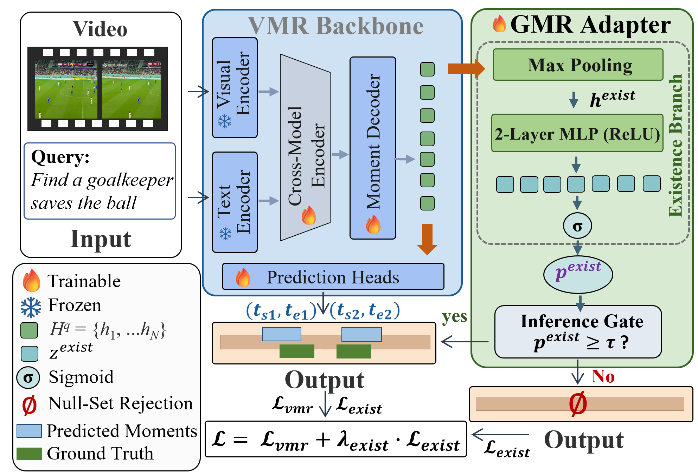
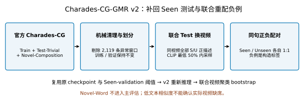
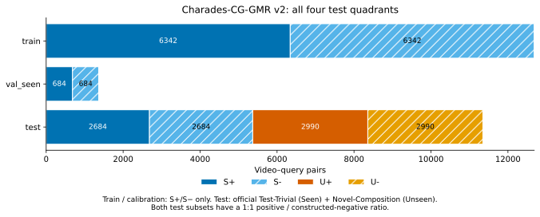
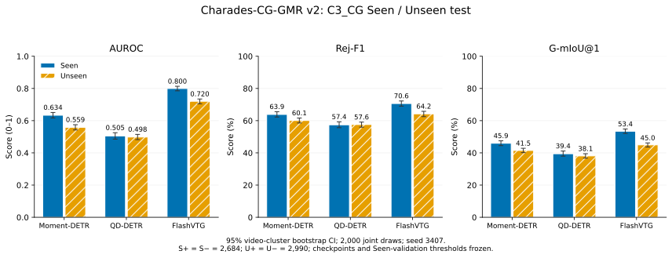
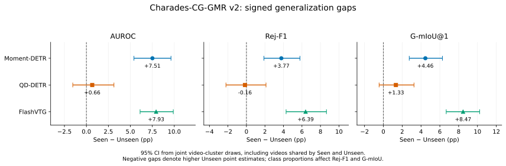

# Charades-CG-GMR v2 C3_CG：数据制作与 Seen→Unseen 退化测评



*原 [GMR](https://github.com/dymm9977/generalized-moment-retrieval) 方法图：存在判断决定返回定位结果或空集。*

GMR 同时判断事件是否存在并定位其时间窗。我们关注：**面对训练未见的动作–对象组合，模型能否定位真实事件，同时拒绝未发生的事件？** 本实验沿用 Charades-CG 官方 Seen/Unseen 身份，只用 Seen 训练和选模；Moment 与 Flash 的 Unseen AUROC 分别比 Seen 低 **7.51、7.93 pp**，两者差距的 95% CI 均高于零，支持在官方组合划分上进一步研究存在判断与定位的共同泛化。

更新日期：2026-10-11。数据来自 [`charades_cg_gmr_v2`](data/release/semantic_existence_v3_release/extensions/charades_cg_gmr_v2/README.md)，重新评估来自 `charades_cg_v2_evaluation_20261011`。**3/3 个 backbone 全部完成，失败 0 个**。完成记录：`2026-10-11T11:07:12.169543`。本报告覆盖此前仅有 Unseen Test 的 v1 本地审阅稿；旧报告已完整归档。本页为最终结果汇总，原 v1 报告另行归档。

## 1. 这套数据想测什么？

在固定下游训练数据与模型后，同时观察官方 Test-Trivial（Seen）和 Novel-Composition（Unseen）查询的事件存在判断、拒绝和时间定位。Seen/Unseen 沿用官方 Charades-CG 子集身份；这里的 Unseen 指下游训练未见组合，不声称预训练模型从未见过其词语或概念。本包仅含 C3_CG 一个划分，不是 Balanced v3 的五划分宏平均。

| 分区 | 官方查询来源 | 事件标签 | 期望输出 |
| --- | --- | --- | --- |
| S+ | Test-Trivial | 存在 | 时间区间 |
| S− | Test-Trivial | 构造缺席 | 空集合 |
| U+ | Novel-Composition | 存在 | 时间区间 |
| U− | Novel-Composition | 构造缺席 | 空集合 |

## 2. 数据怎样制作与修订？



1. 保留官方来源、提交、原句、视频、时间窗与组合标记。v2 纳入 Train、Test-Trivial、Novel-Composition；Novel-Word 单独保留在来源目录，不进入本包主评估。按 `0 ≤ start < end ≤ duration` 机械剔除 2,119 条非法或越界时间窗，分别为 Train 1,255、Test-Trivial 412、Novel-Composition 452 条；不截断窗口。清理后正例分别为 7,026、2,684 和 2,990。
2. 复用 seed 3407 的 Train 视频分配：训练 6,342 正例、Seen validation 684 正例。两者与 v1 文件逐字节一致；训练、验证、测试视频互斥。Test-Trivial 与 Novel-Composition 可以共享测试视频。
3. 参考 [Moment of Untruth §3.3](https://arxiv.org/html/2502.08544v2#S3.SS3) 的同域文本重配对，使用 CLIP ViT-B/32 归一化文本向量。查询与每个同 split 候选视频全部正例描述比较，取最大余弦相似度；排除 donor 视频和含完全相同查询的视频，按相似度、视频 ID 排序，保留最低 `floor(N/2)`，从可用目标均匀采样。最低 50% 是视频排名比例，不是余弦阈值 0.5。
4. v2 的 Test 候选池是两类干净正例视频的并集，同视频的 Seen 和 Unseen 正描述共同进入最大相似度。每个查询保留原文本、S/U 身份和来源，在另一视频构造一个负例；测试 S−、U− 都按联合候选池重新采样。负例 `relevant_windows=[]`，源正例时间窗只用于追溯。
5. 总计 12,700 对，采样缺额 0；机械校验重算候选排名、来源对应、窗口、标签、配对和视频划分。剔除记录保存在 [removed_rows.jsonl](data/release/semantic_existence_v3_release/extensions/charades_cg_gmr_v2/removed_rows.jsonl)。

**全部负例是基于文本与已有标注的构造标签，未逐视频确认实际缺席。** 低文本相似度不能证明视频里没有该事件，报告结论仅针对这一构造分布。

## 3. 划分规模与测试组成

| 划分 | S+ | S− | U+ | U− | 总行数 | 视频数 |
| --- | --- | --- | --- | --- | --- | --- |
| train | 6342 | 6342 | 0 | 0 | 12684 | 2892 |
| val_seen | 684 | 684 | 0 | 0 | 1368 | 321 |
| test | 2684 | 2684 | 2990 | 2990 | 11348 | 2589 |



Seen Test 为 5,368 行，Unseen Test 为 5,980 行，合计 11,348 行；两子集各自正负 1:1。总体指标按全部测试行计算，Seen/Unseen 指标按各自子集计算。Seen validation 仅用于模型与阈值选择，不作为 Seen Test 替代。

Test-Trivial 与 Novel-Composition 正例的源视频交集为 1,087 个；纳入重配负例后，Seen 与 Unseen 实际评测目标视频交集为 2,084 个，总测试目标视频为 2,589 个。Bootstrap 按全部目标视频联合抽样，保留共享视频上两类查询的依赖。

三个模型共享经过精确查询 SHA-256 匹配核验的视频与文本特征：复用 7,734 个既有 token 文本特征，新增编码 161 个文本；来源见 TEXT_FEATURE_MANIFEST。这里是模型推理 token 特征数，与构造负例时 CLIP 句向量缓存的新增文本数不同。

### 冻结测试集中的真实查询示例

| 分区 | qid | 目标视频 | 查询原文 | GT 时间段（秒） | 负例 donor 视频 |
| --- | --- | --- | --- | --- | --- |
| S+ | test_trivial.json:CVPFH:1 | CVPFH | person looking into the mirror,adjust the lights above the mirror. | [[0.0, 13.2]] | — |
| S− | c3cg-31efee282f463a4e-neg | 0DAO5 | person looking into the mirror,adjust the lights above the mirror. | [] | CVPFH |
| U+ | novel_composition.json:2MJA1:0 | 2MJA1 | person they decide to start undressing by removing their sweater. | [[9.0, 24.2]] | — |
| U− | c3cg-25a926eb571e6d34-neg | QD1U7 | person they decide to start undressing by removing their sweater. | [] | 2MJA1 |

这些是标注中的原句和构造实例，未重新人工修改。[QUERY_EXAMPLES.json](docs/reports/charades_cg_gmr_baselines_20261011/QUERY_EXAMPLES.json) 保存完整来源字段。

## 4. Baseline 怎样训练和重新评估？

| 项目 | 固定协议 |
|---|---|
| 模型与特征 | Moment-DETR-GMR、QD-DETR-GMR、FlashVTG-GMR；固定 CLIP 文本及 CLIP + SlowFast 视频特征 |
| 原训练 | 本次复用原设置的冻结 checkpoint，未重新训练；原设置从头训练，无 warm start；仅 S+/S−；seed 3407；最多 100 epochs；max_es_cnt=26（连续 27 次未改善触发早停） |
| Checkpoint 选择 | Moment/QD：Seen validation MR-full-mAP；Flash：Seen validation R1@0.5 与 R1@0.7 均值 |
| 拒绝阈值 | 完整 Seen validation 上 91 个分位数候选（5–95）最大化 Balanced Accuracy；并列保留最早候选 |
| 决策 | score ≥ threshold 接受，否则拒绝；测试期间 checkpoint 与阈值固定 |
| 存在分数 | Moment/QD 原生四位小数 sigmoid；Flash 原生六位小数 logit，避免三位小数概率饱和并列 |
| 定位 | 原生输出中的第一个合法窗口；不因终点超过标注视频时长而跳到其他候选 |
| Bootstrap | 2,000 次视频聚类重采样，seed 3407；联合 Test 的全部视频共享抽样，Seen/Unseen 共享视频的查询整体抽样；单种子 CI 不代表训练随机性的置信区间 |

AUROC 为存在分数的排序能力，展示为 0–1。**Actual Rej-F1** 将拒绝视为正决策，`2TN/(2TN+FP+FN)`：TN 为正确拒绝缺席，FP 为错误接受缺席，FN 为错误拒绝存在。**G-mIoU@1** 在接受时使用原生 top-1 与 GT 的集合 IoU（一个预测时为最大 IoU / GT 窗口数）；拒绝负例得 1，拒绝正例得 0，最后对所有样本平均。

**Gap = Seen − Unseen**，统一为百分点（pp），AUROC 差值乘 100；负 Gap 保留原符号，表示 Unseen 点估计更高。Rej-F1 与 G-mIoU 受子集正负比例影响，Gap 不能直接解释为控制类别比例后的语义泛化效应。所有表均从未舍入数值计算。

本次均为独立 baseline，**Unseen Net Gain、Seen Change、Gap Reduction 未定义，标为 N/A**。后续方法需与同数据版本、同划分、同 backbone baseline 成对比较，并对三项指标分别报告上述相对变化及 paired bootstrap CI。跨数据版本的差值不作为同测试集净增益。

本次数据修订未改变 Train 与 Seen validation，两者文件与 v1 逐字节一致。复用原最佳 checkpoint、原 Seen-validation 原生预测和冻结阈值；仅对 v2 全部测试行重新推理，未利用测试结果调参。测试负例的目标视频也按联合候选池重采样，所以不得将 v1 的旧 Unseen 分数拼接为 v2 结果。


## 5. 最新测试结果

### Seen、Unseen 与三项退化的完整 95% CI

| Backbone | 指标 | Seen | Seen 95% CI | Unseen | Unseen 95% CI | Gap（pp） | Gap 95% CI（pp） |
| --- | --- | --- | --- | --- | --- | --- | --- |
| Moment-DETR-GMR | AUROC | 0.6338 | [0.6170, 0.6509] | 0.5587 | [0.5423, 0.5749] | +7.51 | [+5.41, +9.62] |
| Moment-DETR-GMR | Rej-F1 | 63.87% | [62.27, 65.58] | 60.10% | [58.58, 61.65] | +3.77 | [+1.89, +5.78] |
| Moment-DETR-GMR | G-mIoU@1 | 45.95% | [44.48, 47.49] | 41.49% | [40.15, 42.85] | +4.46 | [+2.75, +6.27] |
| QD-DETR-GMR | AUROC | 0.5050 | [0.4857, 0.5254] | 0.4984 | [0.4822, 0.5149] | +0.66 | [-1.55, +3.13] |
| QD-DETR-GMR | Rej-F1 | 57.42% | [55.64, 59.30] | 57.58% | [55.98, 59.10] | -0.16 | [-2.21, +2.11] |
| QD-DETR-GMR | G-mIoU@1 | 39.44% | [37.93, 41.15] | 38.11% | [36.74, 39.48] | +1.33 | [-0.45, +3.25] |
| FlashVTG-GMR | AUROC | 0.7997 | [0.7853, 0.8134] | 0.7204 | [0.7052, 0.7348] | +7.93 | [+6.11, +9.88] |
| FlashVTG-GMR | Rej-F1 | 70.63% | [69.01, 72.24] | 64.24% | [62.51, 65.79] | +6.39 | [+4.29, +8.65] |
| FlashVTG-GMR | G-mIoU@1 | 53.43% | [52.06, 54.82] | 44.96% | [43.66, 46.18] | +8.47 | [+6.68, +10.23] |





Moment-DETR-GMR：AUROC Gap 为 +7.51 pp（95% CI [+5.41, +9.62]，区间全部高于 0）；Rej-F1 Gap 为 +3.77 pp（95% CI [+1.89, +5.78]，区间全部高于 0）；G-mIoU@1 Gap 为 +4.46 pp（95% CI [+2.75, +6.27]，区间全部高于 0）。
QD-DETR-GMR：AUROC Gap 为 +0.66 pp（95% CI [-1.55, +3.13]，区间跨越或包含 0）；Rej-F1 Gap 为 -0.16 pp（95% CI [-2.21, +2.11]，区间跨越或包含 0）；G-mIoU@1 Gap 为 +1.33 pp（95% CI [-0.45, +3.25]，区间跨越或包含 0）。
FlashVTG-GMR：AUROC Gap 为 +7.93 pp（95% CI [+6.11, +9.88]，区间全部高于 0）；Rej-F1 Gap 为 +6.39 pp（95% CI [+4.29, +8.65]，区间全部高于 0）；G-mIoU@1 Gap 为 +8.47 pp（95% CI [+6.68, +10.23]，区间全部高于 0）。

以上区间反映固定 checkpoint、固定阈值、单次训练种子下的视频抽样不确定性，不代表跨训练种子波动。区间包含 0 时，不将对应点估计方向称为明确退化或改善。本次未做 backbone 之间优越性的成对显著性检验。

### 整体拒绝、真实正例误拒和端到端定位

| Backbone | 指标 | 点估计 | 95% CI |
| --- | --- | --- | --- |
| Moment-DETR-GMR | Overall Rej-F1 | 61.86% | [60.60, 63.08] |
| Moment-DETR-GMR | Overall RR | 66.16% | [64.79, 67.37] |
| Moment-DETR-GMR | S+ FRR | 55.89% | [53.59, 58.20] |
| Moment-DETR-GMR | U+ FRR | 64.58% | [62.40, 66.49] |
| Moment-DETR-GMR | Overall G-mIoU@1 | 43.60% | [42.50, 44.74] |
| QD-DETR-GMR | Overall Rej-F1 | 57.50% | [56.16, 58.81] |
| QD-DETR-GMR | Overall RR | 67.15% | [65.85, 68.48] |
| QD-DETR-GMR | S+ FRR | 67.29% | [65.02, 69.63] |
| QD-DETR-GMR | U+ FRR | 66.62% | [64.64, 68.68] |
| QD-DETR-GMR | Overall G-mIoU@1 | 38.74% | [37.60, 39.91] |
| FlashVTG-GMR | Overall Rej-F1 | 67.25% | [66.02, 68.51] |
| FlashVTG-GMR | Overall RR | 43.87% | [42.72, 45.00] |
| FlashVTG-GMR | S+ FRR | 21.20% | [19.37, 22.98] |
| FlashVTG-GMR | U+ FRR | 27.66% | [25.77, 29.55] |
| FlashVTG-GMR | Overall G-mIoU@1 | 48.97% | [47.98, 49.97] |

RR 为全部测试查询的拒绝比例，S+/U+ FRR 为对应真实正例被拒绝的比例。G-mIoU 中正确拒绝负例贡献 1、误拒正例贡献 0；因此高 G-mIoU 或负 Gap 仍需结合 AUROC 与正例误拒率解释，不直接等同于正例定位改善。虽然当前两个子集都固定为 1:1，Rej-F1 与 G-mIoU 的数值和退化仍随部署时正负比例改变。

作为公式推导的确定性参照：在当前任一子集的正负 1:1 组成下，若对全部查询一律拒绝，则 Rej-F1 为 66.67%、G-mIoU@1 为 50%、S+/U+ FRR 为 100%；若存在分数也恒定，AUROC 为 0.5。这不是额外训练或模型实验，仅说明拒绝相关数值应与排序能力和真实正例误拒率共同阅读。

## 6. 从哪里查数据和完整结果？

| 内容 | 入口 |
| --- | --- |
| 数据、来源、划分与构造 | [数据 README](data/release/semantic_existence_v3_release/extensions/charades_cg_gmr_v2/README.md) · [splits](data/release/semantic_existence_v3_release/extensions/charades_cg_gmr_v2/splits/) |
| 发布校验 | [checksums](data/release/semantic_existence_v3_release/extensions/charades_cg_gmr_v2/checksums.sha256) · [validation](data/release/semantic_existence_v3_release/extensions/charades_cg_gmr_v2/validation_report.json) |
| 评估总表 | [STANDARD_EVALUATION](docs/reports/charades_cg_gmr_baselines_20261011/STANDARD_EVALUATION.md) · [GENERALIZATION_DROP_COMPARISON](docs/reports/charades_cg_gmr_baselines_20261011/GENERALIZATION_DROP_COMPARISON.md) |
| 三项绝对值、Gap与CI | [Markdown](docs/reports/charades_cg_gmr_baselines_20261011/ALL_METRICS_WITH_CI.md) · [CSV](docs/reports/charades_cg_gmr_baselines_20261011/ALL_METRICS_WITH_CI.csv) · [JSON](docs/reports/charades_cg_gmr_baselines_20261011/ALL_METRICS_WITH_CI.json) |
| Overall、RR、FRR与CI | [Markdown](docs/reports/charades_cg_gmr_baselines_20261011/OVERALL_METRICS_WITH_CI.md) · [CSV](docs/reports/charades_cg_gmr_baselines_20261011/OVERALL_METRICS_WITH_CI.csv) · [JSON](docs/reports/charades_cg_gmr_baselines_20261011/OVERALL_METRICS_WITH_CI.json) |
| 未舍入原始汇总 | [metrics](docs/reports/charades_cg_gmr_baselines_20261011/metrics.json) · [degradation_metrics](docs/reports/charades_cg_gmr_baselines_20261011/degradation_metrics.json) · [bootstrap](docs/reports/charades_cg_gmr_baselines_20261011/bootstrap.json) · [degradation_bootstrap](docs/reports/charades_cg_gmr_baselines_20261011/degradation_bootstrap.json) |
| 冻结预测、原生窗口、校准与抽样 | [frozen](docs/reports/charades_cg_gmr_baselines_20261011/frozen/) |
| 协议、状态与复核 | [PROTOCOL](docs/reports/charades_cg_gmr_baselines_20261011/PROTOCOL.json) · [完成状态](docs/reports/charades_cg_gmr_baselines_20261011/FINAL_EVALUATION_STATUS.json) · [LOCAL_VERIFICATION](docs/reports/charades_cg_gmr_baselines_20261011/LOCAL_VERIFICATION.json) · [独立验收](docs/reports/charades_cg_gmr_baselines_20261011/INDEPENDENT_VERIFICATION.json) |
| 执行源码与哈希 | [source_snapshot](docs/reports/charades_cg_gmr_baselines_20261011/source_snapshot/) · [SOURCE_MANIFEST](docs/reports/charades_cg_gmr_baselines_20261011/SOURCE_MANIFEST.json) |
| 图表与可移植重绘 | [assets](assets/charades_cg_gmr/) · [render_figures](assets/charades_cg_gmr/render_figures.py) |
| 本地覆盖包清单 | [PUBLICATION_MANIFEST](PUBLICATION_MANIFEST.json) · [PACKAGING](PACKAGING.json) |

本次本地复核逐项检查全部测试标注与预测的 qid、视频、标签和分区，重放原 Seen-validation 阈值选择，逐条核对原生 top-1 窗口形成的 IoU，并从冻结预测重算点估计及已保存 bootstrap draws 的 95% CI。源码快照用于追溯实际推理与评估代码；模型权重、视频、特征不进入发布包，保留 checkpoint 哈希与校准元数据。

核心字段：`qid`、`vid`、`query`、`duration`、`relevant_windows`、`exist_label`、`partition`。同名 qid 的 v1/v2 测试负例可能对应不同目标视频，版本之间不能混用预测。当前审阅包的图表、指标和冻结预测均来自 v2。

在本覆盖包根目录校验数据 SHA-256：

```bash
python scripts/restore_release.py
```
