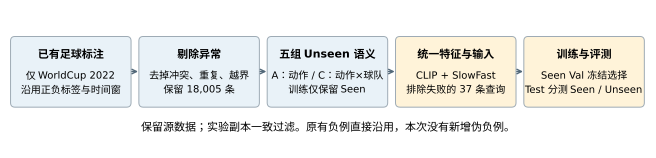
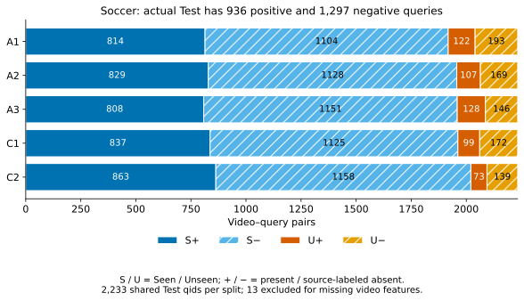
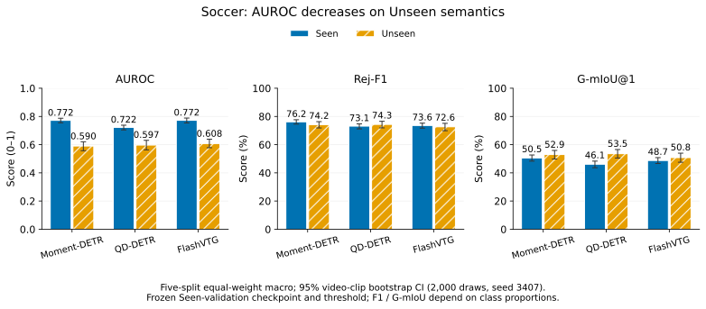
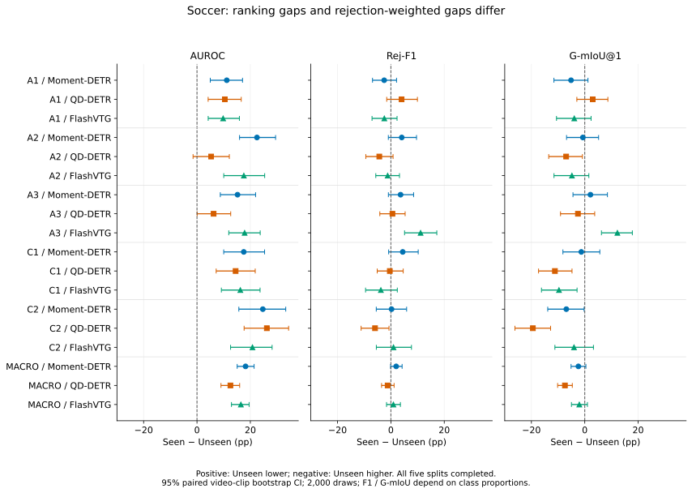
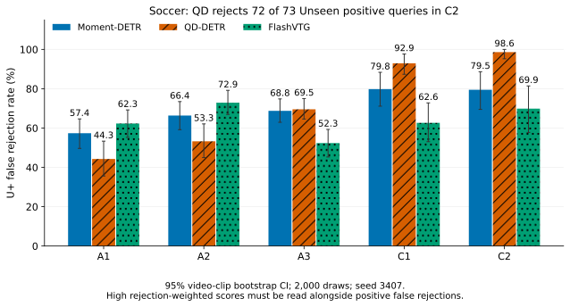

# Soccer-GMR-Unseen v1：数据制作与泛化退化明白纸

整理日期：2026-10-11。参照 v3_balanced 明白纸的“研究问题 → 数据制作 → 划分 → 训练评估 → 结果 → 文件入口”结构。数据为 `soccer_gmr_unseen_v1`，实验为 `soccer_unseen_baselines_20261011`。**三个 backbone × 五个划分，15/15 个设置全部完成训练和评测，失败 0 个；最终完成时间 2026-10-11 20:19:02（北京时间）。** 本页汇总冻结的最终训练与评测结果。全部设置已独立复核预测、阈值、原生窗口、指标及 bootstrap 区间。

## 版本与实验归属

本文只报告 Soccer 本次独立训练结果。Charades 衍生的 balanced v3 与 Charades-CG 使用不同视频、查询及划分，不能把它们的指标当作 Soccer 的同测试集基线。

| 数据范围 | Test + / − | 每组 Test | 用途 |
| --- | --- | --- | --- |
| 原始干净发布 | 940 / 1306 | 2246 | 数据发布；保留原样 |
| 本次特征完整的冻结副本 | 936 / 1297 | 2233 | 本文训练/评测对应输入 |

**4 个视频片段未得到完整特征，关联母池 37 个 qid 被统一排除；其中 Test 排除 13 个。** 三个 backbone 使用相同过滤规则与冻结输入，未改变原始发布数据。原始母池 18,005 条，过滤后 17,968 条；这是五组共用的来源池，不等于每组 Seen-only Train 的行数。

## 1. 这套数据想测什么？

当下游训练没有指定足球动作，或没有“动作 × 球队”组合时，模型能否判断完整查询描述的事件是否发生，并在发生时定位时间段？A1–A3 测动作泛化，C1–C2 测动作与球队的组合泛化。这里的 Unseen 指**本组下游训练不包含的语义**，不表示 CLIP/SlowFast 预训练从未接触这些概念。

| 分区 | 下游语义 | 源标注存在标签 | 期望输出 |
| --- | --- | --- | --- |
| S+ | Seen | 存在 | GT 对应时间段 |
| S− | Seen | 缺席 | 空集合 |
| U+ | Unseen | 存在 | GT 对应时间段 |
| U− | Unseen | 缺席 | 空集合 |

## 2. 数据怎样制作？

1. **取已有 Soccer-GMR 标注。** 从 `data/label/Full/{train,val,test}.jsonl` 中只保留 `dataset_source=worldcup2022`；沿用原 train/val/test。保留完整查询、qid、视频、动作/球队元数据与时间窗。`full.jsonl` 仅检查三个集合的并集。
2. **剔除机械异常。** 解析查询中的动作与球队，排除查询/动作类型矛盾、重复、同片段正负冲突，以及不满足 `0 ≤ start < end ≤ duration` 的 GT。共剔除 263 条，保留 18,005 条。既有正负标签沿用来源，未逐视频复核。
3. **组织五组 Unseen 语义。** A1/A2/A3 分别指定盘带、射门、拦截为 Unseen；C1/C2 指定动作与球队组合为 Unseen。每组 Train 删除对应 Unseen 查询，只留下 S+/S−；Val/Test 保留四个分区，再单独导出 `val_seen.jsonl`。
4. **统一提取特征并冻结输入。** 重新提取 CLIP 视频/文本与 SlowFast 视频特征；失败片段记录后跳过。关联 37 条查询从实验副本排除，保存 qid、原因和哈希。之后三个 backbone 分别训练、只用 Seen Val 选择模型与阈值，在同一完整 Test 上按 Seen/Unseen 分别评估。

**本次没有生成或补充负样本。** 空时间窗负例直接继承 Soccer-GMR 源标注；这里没有执行 balanced v3/Charades-CG 的跨视频伪负例算法，不能将其构造流程套用到本数据。

| 源划分 | 原始行数 | 机械清理剔除 | 干净发布 + / − | 特征失败剔除 | 实验母池 + / − |
| --- | --- | --- | --- | --- | --- |
| train | 14204 | 200 | 5470 / 8534 | 13 | 5466 / 8525 |
| val | 1785 | 30 | 695 / 1060 | 11 | 692 / 1052 |
| test | 2279 | 33 | 940 / 1306 | 13 | 936 / 1297 |

上表“实验母池”尚未按各组 Unseen 语义删除训练查询；每组真正使用的 Train 数见下一节。发布清理剔除与特征排除是两个阶段，不能重复计算。原始发布未提供 `checksums.sha256`；本次实验保存了逐文件 SHA-256 的 `RELEASE_MANIFEST.json`，已核对发布文件仍一致。

## 3. 五组怎么划分，有多大？

| 划分 | Unseen 的语义 | Train S+ / S− | Val 全集 | Val Seen | Test 全集 |
| --- | --- | --- | --- | --- | --- |
| A1_soccer | dribble（盘带） | 4,646 / 7,375 | 1744 | 1489 | 2233 |
| A2_soccer | shot（射门） | 4,773 / 7,461 | 1744 | 1530 | 2233 |
| A3_soccer | interception（拦截） | 4,819 / 7,536 | 1744 | 1542 | 2233 |
| C1_soccer | {block, clearance} × 指定球队（每个动作 8 队） | 4,142 / 7,243 | 1744 | 1510 | 2233 |
| C2_soccer | {dribble, interception} × 指定球队（每个动作 8 队） | 4,603 / 7,584 | 1744 | 1535 | 2233 |

**以上都是过滤后实际训练/评测的行数。** 训练读取冻结副本 `train.jsonl`；checkpoint/阈值选择仅读取 `val_seen.jsonl`。`val.jsonl` 含 Unseen，不能用于本协议选择。Seen→Unseen 退化是在**同一个 Test 文件中按分区计算**，不是用 Val 与 Test 比较。

| 划分 | S+ | S− | U+ | U− | 总数 |
| --- | --- | --- | --- | --- | --- |
| A1_soccer | 814 | 1104 | 122 | 193 | 2233 |
| A2_soccer | 829 | 1128 | 107 | 169 | 2233 |
| A3_soccer | 808 | 1151 | 128 | 146 | 2233 |
| C1_soccer | 837 | 1125 | 99 | 172 | 2233 |
| C2_soccer | 863 | 1158 | 73 | 139 | 2233 |

五组复用同一批 2,233 个测试 qid，只是 Seen/Unseen 身份随本组规则变化；不能将五组相加当作独立测试规模。测试负例多于正例，Seen 与 Unseen 各自也没有固定 1:1。

### 每组的实际含义

- **A1：盘带。** 训练删除所有 dribble 查询（正负都删）；Test 中 dribble 查询进入 U+/U−，其他动作进入 S+/S−。实际 Unseen 为 122 正 + 193 负。
- **A2：射门。** 训练删除所有 shot 查询；Test 中 shot 查询进入 U+/U−。实际 Unseen 为 107 正 + 169 负。
- **A3：拦截。** 训练删除所有 interception 查询；Test 中该动作进入 U+/U−。实际 Unseen 为 128 正 + 146 负。
- **C1：封堵/解围 × 球队。** 对 block、clearance 各选 8 队，删除训练中的这 16 个指定组合；测试只把明确命中组合的查询划为 Unseen。实际 Unseen 为 99 正 + 172 负。
- **C2：盘带/拦截 × 球队。** 对 dribble、interception 各选 8 队，按相同规则组织 16 个组合。实际 Unseen 为 73 正 + 139 负。

C1/C2 的球队只按**干净 Train**支持量选择：组合至少有 10 正和 10 负；按正负较小计数降序，再按正例数、负例数降序和球队名排序，每个动作取前 8 队。没有使用 Val/Test 数量或模型结果挑组合。

| 划分 | 动作 | Unseen 的球队组合 |
| --- | --- | --- |
| C1_soccer | block | Croatia, Argentina, Morocco, France, Australia, Netherlands, Poland, South Korea |
| C1_soccer | clearance | Croatia, Argentina, Morocco, France, Senegal, Poland, Ghana, Netherlands |
| C2_soccer | dribble | France, Morocco, Croatia, Argentina, Senegal, Ghana, Brazil, Netherlands |
| C2_soccer | interception | France, Morocco, Croatia, Argentina, Saudi Arabia, Ghana, Japan, South Korea |

**不写球队的泛指查询需单独理解。** C1/C2 训练会删除相关动作的泛指查询，以免绕过组合限制；Val/Test 中泛指查询因未指明指定“动作 × 球队”关系，仍算 Seen。因此 C1/C2 的 Seen 不等于“训练中逐字出现过”，这些划分也不保证所有组合原子均满足同等训练曝光条件。

### 冻结 Test 的完整查询示例

| 划分 | 分区 | qid | 目标片段 | 完整查询 | GT（秒） |
| --- | --- | --- | --- | --- | --- |
| A1_soccer | U+ | 19530 | WC2022_3857258_2_2840s_2990s.mp4 | Find dribble moments. | [[23, 31], [37, 45]] |
| A1_soccer | U- | 19640 | WC2022_3857286_1_1540s_1690s.mp4 | Find dribble moments by players from Qatar. | [] |
| A2_soccer | U+ | 19442 | WC2022_3857258_2_3680s_3830s.mp4 | Find shot moments. | [[31, 39], [32, 40]] |
| A2_soccer | U- | 20276 | WC2022_3857255_2_5080s_5230s.mp4 | Find shot moments by players from Japan. | [] |
| A3_soccer | U+ | 19245 | WC2022_3857254_1_1680s_1830s.mp4 | Find interception moments. | [[10, 18], [47, 55]] |
| A3_soccer | U- | 19692 | WC2022_3857293_1_1120s_1270s.mp4 | Find interception moments by players from Ghana. | [] |
| C1_soccer | U+ | 20693 | WC2022_3869684_1_2380s_2530s.mp4 | Find block moments by players from Morocco. | [[111, 119]] |
| C1_soccer | U- | 19807 | WC2022_3857264_1_560s_710s.mp4 | Find block moments by players from Poland. | [] |
| C2_soccer | U+ | 21645 | WC2022_3857280_1_700s_850s.mp4 | Find dribble moments by players from Brazil. | [[72, 80]] |
| C2_soccer | U- | 20260 | WC2022_3857293_1_0s_150s.mp4 | Find dribble moments by players from Ghana. | [] |

以上原句直接来自冻结测试标注，U− 空窗口来自继承的缺席标签；本次未重新观看视频证明缺席。完整字段见 [QUERY_EXAMPLES.json](docs/reports/soccer_unseen_baselines_20261011/QUERY_EXAMPLES.json)。`test_matched_u.jsonl` 是原始发布中的可选观测配对诊断，不是本文全量评测输入，也不是反事实编辑对。

## 4. Baseline 怎样训练和评估？

| 项目 | 固定协议 |
| --- | --- |
| Backbone | Moment-DETR-GMR、QD-DETR-GMR、FlashVTG-GMR；每组分别从头训练，无 warm start |
| 视频特征 | CLIP ViT-B/32（512 维）+ SlowFast 8x8 R50 K400（2304 维），224×224，2 秒一段 |
| 文本特征 | 全部 3,188 条不同完整查询重新编码；77×512 token 特征及 attention mask，按 qid 映射 |
| 旧特征 | 两种模态一致性探针未同时通过；本次统一重新提取，不混用旧 SlowFast |
| 训练 | 仅 S+/S−；seed 3407；最多 100 epochs；max_es_cnt=26，连续 27 次未改善触发早停；Moment/QD/Flash batch size=8/16/8 |
| Checkpoint | Moment/QD：Seen Val MR-full-mAP；Flash：Seen Val R1@0.5 与 R1@0.7 均值 |
| 阈值 | 完整 Seen Val 的 91 个分位数候选（5–95），最大化 Balanced Accuracy；并列取最早候选 |
| 决策/分数 | score ≥ threshold 接受；Moment/QD 原生四位小数 sigmoid，Flash 原生六位小数 logit；测试冻结 checkpoint 与阈值 |
| 定位 | 原生输出的第一个合法窗口；不因预测终点超过视频时长而改选其他候选 |
| Bootstrap | 2,000 次视频片段簇重采样，seed 3407；同片段全部查询一起抽样；Seen/Unseen 同次抽样计算 Gap |

AUROC 为存在分数的排序能力（0–1）。**Actual Rej-F1** 将拒绝视为正决策，`2TN/(2TN+FP+FN)`；TN 为正确拒绝缺席，FP 为错误接受缺席，FN 为错误拒绝存在。**G-mIoU@1** 在接受时使用原生 top-1 与 GT 的集合 IoU（单个预测时为最大 IoU / GT 窗口数）；拒绝负例得 1，拒绝正例得 0，再对全部查询平均。

**Gap = Seen − Unseen**，统一为百分点（pp）；AUROC 差值乘 100。负 Gap 原样保留，表示 Unseen 点估计更高。Rej-F1/G-mIoU 受正负比例影响，不能把 Gap 直接视为控制类别比例后的语义泛化损失。CI 衡量当前单种子实验的视频片段抽样不确定性，不是训练随机性 CI，也不是整场比赛聚类 CI。

本次是独立 baseline，三项指标的 **Unseen Net Gain、Seen Change、Gap Reduction 均为 N/A**。后续方法应与同版本、同划分、同 backbone 比较，并保存 paired bootstrap 区间；跨数据集或跨版本差值不充当净增益。

## 5. 最终结果

### 五划分等权宏平均

五组全部完成。宏平均 CI 使用相同视频宇宙与相同抽样，对每次抽样的五组指标等权平均；没有平均五个 CI 的端点。

| Backbone | 指标 | Seen | Unseen | Gap（pp） | Gap 95% CI（pp） |
| --- | --- | --- | --- | --- | --- |
| Moment-DETR-GMR | AUROC | 0.7720 | 0.5900 | +18.20 | [+15.06, +21.41] |
| Moment-DETR-GMR | Rej-F1 | 76.17% | 74.19% | +1.98 | [-0.11, +4.20] |
| Moment-DETR-GMR | G-mIoU@1 | 50.55% | 52.94% | -2.39 | [-5.14, +0.42] |
| QD-DETR-GMR | AUROC | 0.7221 | 0.5969 | +12.52 | [+8.99, +15.99] |
| QD-DETR-GMR | Rej-F1 | 73.12% | 74.34% | -1.22 | [-3.50, +1.20] |
| QD-DETR-GMR | G-mIoU@1 | 46.10% | 53.54% | -7.44 | [-10.18, -4.67] |
| FlashVTG-GMR | AUROC | 0.7722 | 0.6077 | +16.45 | [+12.91, +19.53] |
| FlashVTG-GMR | Rej-F1 | 73.56% | 72.63% | +0.94 | [-1.62, +3.57] |
| FlashVTG-GMR | G-mIoU@1 | 48.73% | 50.78% | -2.05 | [-4.99, +0.99] |

三个 backbone 的宏平均 AUROC Gap 分别为 **Moment +18.20、QD +12.52、Flash +16.45 pp**，95% CI 均在 0 以上，存在分数的 Seen→Unseen 排序性能下降。三个模型的宏平均 Rej-F1 Gap 区间均跨 0，不能据此宣称方向明确的总体下降；G-mIoU 宏平均 Gap 均为负，只有 QD 的区间完全低于 0。

### 逐划分三项指标与退化区间

#### AUROC

| 划分 | Backbone | Seen | Unseen | Gap（pp） | Gap 95% CI（pp） |
| --- | --- | --- | --- | --- | --- |
| A1_soccer | Moment-DETR-GMR | 0.7795 | 0.6680 | +11.16 | [+4.97, +17.07] |
| A1_soccer | QD-DETR-GMR | 0.7560 | 0.6516 | +10.44 | [+4.18, +16.58] |
| A1_soccer | FlashVTG-GMR | 0.7766 | 0.6786 | +9.80 | [+4.20, +15.90] |
| A2_soccer | Moment-DETR-GMR | 0.7676 | 0.5429 | +22.47 | [+15.95, +29.45] |
| A2_soccer | QD-DETR-GMR | 0.7037 | 0.6508 | +5.29 | [-1.48, +12.12] |
| A2_soccer | FlashVTG-GMR | 0.7664 | 0.5908 | +17.56 | [+10.03, +25.37] |
| A3_soccer | Moment-DETR-GMR | 0.7733 | 0.6214 | +15.19 | [+8.74, +21.97] |
| A3_soccer | QD-DETR-GMR | 0.7106 | 0.6484 | +6.23 | [+0.06, +12.64] |
| A3_soccer | FlashVTG-GMR | 0.7700 | 0.5914 | +17.85 | [+11.91, +23.69] |
| C1_soccer | Moment-DETR-GMR | 0.7717 | 0.5964 | +17.53 | [+10.02, +25.33] |
| C1_soccer | QD-DETR-GMR | 0.7287 | 0.5839 | +14.48 | [+7.19, +21.83] |
| C1_soccer | FlashVTG-GMR | 0.7756 | 0.6131 | +16.24 | [+9.14, +23.64] |
| C2_soccer | Moment-DETR-GMR | 0.7679 | 0.5211 | +24.67 | [+15.69, +33.26] |
| C2_soccer | QD-DETR-GMR | 0.7116 | 0.4498 | +26.18 | [+17.66, +34.34] |
| C2_soccer | FlashVTG-GMR | 0.7725 | 0.5646 | +20.79 | [+12.59, +28.15] |

#### Rej-F1

| 划分 | Backbone | Seen | Unseen | Gap（pp） | Gap 95% CI（pp） |
| --- | --- | --- | --- | --- | --- |
| A1_soccer | Moment-DETR-GMR | 76.29% | 78.80% | -2.51 | [-6.89, +2.13] |
| A1_soccer | QD-DETR-GMR | 70.14% | 66.12% | +4.01 | [-1.56, +9.95] |
| A1_soccer | FlashVTG-GMR | 76.64% | 79.10% | -2.46 | [-7.07, +2.32] |
| A2_soccer | Moment-DETR-GMR | 73.64% | 69.57% | +4.07 | [-0.95, +9.61] |
| A2_soccer | QD-DETR-GMR | 70.45% | 74.79% | -4.34 | [-9.39, +0.82] |
| A2_soccer | FlashVTG-GMR | 78.89% | 80.10% | -1.21 | [-5.66, +3.22] |
| A3_soccer | Moment-DETR-GMR | 77.83% | 74.19% | +3.63 | [-0.94, +8.52] |
| A3_soccer | QD-DETR-GMR | 75.91% | 75.33% | +0.58 | [-4.14, +5.34] |
| A3_soccer | FlashVTG-GMR | 72.37% | 61.24% | +11.13 | [+5.13, +17.21] |
| C1_soccer | Moment-DETR-GMR | 78.31% | 73.87% | +4.44 | [-0.84, +10.24] |
| C1_soccer | QD-DETR-GMR | 75.95% | 76.35% | -0.40 | [-5.12, +4.62] |
| C1_soccer | FlashVTG-GMR | 70.44% | 74.19% | -3.75 | [-9.49, +2.41] |
| C2_soccer | Moment-DETR-GMR | 74.78% | 74.52% | +0.25 | [-5.48, +5.89] |
| C2_soccer | QD-DETR-GMR | 73.15% | 79.08% | -5.94 | [-11.17, -0.71] |
| C2_soccer | FlashVTG-GMR | 69.49% | 68.51% | +0.97 | [-5.45, +7.71] |

#### G-mIoU@1

| 划分 | Backbone | Seen | Unseen | Gap（pp） | Gap 95% CI（pp） |
| --- | --- | --- | --- | --- | --- |
| A1_soccer | Moment-DETR-GMR | 50.66% | 55.81% | -5.15 | [-11.56, +1.19] |
| A1_soccer | QD-DETR-GMR | 43.54% | 40.55% | +2.99 | [-2.97, +8.65] |
| A1_soccer | FlashVTG-GMR | 52.83% | 56.77% | -3.94 | [-10.60, +2.37] |
| A2_soccer | Moment-DETR-GMR | 47.00% | 47.72% | -0.73 | [-6.83, +5.18] |
| A2_soccer | QD-DETR-GMR | 42.30% | 49.29% | -6.99 | [-13.51, -0.89] |
| A2_soccer | FlashVTG-GMR | 55.92% | 60.73% | -4.81 | [-11.53, +1.53] |
| A3_soccer | Moment-DETR-GMR | 52.96% | 50.84% | +2.12 | [-4.42, +8.49] |
| A3_soccer | QD-DETR-GMR | 50.04% | 52.61% | -2.57 | [-9.10, +3.72] |
| A3_soccer | FlashVTG-GMR | 47.36% | 35.14% | +12.22 | [+6.25, +17.83] |
| C1_soccer | Moment-DETR-GMR | 53.50% | 54.80% | -1.30 | [-8.19, +5.63] |
| C1_soccer | QD-DETR-GMR | 48.96% | 60.15% | -11.19 | [-17.33, -4.78] |
| C1_soccer | FlashVTG-GMR | 44.19% | 53.86% | -9.67 | [-16.23, -2.89] |
| C2_soccer | Moment-DETR-GMR | 48.62% | 55.54% | -6.92 | [-13.89, -0.26] |
| C2_soccer | QD-DETR-GMR | 45.64% | 65.09% | -19.45 | [-26.18, -12.81] |
| C2_soccer | FlashVTG-GMR | 43.37% | 47.40% | -4.04 | [-11.20, +3.25] |

### 整体拒绝、正例误拒与端到端定位

| 划分 | Backbone | Overall Rej-F1 | Overall RR | S+ FRR | U+ FRR | Overall G-mIoU@1 |
| --- | --- | --- | --- | --- | --- | --- |
| A1_soccer | Moment-DETR-GMR | 76.68% | 68.65% | 46.44% | 57.38% | 51.38% |
| A1_soccer | QD-DETR-GMR | 69.54% | 53.96% | 34.52% | 44.26% | 43.12% |
| A1_soccer | FlashVTG-GMR | 77.03% | 69.59% | 46.68% | 62.30% | 53.38% |
| A2_soccer | Moment-DETR-GMR | 73.08% | 62.02% | 40.29% | 66.36% | 47.09% |
| A2_soccer | QD-DETR-GMR | 71.04% | 60.68% | 42.94% | 53.27% | 43.16% |
| A2_soccer | FlashVTG-GMR | 79.05% | 76.18% | 52.83% | 72.90% | 56.51% |
| A3_soccer | Moment-DETR-GMR | 77.36% | 70.67% | 46.78% | 68.75% | 52.70% |
| A3_soccer | QD-DETR-GMR | 75.84% | 72.77% | 52.97% | 69.53% | 50.35% |
| A3_soccer | FlashVTG-GMR | 71.03% | 56.16% | 34.78% | 52.34% | 45.86% |
| C1_soccer | Moment-DETR-GMR | 77.71% | 73.89% | 50.90% | 79.80% | 53.66% |
| C1_soccer | QD-DETR-GMR | 76.00% | 72.37% | 49.82% | 92.93% | 50.32% |
| C1_soccer | FlashVTG-GMR | 71.00% | 54.32% | 31.06% | 62.63% | 45.37% |
| C2_soccer | Moment-DETR-GMR | 74.75% | 66.05% | 44.15% | 79.45% | 49.28% |
| C2_soccer | QD-DETR-GMR | 73.88% | 68.61% | 48.09% | 98.63% | 47.49% |
| C2_soccer | FlashVTG-GMR | 69.37% | 52.31% | 30.36% | 69.86% | 43.75% |
| MACRO | Moment-DETR-GMR | 75.91% | 68.26% | 45.71% | 70.35% | 50.82% |
| MACRO | QD-DETR-GMR | 73.26% | 65.68% | 45.67% | 71.72% | 46.89% |
| MACRO | FlashVTG-GMR | 73.50% | 61.71% | 39.14% | 64.01% | 48.98% |

RR 为全部测试查询被拒绝的比例；S+/U+ FRR 为对应真实正例被误拒的比例。Overall 使用各组完整 Test；MACRO 为五组等权平均。全部整体指标的 CI 见 [OVERALL_METRICS_WITH_CI](docs/reports/soccer_unseen_baselines_20261011/OVERALL_METRICS_WITH_CI.md)。

**高 G-mIoU 或负 Gap 不能单独证明 Unseen 定位更好。** 例如 C2/QD 的 Unseen AUROC=0.4498，U+ FRR=98.63%（73 条 U+ 中误拒 72 条），却有 Unseen Rej-F1=79.08%、G-mIoU=65.09%。该子集含 139 条 U−；正确拒绝负例会同时提高拒绝 F1 和 G-mIoU。这些分数必须与 U+ FRR、正负比例一起读。

同时也有三项一致下降的设置：A3/Flash 的 AUROC、Rej-F1、G-mIoU Gap 分别为 +17.85、+11.13、+12.22 pp，三者 CI 均高于 0。A2/QD 的 AUROC Gap CI 跨 0；不能把所有单组 AUROC 点估计下降都表述为显著下降。

## 6. 从哪里查数据和完整结果？

| 内容 | 入口 |
| --- | --- |
| 原始发布与清理规则 | [数据 README](data/release/soccer_gmr_unseen_v1/README.md) · [构建协议](data/release/soccer_gmr_unseen_v1/construction_protocol.json) · [原始 splits](data/release/soccer_gmr_unseen_v1/splits/) |
| 本次真正使用的输入 | [冻结实验 splits](data/experiment_inputs/soccer_unseen_baselines_20261011/splits/) · [实际计数](docs/reports/soccer_unseen_baselines_20261011/EXPERIMENT_DATA_COUNTS.json) · [特征排除](docs/reports/soccer_unseen_baselines_20261011/FEATURE_EXCLUSIONS.json) |
| 原始评估表 | [STANDARD_EVALUATION](docs/reports/soccer_unseen_baselines_20261011/STANDARD_EVALUATION.md) · [GENERALIZATION_DROP_COMPARISON](docs/reports/soccer_unseen_baselines_20261011/GENERALIZATION_DROP_COMPARISON.md) |
| 三项绝对值/Gap 全部区间与相对收益字段 | [Markdown](docs/reports/soccer_unseen_baselines_20261011/ALL_METRICS_WITH_CI.md) · [CSV](docs/reports/soccer_unseen_baselines_20261011/ALL_METRICS_WITH_CI.csv) · [JSON](docs/reports/soccer_unseen_baselines_20261011/ALL_METRICS_WITH_CI.json) |
| 整体拒绝/误拒/定位区间 | [Markdown](docs/reports/soccer_unseen_baselines_20261011/OVERALL_METRICS_WITH_CI.md) · [CSV](docs/reports/soccer_unseen_baselines_20261011/OVERALL_METRICS_WITH_CI.csv) · [JSON](docs/reports/soccer_unseen_baselines_20261011/OVERALL_METRICS_WITH_CI.json) |
| 原始未舍入结果与抽样区间 | [metrics](docs/reports/soccer_unseen_baselines_20261011/metrics.json) · [degradation_metrics](docs/reports/soccer_unseen_baselines_20261011/degradation_metrics.json) · [bootstrap](docs/reports/soccer_unseen_baselines_20261011/bootstrap.json) · [degradation_bootstrap](docs/reports/soccer_unseen_baselines_20261011/degradation_bootstrap.json) |
| 冻结预测、原生窗口、校准与抽样 draws | [frozen](docs/reports/soccer_unseen_baselines_20261011/frozen/) · [degradation_cache](docs/reports/soccer_unseen_baselines_20261011/degradation_cache/) |
| 协议、完成状态与独立复核 | [PROTOCOL](docs/reports/soccer_unseen_baselines_20261011/PROTOCOL.json) · [完成状态](docs/reports/soccer_unseen_baselines_20261011/FINAL_EVALUATION_STATUS.json) · [LOCAL_VERIFICATION](docs/reports/soccer_unseen_baselines_20261011/LOCAL_VERIFICATION.json) |
| 来源和源码追溯 | [发布 SHA-256](docs/reports/soccer_unseen_baselines_20261011/RELEASE_MANIFEST.json) · [执行源码](docs/reports/soccer_unseen_baselines_20261011/source_snapshot/) · [源码清单](docs/reports/soccer_unseen_baselines_20261011/SOURCE_MANIFEST.json) |
| 图表及绘图代码 | [SVG/PDF/PNG](assets/soccer_gmr_unseen_v1/) · [可重画脚本](scripts/plot_report.py) · [图表核验](FIGURE_AUDIT.md) |
| 报告包文件校验 | [PUBLICATION_MANIFEST](PUBLICATION_MANIFEST.json) · [PACKAGING](PACKAGING.json) |

本次逐设置核对标注与预测的 qid、视频、存在标签、分区，复算 Seen Val 阈值，逐条核对原生 top-1 窗口的 IoU，重算点指标并核对保存 draws 的全部 CI 与宏平均 CI。包内保留原始发布与过滤后的输入副本、预测、校准、checkpoint 哈希和抽样，不含视频、特征及模型权重。代码快照中的原机器路径需要在复现时配置。

解释边界：源 train/val/test 归属沿用；本次核对规范化片段 ID 互斥，但没有消除同场比赛、不同时段重叠或球队/模板偏差。bootstrap 以片段 ID 聚类，因此不能声称整场比赛独立。负例标签和正例时间窗继承来源，机械清理不能证明其视觉真值；C2 只有 73 条 U+。这些限制与类别比例效应需随结果共同保留。
